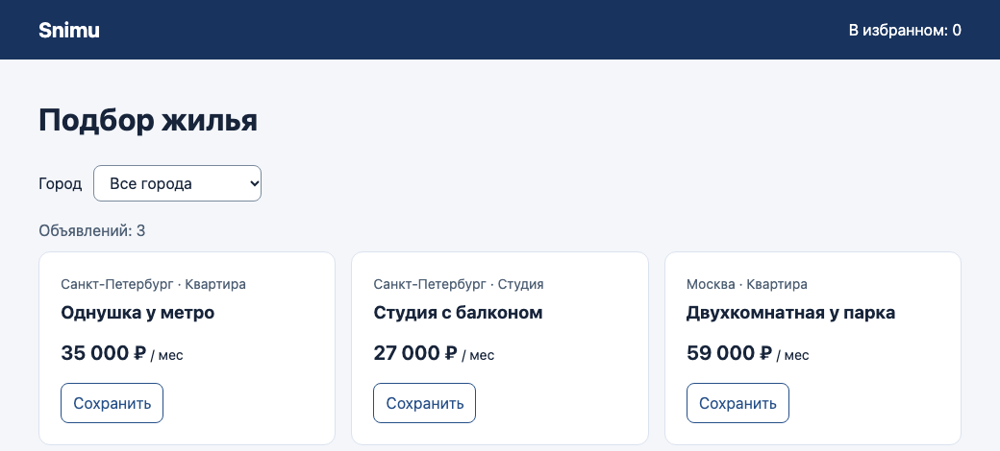
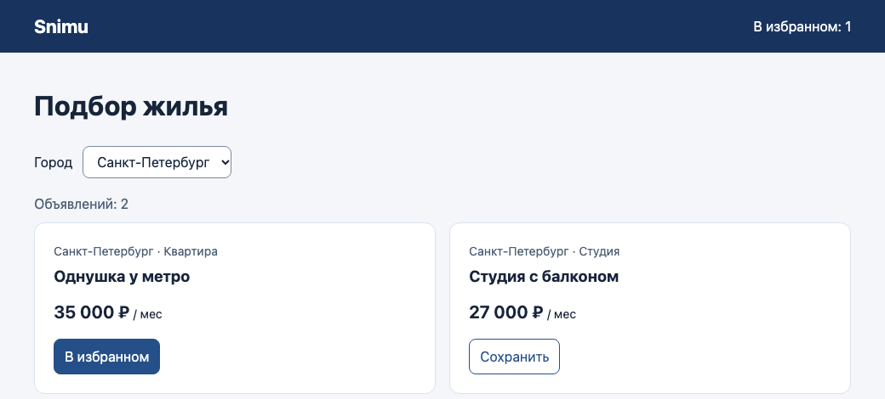

# ДЗ5 — npm и первый проект на Vue

Данилова Анастасия, K3439.

Учебный каталог Snimu показывает три объявления. Город можно выбрать в фильтре,
а объявления добавить в избранное. Счётчик обновляется при каждом изменении.

## Запуск и сборка

Нужны Node.js 20.19+ или 22.12+ и npm. Команды выполняются из папки `hw5`.

| Команда | Что делает |
| --- | --- |
| `npm install` | Устанавливает зависимости и обновляет `package-lock.json` при необходимости |
| `npm ci` | Устанавливает версии из сохранённого `package-lock.json` |
| `npm run dev` | Запускает Vite для разработки |
| `npm run build` | Собирает статические файлы в `dist/` |
| `npm run preview` | Открывает собранную версию локально после сборки |

Для первого запуска из репозитория выполнить `npm ci`, затем `npm run dev`
и открыть адрес из вывода терминала. Обычно это [localhost:5173](http://localhost:5173).

## Компоненты

- `src/App.vue` хранит список объявлений, выбранный город и избранное.
  `computed` пересчитывает видимый список при смене города.
- `src/components/ListingFilters.vue` получает список городов и передаёт выбранный
  город родительскому компоненту через `v-model`.
- `src/components/ListingCard.vue` получает объявление и состояние избранного
  через входные свойства. По нажатию кнопки отправляет событие `toggle` с ID объявления.

Объявления заданы в коде. Избранное хранится в состоянии приложения до перезагрузки.

## Скриншоты

Каталог с фильтром и тремя карточками.

Фильтр по Санкт-Петербургу и одна карточка в избранном.

В Chrome проверены отображение каталога, фильтрация по городу, добавление и удаление
из избранного. Сборка `npm run build` завершилась успешно.
