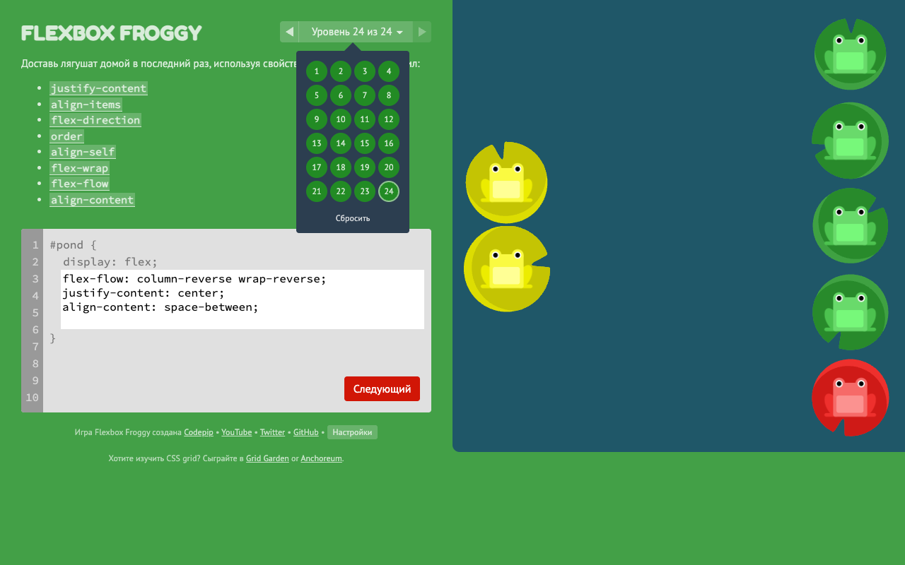
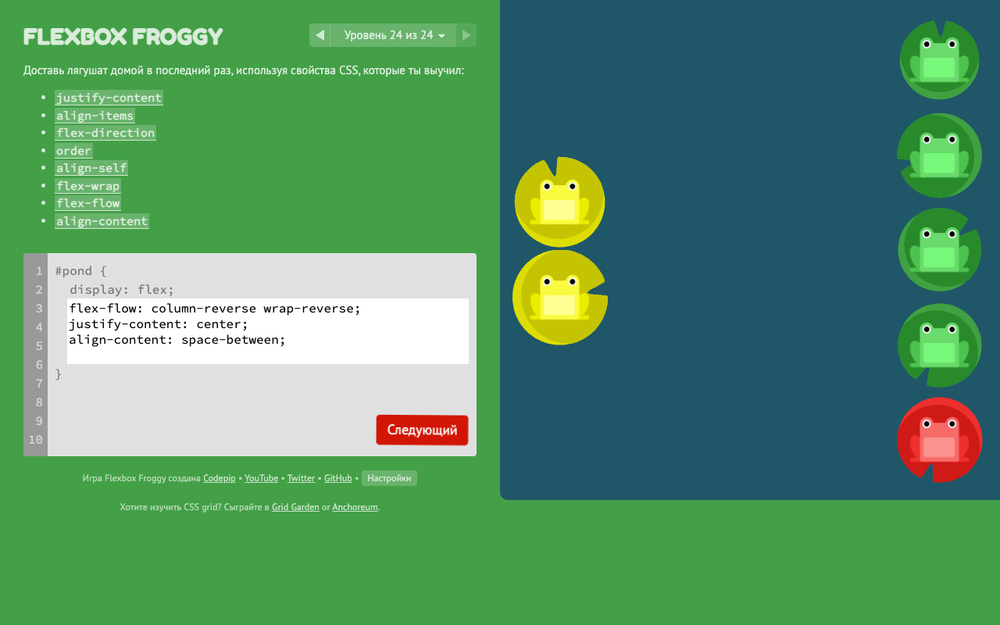
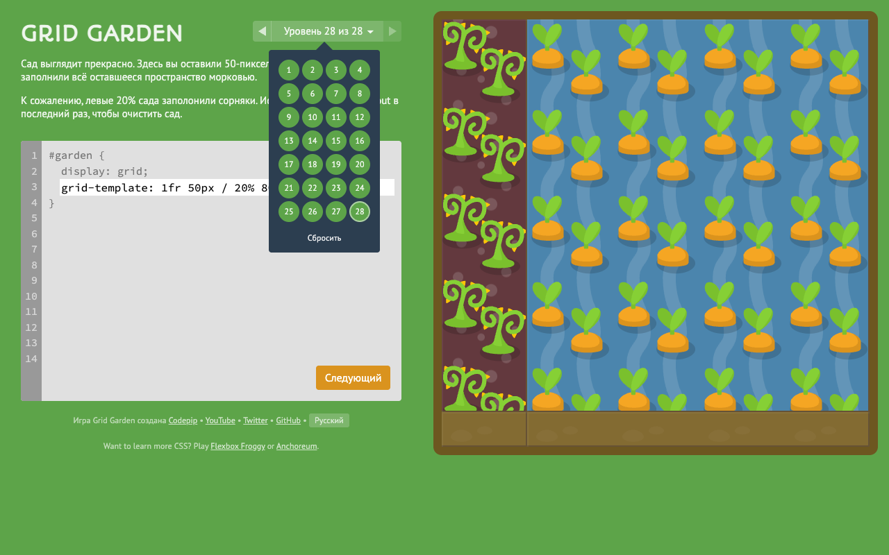
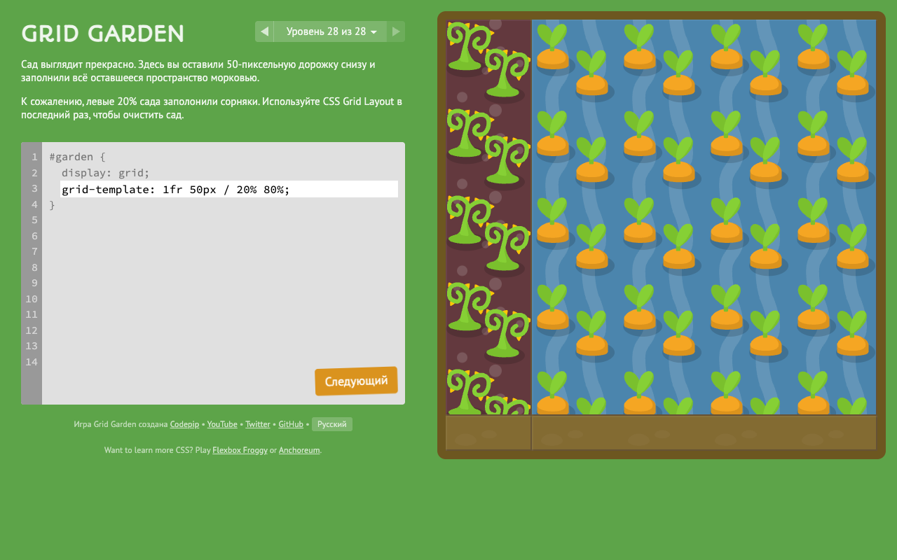
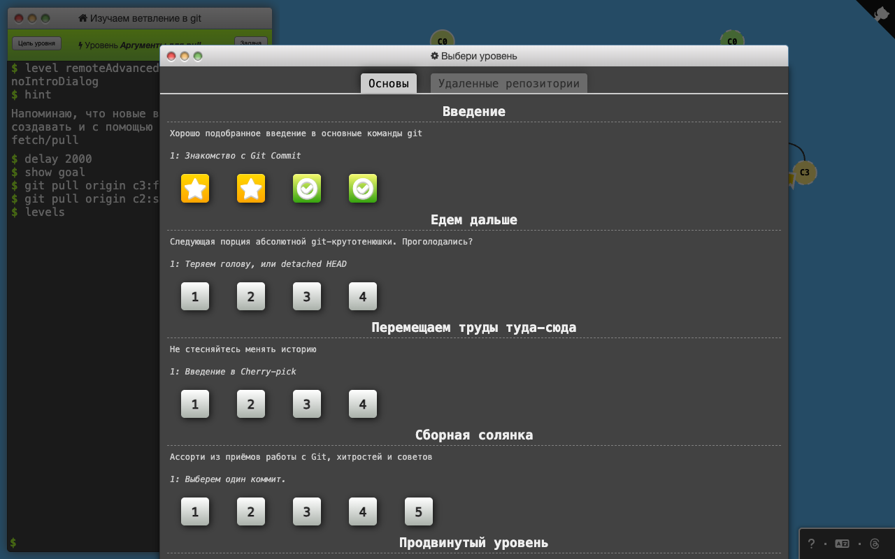
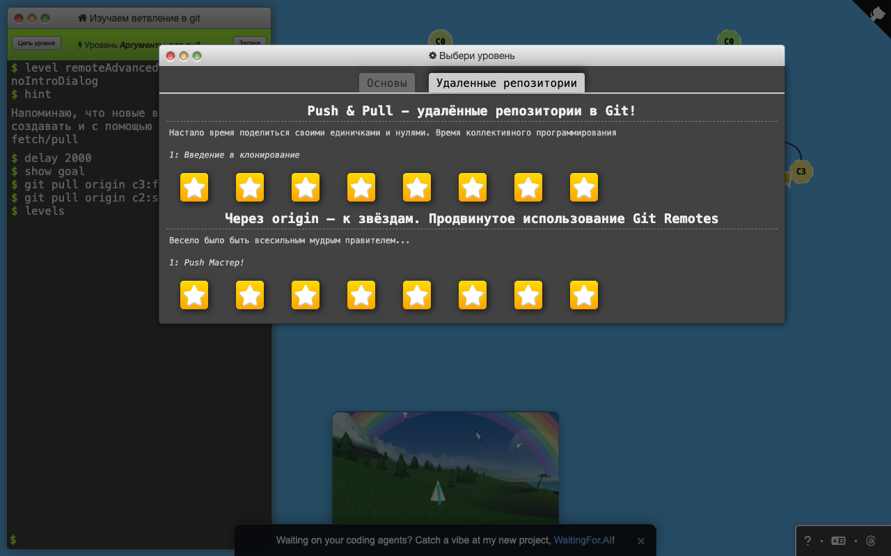
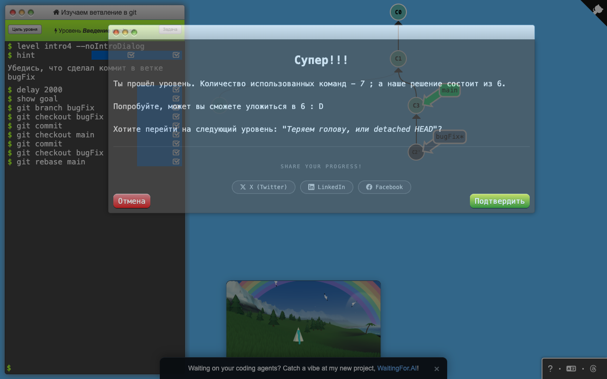
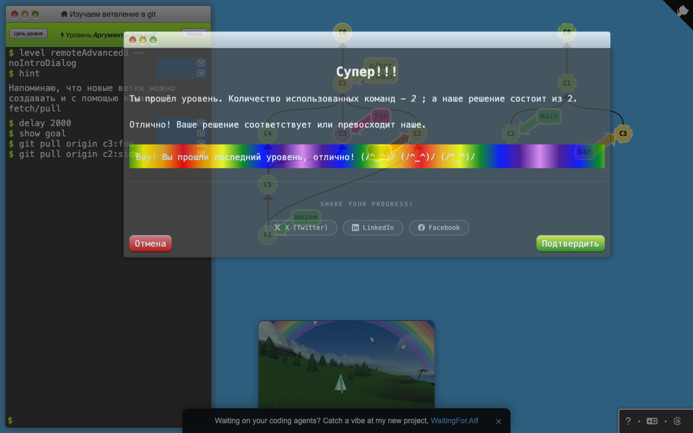

# Домашняя работа 1. CSS Flexbox, CSS Grid, Git

**Студент:** Субботин Александр, поток K3439

Отчёт по шаблону курса — [Отчёт.pdf](Отчёт.pdf). Ниже то же содержание для просмотра на GitHub.

## Задача

Пройти три игры: Flexbox Froggy, CSS Grid Garden и Learn Git Branching (в Learn Git Branching достаточно выполнить первые 4 урока и все уроки по удалённым репозиториям). Собрать отчёт по шаблону, экспортировать в PDF и открыть Pull Request в репозиторий курса.

## Ход работы

### 1. Flexbox Froggy — 24 из 24

Игра на свойства CSS Flexbox: лягушек нужно расставить по кувшинкам, задавая свойства контейнеру `#pond` и отдельным лягушкам. Пройдены все 24 уровня. По ходу разобраны: выравнивание по главной оси (`justify-content`) и по поперечной (`align-items`, `align-self`), смена направления главной оси (`flex-direction`, в том числе `row-reverse` и `column-reverse` — при них `flex-end` «меняет сторону»), порядок элементов (`order`), перенос строк (`flex-wrap`, сокращение `flex-flow`) и распределение строк при переносе (`align-content`).

| Все уровни пройдены | Последний уровень |
|---|---|
|  |  |

Решения всех уровней

| № | Уровень | CSS |
|---|---|---|
| 1 | justify-content 1 | `justify-content: flex-end;` |
| 2 | justify-content 2 | `justify-content: center;` |
| 3 | justify-content 3 | `justify-content: space-around;` |
| 4 | justify-content 4 | `justify-content: space-between;` |
| 5 | align-items 1 | `align-items: flex-end;` |
| 6 | align-items 2 | `justify-content: center; align-items: center;` |
| 7 | align-items 3 | `justify-content: space-around; align-items: flex-end;` |
| 8 | flex-direction 1 | `flex-direction: row-reverse;` |
| 9 | flex-direction 2 | `flex-direction: column;` |
| 10 | flex-direction 3 | `flex-direction: row-reverse; justify-content: flex-end;` |
| 11 | flex-direction 4 | `flex-direction: column; justify-content: flex-end;` |
| 12 | flex-direction 5 | `flex-direction: column-reverse; justify-content: space-between;` |
| 13 | flex-direction 6 | `flex-direction: row-reverse; justify-content: center; align-items: flex-end;` |
| 14 | order 1 | `order: 1;` |
| 15 | order 2 | `order: -1;` |
| 16 | align-self 1 | `align-self: flex-end;` |
| 17 | align-self 2 | `order: 1; align-self: flex-end;` |
| 18 | flex-wrap 1 | `flex-wrap: wrap;` |
| 19 | flex-wrap 2 | `flex-direction: column; flex-wrap: wrap;` |
| 20 | flex-flow 1 | `flex-flow: column wrap;` |
| 21 | align-content 1 | `align-content: flex-start;` |
| 22 | align-content 2 | `align-content: flex-end;` |
| 23 | align-content 3 | `flex-direction: column-reverse; align-content: center;` |
| 24 | align-content 4 | `flex-flow: column-reverse wrap-reverse; justify-content: center; align-content: space-between;` |

### 2. CSS Grid Garden — 28 из 28

Игра на CSS Grid: грядки поливаются и пропалываются, если правильно разместить элемент в сетке 5×5. Пройдены все 28 уровней. Разобраны: размещение по линиям сетки (`grid-column-start/end`, `grid-row`), отрицательные номера линий (отсчёт с конца), `span` вместо конечной линии, сокращение `grid-area` (строка-начало / столбец-начало / строка-конец / столбец-конец), `order` у элементов сетки, задание столбцов и строк (`grid-template-columns/rows`) в процентах, пикселях и долях `fr`, функция `repeat()` и сокращение `grid-template: строки / столбцы`.

| Все уровни пройдены | Последний уровень |
|---|---|
|  |  |

Решения всех уровней

| № | Уровень | CSS |
|---|---|---|
| 1 | grid-column-start 1 | `grid-column-start: 3;` |
| 2 | grid-column-start 2 | `grid-column-start: 5;` |
| 3 | grid-column-end 1 | `grid-column-end: 4;` |
| 4 | grid-column-end 2 | `grid-column-end: 2;` |
| 5 | grid-column-end 3 | `grid-column-end: -2;` |
| 6 | grid-column-start 3 | `grid-column-start: -3;` |
| 7 | grid-column-end 4 | `grid-column-end: span 2;` |
| 8 | grid-column-end 5 | `grid-column-end: span 5;` |
| 9 | grid-column-start 4 | `grid-column-start: span 3;` |
| 10 | grid-column 1 | `grid-column: 4 / 6;` |
| 11 | grid-column 2 | `grid-column: 2 / span 3;` |
| 12 | grid-row-start 1 | `grid-row-start: 3;` |
| 13 | grid-row-start 2 | `grid-row: 3 / 6;` |
| 14 | grid-column-row 1 | `grid-column: 2; grid-row: 5;` |
| 15 | grid-column-row 2 | `grid-column: 2 / 6; grid-row: 1 / 6;` |
| 16 | grid-area 1 | `grid-area: 1 / 2 / 4 / 6;` |
| 17 | grid-area 2 | `grid-area: 2 / 3 / 5 / 6;` |
| 18 | order 1 | `order: 2;` |
| 19 | order 2 | `order: -1;` |
| 20 | grid-template-columns 1 | `grid-template-columns: 50% 50%;` |
| 21 | grid-template-columns 2 | `grid-template-columns: repeat(8, 12.5%);` |
| 22 | grid-template-columns 4 | `grid-template-columns: 100px 3em 40%;` |
| 23 | grid-template-columns 5 | `grid-template-columns: 1fr 5fr;` |
| 24 | grid-template-columns 3 | `grid-template-columns: 50px 1fr 1fr 1fr 50px;` |
| 25 | grid-template-columns 6 | `grid-template-columns: 75px 3fr 2fr;` |
| 26 | grid-template-rows 1 | `grid-template-rows: 50px 0 0 0 1fr;` |
| 27 | grid-template 1 | `grid-template: 60% 40% / 200px 1fr;` |
| 28 | grid-template 2 | `grid-template: 1fr 50px / 20% 80%;` |

### 3. Learn Git Branching — 4 + 16 уроков

Интерактивный тренажёр git с визуализацией дерева коммитов. Пройдены первые 4 урока раздела «Введение» (коммиты, ветки, слияние, rebase) и все 16 уроков вкладки «Удалённые репозитории»: клонирование, удалённые ветки `o/main`, `fetch`/`pull`/`push`, расхождение истории и `pull --rebase`, работа с защищённой веткой `main` через отдельную ветку, слежение веток за удалёнными, аргументы `push`/`fetch`/`pull` в виде `<источник>:<приёмник>` и «пустой источник» (`git push origin :foo` удаляет ветку на сервере, `git fetch origin :bar` создаёт локальную). Уроки по удалённым репозиториям решены оптимальным числом команд — у всех стоит звезда.

| Основы: «Введение» | Удалённые репозитории |
|---|---|
|  |  |
|  Урок «Введение в rebase» |  Последний урок «Аргументы для pull» |

**Основы → «Введение» (первые 4 урока)**

| Урок | Команды |
|---|---|
| Знакомство с Git Commit | `git commit; git commit` |
| Ветвление в Git | `git branch bugFix; git checkout bugFix` |
| Слияния веток в Git | `git branch bugFix; git checkout bugFix; git commit; git checkout main; git commit; git merge bugFix` |
| Введение в rebase | `git branch bugFix; git checkout bugFix; git commit; git checkout main; git commit; git checkout bugFix; git rebase main` |

**Удалённые репозитории → «Push & Pull — удалённые репозитории в Git!»**

| Урок | Команды |
|---|---|
| Введение в клонирование | `git clone` |
| Удалённые ветки | `git commit; git checkout o/main; git commit` |
| Git fetch | `git fetch` |
| Git pull | `git pull` |
| Коллективная работа | `git clone; git fakeTeamwork 2; git commit; git pull` |
| Git push | `git commit; git commit; git push` |
| Расхождение в истории | `git clone; git fakeTeamwork; git commit; git pull --rebase; git push` |
| Заблокированная ветвь main | `git reset --hard o/main; git checkout -b feature C2; git push origin feature` |

**Удалённые репозитории → «Через origin — к звёздам. Продвинутое использование Git Remotes»**

| Урок | Команды |
|---|---|
| Push Мастер! | `git fetch; git rebase o/main side1; git rebase side1 side2; git rebase side2 side3; git rebase side3 main; git push` |
| Слияние с удалённым репозиторием | `git checkout main; git pull; git merge side1; git merge side2; git merge side3; git push` |
| Слежка за удалённым репозиторием | `git checkout -b side o/main; git commit; git pull --rebase; git push` |
| Аргументы git push | `git push origin main; git push origin foo` |
| Аргументы для push -- расширенная версия! | `git push origin main^:foo; git push origin foo:main` |
| Аргументы для fetch | `git fetch origin c3:foo; git fetch origin c6:main; git checkout foo; git merge main` |
| Пустой источник | `git push origin :foo; git fetch origin :bar` |
| Аргументы для pull | `git pull origin c3:foo; git pull origin c2:side` |

## Вывод

В ходе работы на практике освоены оба механизма раскладки CSS. Flexbox удобен для одномерного расположения: строки или столбца элементов с выравниванием и переносом. Grid подходит для двумерной сетки, когда элемент нужно поставить в конкретную область по строкам и столбцам. Эти свойства дальше использовались в вёрстке ЛР1. В Learn Git Branching отработаны ветвление, слияние и rebase, а главное — работа с удалёнными репозиториями: чем `fetch` отличается от `pull`, зачем `pull --rebase` при расхождении истории и как устроены аргументы `push`/`fetch`/`pull`. Это ровно тот процесс, которым сдаются работы курса: форк, ветка на каждую работу, коммиты и Pull Request.
