# Домашняя работа 2. Доступность в HTML

**Студент:** Субботин Александр, поток K3439
**Вариант:** 1 — приложение для бронирования столиков в ресторанах («Столик»)

## Задание

Улучшить доступность ранее реализованного сайта: добавить необходимые HTML-атрибуты ко всему контенту на странице и проверить это с помощью инструментов из Dev Tools браузера Firefox и сервиса Google Lighthouse.

За основу взят сайт из ЛР2 (вёрстка ЛР1 + моковое API на json-server). Запускается так же:

```bash
npm install
npm start
```

Затем откройте http://localhost:3000/index.html. Демо-аккаунт: `demo@stolik.ru` / `stolik2026`.

## Чем проверял

| Инструмент | Что смотрел |
|---|---|
| **Firefox DevTools → «Специальные возможности»** | проверка «Все проблемы» (контраст, клавиатура, текстовые метки) и «Показать порядок табуляции» |
| **Google Lighthouse 12** (Chrome, мобильный режим) | категории «Специальные возможности», «Рекомендации», SEO на всех 7 страницах; страницы кабинета — после входа |
| **axe-core 4.14** — тот же движок, на котором построена проверка доступности в Lighthouse | все правила WCAG 2.0/2.1/2.2 уровней A и AA и best practices, в том числе на открытых модалках, формах с ошибками и мобильной панели фильтров |
| **Дерево доступности Chrome** | как скринридер «видит» карточки, брони и поля форм (фрагменты ниже) |
| **Клавиатура** | весь сайт пройден только клавишами Tab / Shift+Tab / Enter / Space / Esc / стрелками |

## Результаты

### Lighthouse, «Специальные возможности»

| Страница | До | После |
|---|---|---|
| Главная `index.html` | 100 | 100 |
| Вход `login.html` | 100 | 100 |
| Регистрация `register.html` | 100 | 100 |
| Поиск `search.html` | 100 | 100 |
| Ресторан `restaurant.html?id=1` (гость и вошедший) | 100 | 100 |
| Личный кабинет `profile.html` | **96** | 100 |
| История броней `bookings.html` | **95** | 100 |

«Рекомендации» и SEO — 100 на всех страницах до и после.

| | |
|---|---|
|  История броней до: 95 | 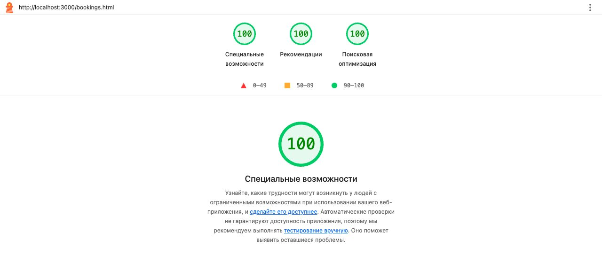 После: 100 |
| 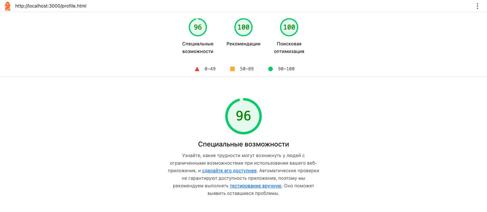 Кабинет до: 96 |  После: 100 |

### axe-core

- **До:** 7 элементов с недостаточным контрастом. Один в кабинете: кнопка «Выйти». Шесть в истории броней: бейдж «Отменено» и текст отменённой брони.
- **Прогон по интерактивным состояниям** нашёл ещё два нарушения контраста. При загрузке страницы их не видно, они появляются только в модалках: серая кнопка «Отмена» и зелёная подпись чекбокса после проверки формы.
- **После:** 0 нарушений на всех страницах и во всех 9 проверенных состояниях:
  - отправка пустой формы регистрации;
  - окно восстановления пароля;
  - модалка брони — у гостя и с ошибками;
  - вкладки «Меню» и «Отзывы» с формой отзыва;
  - панель фильтров на экране 375 px;
  - модалка редактирования профиля;
  - модалка отмены брони.

Lighthouse изначально ставил высокие оценки: вёрстка ЛР1 делалась семантической, с подписями у полей и `alt` у картинок. Но автоматические проверки ловят только часть проблем. Почти всё, что исправлено ниже, найдено вручную: проходом с клавиатуры и по дереву доступности.

### Firefox DevTools

Панель «Специальные возможности»: в списке «Проверить на наличие проблем» выбрано «Все проблемы». Скриншоты сделаны **до** исправлений из этого раздела. Firefox нашёл то, что пропустили Lighthouse и axe: те не считают контраст текста поверх градиентов и картинок и помечают такие случаи как «не удалось проверить».

| | |
|---|---|
| 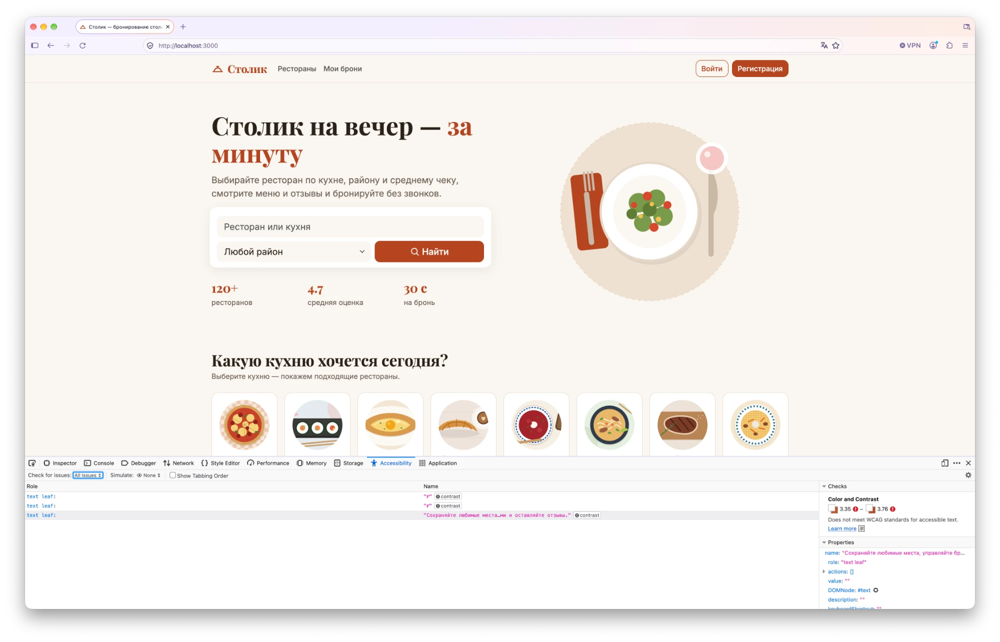 Главная | 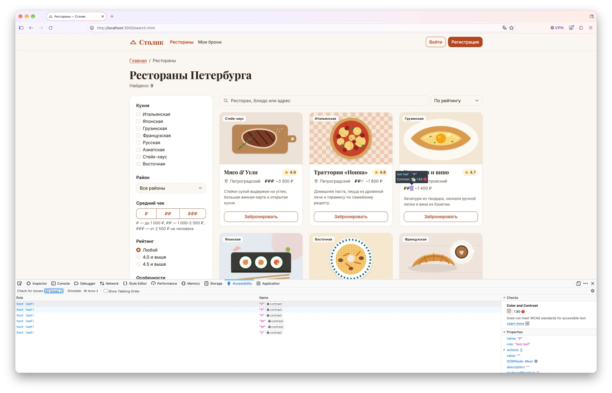 Поиск |
| 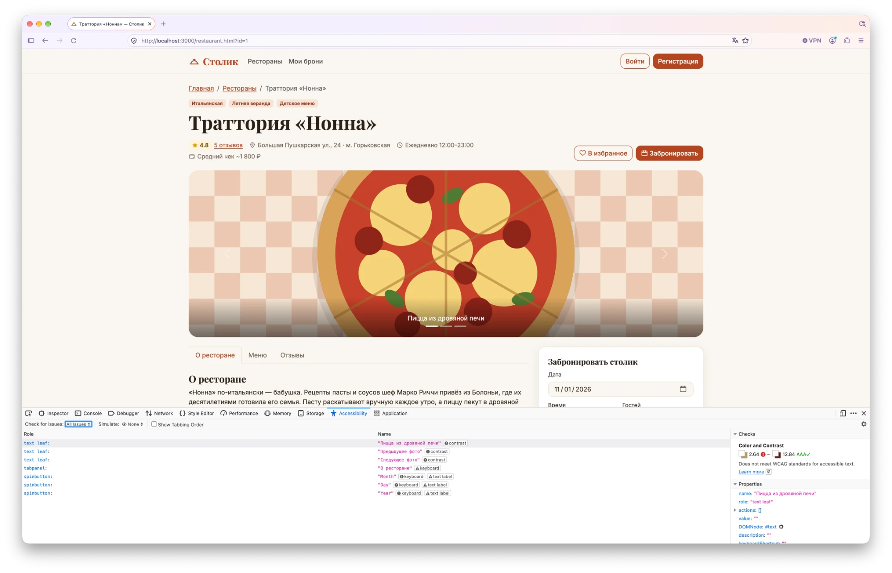 Страница ресторана | 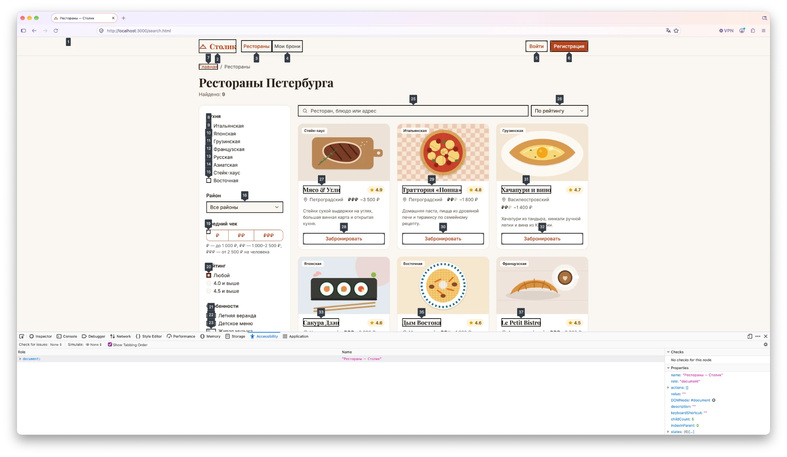 Порядок табуляции на поиске |

| Что нашёл Firefox | Причина | Что сделано |
|---|---|---|
| Текст баннера «Сохраняйте любимые места…» на главной, контраст **3.35–3.76** | белый текст с `opacity-75` поверх градиента; на светлом конце градиента (`#c8642f`) всего 2.9:1 | прозрачность убрана, светлый конец градиента затемнён до `#b94f24` — белый на нём **5:1**. Тот же градиент у блока на страницах входа и регистрации |
| Бледные «₽» в ценовом уровне карточек, контраст **1.80** | невыбранные «₽» были светло-серыми `#cbbfb2`. Для скринридера у значка есть `aria-label` «Ценовой уровень 2 из 3», но Firefox проверяет и сами символы | цвет `#7a6c60` (**5.1:1** к белому). Чтобы выбранные и невыбранные «₽» всё равно различались, у невыбранных обычное начертание вместо полужирного |
| Подпись под фото в галерее «Пицца из дровяной печи», контраст **2.64–12.84** | белый текст на картинке: где затемнение слабое, а фото светлое, контраст падает | под подписью своя полупрозрачная тёмная подложка `rgba(0, 0, 0, .6)`. Белый на ней не меньше **5.7:1** при любом фото |
| «Предыдущее фото», «Следующее фото» — контраст | скрытый текст (`.visually-hidden`) белого цвета внутри кнопок-стрелок; на экране его не видно, но Firefox проверяет и его | подпись перенесена в `aria-label` кнопки, скрытого текста больше нет. Скринридер читает то же самое |
| Вкладка «О ресторане» (`tabpanel`) — keyboard | у панели вкладки `tabindex="0"`: Firefox считает, что фокусируемому элементу нужна интерактивная роль | **оставлено намеренно.** Так рекомендует WAI-ARIA Authoring Practices для вкладок: если внутри панели нет фокусируемых элементов, сама панель должна получать фокус, иначе с клавиатуры до текста вкладки не дойти. Обводка фокуса у неё есть |
| Month / Day / Year (`spinbutton`) — keyboard, text label | это внутренние поля встроенного в Firefox `<input type="date">`, а не наша разметка | **исправлять нечего:** у самого поля даты есть `<label for="bookingDate">Дата</label>`, а подписи вложенных полей дня, месяца и года — часть реализации браузера, из разметки их не задать |

На четвёртом скриншоте включён «Показать порядок табуляции»:
- первый Tab — ссылка «Перейти к основному содержимому»;
- дальше шапка, хлебные крошки, фильтры (кухни, район, чек, рейтинг, особенности), поиск и сортировка, карточки ресторанов.

Порядок совпадает с визуальным: колонка фильтров слева идёт раньше результатов, внутри карточки сначала название, потом кнопка «Забронировать».

После исправлений на главной, странице входа, поиске и странице ресторана axe по-прежнему не находит нарушений, а исправленный контраст пересчитан по формуле WCAG.

## Что сделано

### 1. Навигация и ориентиры (landmarks)

- **Ссылка «Перейти к основному содержимому»** — первый элемент на каждой странице. Видна только в фокусе и ведёт на `<main id="main" tabindex="-1">`, так что не нужно каждый раз проходить меню по Tab.
- **Подписи у навигации.** У шапки `<nav aria-label="Основное меню">`. Ссылки в подвале обёрнуты в `<nav aria-labelledby="…">` с заголовками «Сервис» и «Аккаунт». Без подписей скринридер называет все блоки одинаково — «навигация».
- **`aria-current="page"`** у текущего пункта в шапке и в меню личного кабинета. Раньше текущая страница отмечалась только цветом.
- **Инициалы в аватарах** («ИП») скрыты через `aria-hidden="true"`: рядом и так написано полное имя.
- **Убрана пустая ссылка** «правила сервиса» (`href="#"`) — она никуда не вела.

### 2. Текстовые альтернативы

| Было (что слышит скринридер) | Стало | Как |
|---|---|---|
| «звезда 4.9» | «Рейтинг 4.9 из 5, 7 отзывов» | `role="img"` + `aria-label` на значке рейтинга |
| «рубль рубль» | «Ценовой уровень 2 из 3» | `role="img"` + `aria-label` |
| «тильда 1 800 ₽» | «средний чек около 1 800 ₽» | `~` в `aria-hidden`, текст — в `.visually-hidden` |
| пять безымянных картинок-звёзд | «Оценка 4 из 5» / «Средняя оценка 4.8 из 5» | `role="img"` + `aria-label` вместо `title` |
| полосы-«прогрессбары» распределения оценок | список «5 звёзд: 80% отзывов», «4 звезды: 20% отзывов»… | `<ul aria-label="Распределение оценок">`, полосы в `aria-hidden` |
| фильтр цены «рубль», «рубль рубль» | «до 1 000 ₽», «1 000–2 500 ₽», «от 2 500 ₽» | текст в `.visually-hidden` |
| «Фильтры 3» | «Фильтры, выбрано: 3» | скрытый текст у бейджа |
| занятый слот «19:00» | «19:00, занято» | раньше занятость передавалась только зачёркиванием |
| девять одинаковых «Забронировать» | «Забронировать столик в «Мясо & Угли»» | контекст в `.visually-hidden` |
| «Отменить», «Повторить» в каждой брони | «Отменить бронь в «Сакура Дзэн» на 15 ноября, 20:00» | то же |

Ещё:
- у разделов меню появилась связь с заголовком через `aria-labelledby`;
- у фотогалереи — `role="region"`, `aria-roledescription="карусель"`, слайды подписаны «1 из 3»;
- у точек-переключателей — «Фото 1 из 3».

### 3. Формы

У полей уже были `<label>`, `autocomplete`, `required`, `type="email|tel|password"`, а ошибки Bootstrap показывал красным текстом под полем. Скринридер этого текста не слышал: он никак не был связан с полем, а невалидность передавалась только цветом.

- У каждого из 17 полей с проверкой появился атрибут `aria-errormessage="…Error"`, а у текста ошибки — соответствующий `id`.
- После отправки формы `syncValidity()` в `main.js` выставляет `aria-invalid="true|false"`. Пока ошибка видна, её `id` добавляется в `aria-describedby`. Почему не постоянно: иначе скринридер читал бы «Введите корректный адрес почты» ещё до ввода. Статус обновляется по мере ввода и снимается при сбросе формы (`resetValidation()`).
- Группы радиокнопок (оценка в отзыве, время брони) — это `<fieldset role="radiogroup">`. Группе можно поставить `aria-invalid` только с этой ролью.
- Фокус после неудачной отправки уходит на первое ошибочное поле. Это было и раньше, теперь вместе с полем читается текст ошибки.

Так поле с ошибкой выглядит в дереве доступности:

```
textbox "Электронная почта" [value="demo@", description="Введите корректный адрес почты.", required=true, invalid="true"]
```

### 4. Динамический контент и фокус

- **Число найденных ресторанов** в поиске — `role="status"`: после смены фильтра скринридер говорит «Найдено: 3». У списка во время загрузки `aria-busy="true"`.
- **Тосты** («Столик забронирован», «Отзыв опубликован»). Контейнер стал постоянной live-областью (`aria-live="polite"`) и создаётся при загрузке страницы. Раньше `role="status"` ставился на новый тост, а элемент, вставленный вместе с текстом, скринридер может не объявить. Ошибки больше не исчезают через 4 секунды — их закрывают кнопкой.
- **Фильтр истории броней.** Состояние кнопок — `aria-pressed`, а не только цвет. После переключения объявляется «Показано бронирований: 2».
- **Фокус больше не теряется** в местах, где элемент в фокусе исчезал или модалку открывал скрипт:

| Действие | Куда раньше уходил фокус | Куда сейчас |
|---|---|---|
| отмена брони | в начало страницы | на название ресторана в той же карточке |
| «Оставить» в окне отмены | в начало страницы | обратно на кнопку «Отменить» |
| удаление из избранного | в начало страницы | на кнопку в соседней карточке, после последней — на заголовок блока |
| публикация отзыва (форма сворачивается) | в начало страницы | на новый отзыв |
| ссылка «N отзывов» в шапке ресторана | оставался на ссылке | на открытую вкладку отзывов |
| закрытие модалки брони, открытой из быстрой формы | в начало страницы | на кнопку «Выбрать столик» |

### 5. Контраст и видимый фокус

- **Красный.** Стандартный `#dc3545` на кремовом фоне даёт контраст 4.2:1 (нужно 4.5:1). Через CSS-переменные Bootstrap (`--bs-danger`, `--bs-form-invalid-color`) и у `.btn-danger` и `.btn-outline-danger` он заменён на `#b02a37` — 6.0:1.
- **Зелёный и серый в модалках.** Зелёный «поле заполнено верно» `#198754` (4.2:1) заменён на `#146c43` (6.0:1). Серая кнопка `#6c757d` (4.4:1) — на фирменный приглушённый `#6f6257` (5.5:1).
- **Найденное в Firefox:** баннер на главной, бледные «₽», подпись под фото (подробности — в разделе «Firefox DevTools» выше).
- **Отменённые брони** раньше были целиком полупрозрачными, и текст с бейджем теряли контраст. Теперь приглушается только картинка (`grayscale` + прозрачность).
- **Фокус.** Bootstrap рисует его полупрозрачной тенью, на кремовом фоне её почти не видно. Теперь у ссылок, кнопок и вкладок обводка `:focus-visible` толщиной 3 px цвета `#8f3416` (7.3:1 к фону). На тёмном подвале, цветных баннерах, фото и красных кнопках обводка белая с тёмной окантовкой. У полей ввода тень фокуса стала плотнее.

### 6. Движение

- **Карусель.** У фотогалереи убрана автопрокрутка (`data-bs-ride="carousel"`). Раньше её нельзя было остановить с клавиатуры: Bootstrap ставит паузу только при наведении мыши (WCAG 2.2.2).
- **Пользователи с `prefers-reduced-motion: reduce`.** Анимации и переходы отключены, прокрутка к отзывам выполняется без плавности.

## Как это видит скринридер

Фрагменты дерева доступности Chrome. Безымянные обёртки `div`/`span` скрыты, как их пропускает и скринридер.

Карточка ресторана в поиске:

```
article
  image "Стейк на деревянной доске с розмарином"
  text "Стейк-хаус"
  heading "Мясо & Угли" [level=2]
    link "Мясо & Угли"
  image "Рейтинг 4.9 из 5, 7 отзывов"
  list
    listitem
      text "Петроградский"
    listitem
      image "Ценовой уровень 3 из 3"
      text "средний чек около"
      text "3 500 ₽"
  paragraph
    text "Стейки сухой выдержки на углях, большая винная карта и открытая кухня."
  link "Забронировать столик в «Мясо & Угли»"
```

Бронь в истории:

```
article
  heading "Сакура Дзэн" [level=2]
    link "Сакура Дзэн"
  text "Ожидает подтверждения"
  list
    listitem
      time
        text "15 ноября 2026, 20:00"
    listitem
      text "4 гостя"
    listitem
      text "У окна"
  paragraph
    text "Бронь № 2"
  link "К ресторану «Сакура Дзэн»"
  button "Отменить бронь в «Сакура Дзэн» на 15 ноября, 20:00"
```

Распределение оценок на странице ресторана:

```
list "Распределение оценок"
  listitem
    text "5 звёзд: 80% отзывов"
  listitem
    text "4 звезды: 20% отзывов"
  …
```

## Ручная проверка с клавиатуры

Это пункты, которые Lighthouse помечает как требующие ручной проверки.

- [x] Первый Tab на любой странице показывает ссылку-пропуск, Enter переводит фокус в `<main>`.
- [x] Порядок фокуса совпадает с визуальным: шапка → фильтры → поиск и сортировка → карточки → подвал. Проверено и в Firefox («Показать порядок табуляции», скриншот выше).
- [x] Все элементы управления доступны с клавиатуры. Звёзды в форме отзыва переключаются стрелками, слоты времени — тоже. Вкладки, выпадающее меню пользователя, карусель и панель фильтров работают так, как их сделал Bootstrap.
- [x] Фокус всегда виден: проверено на светлом и тёмном фоне, на фото и на цветных кнопках.
- [x] Фокус не застревает. Модалки держат фокус внутри себя, закрываются по Esc и возвращают его на кнопку, которой были открыты.
- [x] Невидимое содержимое скрыто от вспомогательных технологий: закрытые модалки, свёрнутые блоки и неактивные вкладки (`display: none` / `aria-hidden`).
- [x] Новое содержимое получает фокус или объявляется: новый отзыв, вкладка отзывов, результаты поиска, тосты.

## Скриншоты

| | |
|---|---|
| 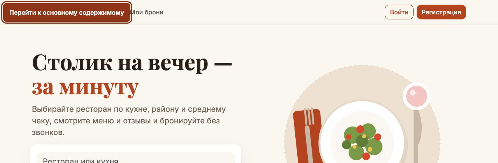 Первый Tab — ссылка «Перейти к основному содержимому» | 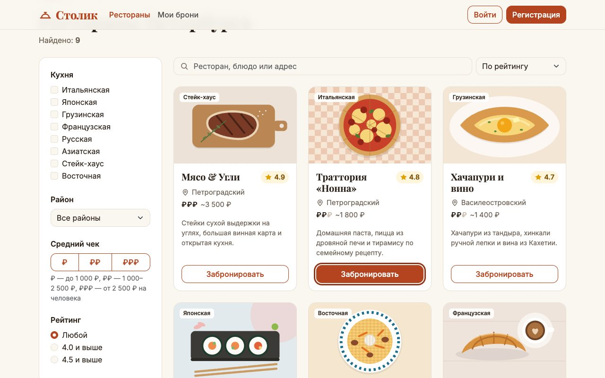 Видимая обводка фокуса на кнопке карточки |
| 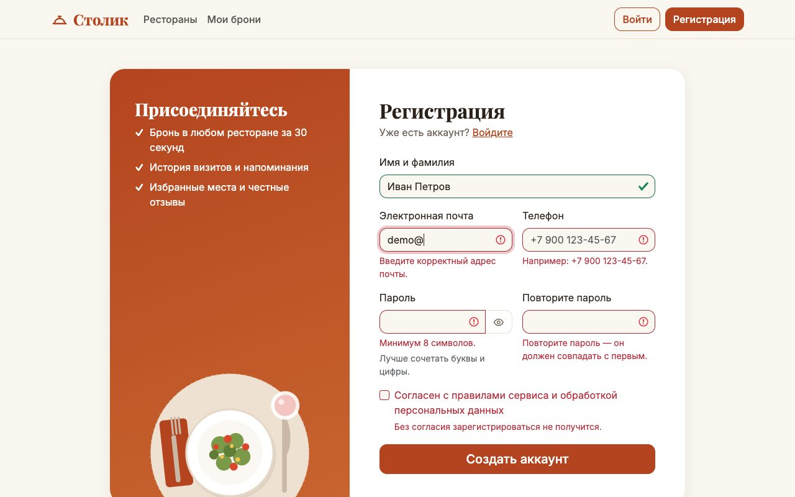 Ошибки формы связаны с полями через `aria-invalid` и `aria-describedby` | 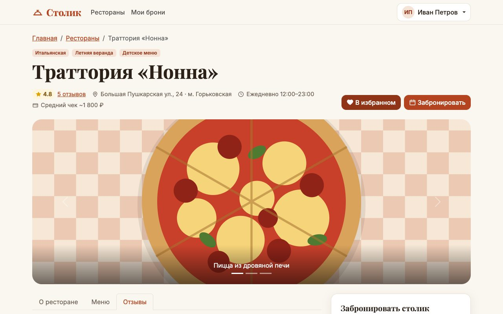 Рейтинг и распределение оценок с текстом для скринридера |
| 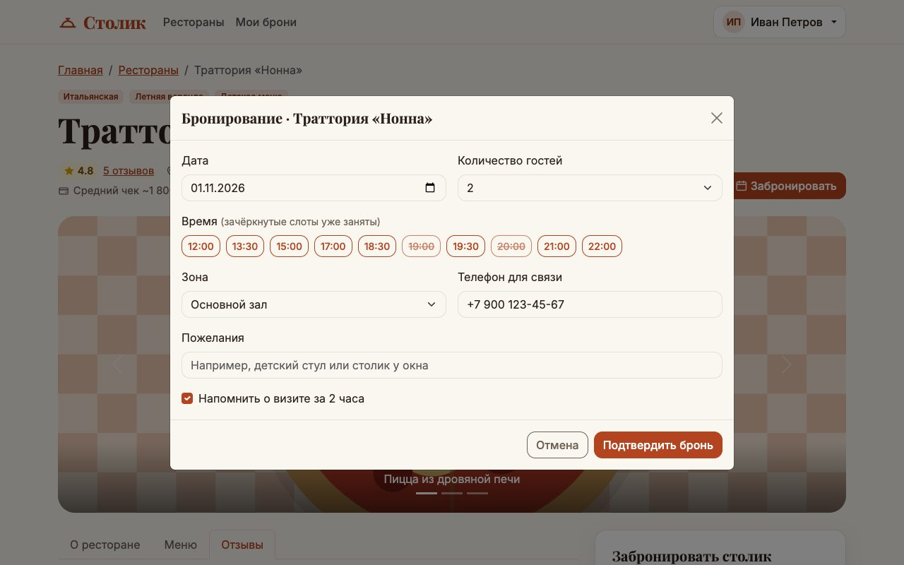 Слоты времени: занятые подписаны «занято» | 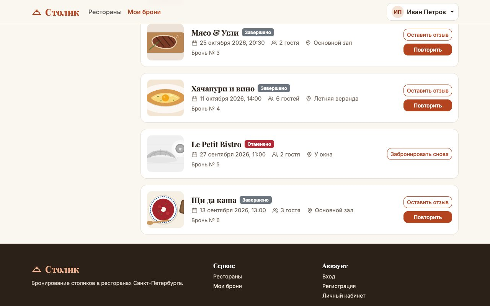 Отменённая бронь без потери контраста |

## Вывод

Lighthouse уже показывал 95–100 баллов. Автоматические проверки нашли только две проблемы контраста при загрузке и ещё две в модалках. Firefox DevTools добавил три места, которые Chrome-инструменты пропускают: текст поверх градиента, текст поверх фото и бледные символы внутри значка с `aria-label`. Проход с клавиатуры и разбор дерева доступности выявили больше:
- значки, которые читаются как «рубль рубль» и «тильда»;
- одинаковые безымянные кнопки в карточках;
- ошибки форм, о которых скринридер не сообщает;
- изменения на странице без объявления;
- фокус, который теряется после модалок и удалений;
- карусель, которую нельзя остановить с клавиатуры.

Всё это исправлено HTML-атрибутами (`aria-label`, `aria-current`, `aria-pressed`, `aria-invalid`, `aria-errormessage`, `aria-describedby`, `aria-live`, `role`, `tabindex`), скрытым текстом и небольшими правками стилей и скриптов. Итог: 100 баллов Lighthouse на всех страницах и ни одного нарушения axe-core ни на одной странице и ни в одном проверенном состоянии.
