# Домашняя работа 3. CSS-переменные, темизация сайта

**Студент:** Субботин Александр, поток K3439
**Вариант:** 1 — приложение для бронирования столиков в ресторанах («Столик»)

## Задание

Выполнить темизацию ранее реализованного сайта: добавить к текущему варианту дополнительную тему. В итоге должны получиться либо светлая и тёмная темы с ориентиром на пользовательские настройки, либо две кастомные темы с переключателем через JS.

Сделаны **оба варианта сразу**:
- Тема подстраивается под настройку системы (`prefers-color-scheme`) только средствами CSS, как в примере с лекции.
- В шапке есть переключатель «Светлая / Тёмная / Как в системе» на JS. Он нужен, если пользователь хочет тему, отличную от системной. Выбор запоминается.

За основу взят сайт из ДЗ2 (вёрстка ЛР1 + API из ЛР2 + правки доступности). Запуск:

```bash
npm install
npm start
```

Затем откройте http://localhost:3000/index.html. Демо-аккаунт: `demo@stolik.ru` / `stolik2026`.

## Как устроено

### 1. Все цвета — в CSS-переменных

Раньше часть цветов была в переменных `:root`, но ещё 42 цвета были «зашиты» прямо в правила (`#fff4dc`, `rgba(255, 255, 255, .92)`, `#e0a100`…). Теперь в `style.css` нет ни одного значения цвета: каждое правило берёт цвет из переменной.

```css
/* было */
.rating-pill { background: #fff4dc; color: #7a4d00; }
.site-header { background-color: rgba(250, 246, 240, 0.92); }

/* стало */
.rating-pill { background: var(--rating-bg); color: var(--rating-text); }
.site-header { background-color: var(--header-bg); }
```

Переменные названы по смыслу, а не по цвету: `--surface` — фон карточек, `--muted` — второстепенный текст, `--star` — звёзды рейтинга. Так одна и та же переменная может иметь в разных темах совершенно разные значения.

Важный момент: фирменный кирпичный `#b4441f` на тёмном фоне даёт контраст всего 3.3:1. Поэтому у фирменного цвета три роли с разными переменными:

| Переменная | Где используется | Светлая | Тёмная |
|---|---|---|---|
| `--brand` | заливка кнопок (на ней белый текст) | `#b4441f` | `#b4441f` (белый на нём — 5.5:1) |
| `--brand-text` | ссылки, активный пункт меню, контурные кнопки | `#b4441f` | `#f08d63` (7.7:1 к фону) |
| `--brand-soft` / `--brand-soft-text` | мягкие плашки (бейджи, аватар) | `#f6e3d8` / `#8f3416` | `#3b2419` / `#f6b28f` |

С красным то же самое. `--danger` — заливка кнопки «Да, отменить» под белый текст, а `--danger-text` — красный текст ошибок и рамки. В тёмной теме это разные оттенки.

### 2. Две темы — два файла

```
public/css/
├── style.css          # вёрстка, только var(--…)
└── themes/
    ├── light.css      # значения переменных для светлой темы
    └── dark.css       # те же переменные — значения для тёмной
```

Подключение — как в примере с лекции, через атрибут `media`:

```html
<link href="css/style.css" rel="stylesheet">
<link href="css/themes/light.css" rel="stylesheet">
<link href="css/themes/dark.css" rel="stylesheet" media="(prefers-color-scheme: dark)" id="darkTheme">
```

Светлая тема — базовая и подключена всегда. Тёмная применяется только при тёмной теме в системе и переопределяет те же переменные. Можно было сделать симметрично, с `media="(prefers-color-scheme: light)"` у светлой. Но тогда в браузере, который не сообщает предпочтение, не применилась бы ни одна тема и сайт остался бы без цветов.

Через переменные перекрашивается и Bootstrap. В темах заданы его переменные `--bs-body-bg`, `--bs-body-color`, `--bs-border-color`, `--bs-link-color-rgb`, `--bs-danger-rgb`, `--bs-form-invalid-color` и другие, поэтому модалки, выпадающие меню, поля форм, тосты и панель фильтров меняют цвет вместе с сайтом.

Палитра тёмной темы — тёплый тёмно-коричневый (`#17120e`) вместо чёрного, в тон фирменному цвету. Все пары «текст — фон» проверены на контраст не ниже 4.5:1, значения подписаны в комментариях `dark.css`:

| | Цвет | Контраст к фону |
|---|---|---|
| Основной текст | `#f3eae0` | 15.6:1 |
| Второстепенный текст | `#b9a898` | 8.1:1 |
| Ссылки | `#f08d63` | 7.7:1 |
| Текст ошибок | `#ff8f99` | 8.5:1 |
| Обводка фокуса | `#f6b28f` | 10.4:1 |

Иллюстрации нарисованы под светлый фон, поэтому в тёмной теме они слегка приглушены (`filter: brightness(.88)`) и не «светят».

### 3. Переключатель на JS

`js/theme.js` подключён в `<head>` без `defer`. Тема применяется до первой отрисовки страницы, поэтому при загрузке в тёмной теме нет вспышки белого.

Скрипт меняет атрибут `media` у `dark.css`:

| Выбор | `media` у `dark.css` | Что получается |
|---|---|---|
| Как в системе (по умолчанию) | `(prefers-color-scheme: dark)` | решает браузер, как в чистом CSS-варианте |
| Тёмная | `all` | тёмная тема всегда |
| Светлая | `not all` | `dark.css` не применяется никогда |

```js
const THEME_MEDIA = { auto: '(prefers-color-scheme: dark)', dark: 'all', light: 'not all' };

function applyTheme(choice) {
  document.querySelector('#darkTheme').media = THEME_MEDIA[choice];
  const isDark = choice === 'dark' || (choice === 'auto' && systemDarkQuery.matches);
  document.documentElement.dataset.bsTheme = isDark ? 'dark' : 'light';
}
```

Ещё скрипт делает следующее:
- **Запоминает выбор** в `localStorage`. В режиме «как в системе» запись удаляется.
- **Ставит `data-bs-theme` на `<html>`.** По этому атрибуту Bootstrap перекрашивает то, что у него не вынесено в переменные: крестики модалок, стрелки выпадающих списков, иконку меню на мобильных.
- **Следит за сменой темы в системе** (`matchMedia(...).addEventListener('change')`). Если выбрано «как в системе» и macOS вечером переключилась на тёмную тему, сайт перекрашивается без перезагрузки.
- **Синхронизирует вкладки** через событие `storage`: если сменить тему в одной вкладке, она поменяется и в остальных.
- **Сохраняет доступность переключателя** из ДЗ2. Выбранный пункт помечен `aria-pressed="true"`, а у кнопки в шапке скринридер читает «Тема оформления: тёмная».

### 4. Что пришлось поправить по ходу

- **Галерея на странице ресторана.** В тёмном режиме Bootstrap делает подпись и стрелки карусели чёрными (`[data-bs-theme=dark] .carousel .carousel-caption { color: #000 }`), и чёрный текст оказывался на тёмном затемнении фото. Подпись лежит поверх фото, поэтому она светлая в обеих темах (`--on-photo`). Пришлось задать более специфичные селекторы, чем у Bootstrap.
- **Крестики в избранном** (`btn-light`) в тёмной теме были ярко-белыми кругами. Они переведены на переменные темы.
- **`.text-danger`.** У Bootstrap и заливка, и красный текст берутся из одной переменной `--bs-danger-rgb`, а в тёмной теме им нужны разные оттенки. Поэтому у `.text-danger` своя переменная `--danger-text`.

## Проверка

- **Все страницы и состояния** проверены в обеих темах: главная, вход, регистрация с ошибками, поиск, ресторан, вкладка отзывов, модалка брони, кабинет, история броней, меню переключателя, мобильное меню.
- **axe-core** (правила WCAG 2.2 A/AA) по этим 11 экранам в каждой теме — **0 нарушений**, в том числе по контрасту.
- **Переключатель в браузере:**
  - «Тёмная» сохраняется при переходе между страницами;
  - «Как в системе» перекрашивает сайт сразу после смены темы в системе;
  - «Светлая» перекрывает тёмную системную тему;
  - выбор в одной вкладке сразу применяется в другой.

## Скриншоты

| Светлая тема | Тёмная тема |
|---|---|
| 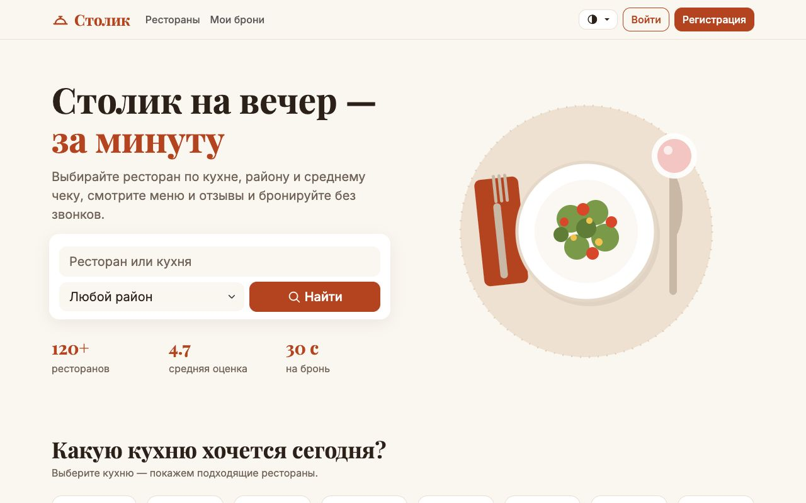 | 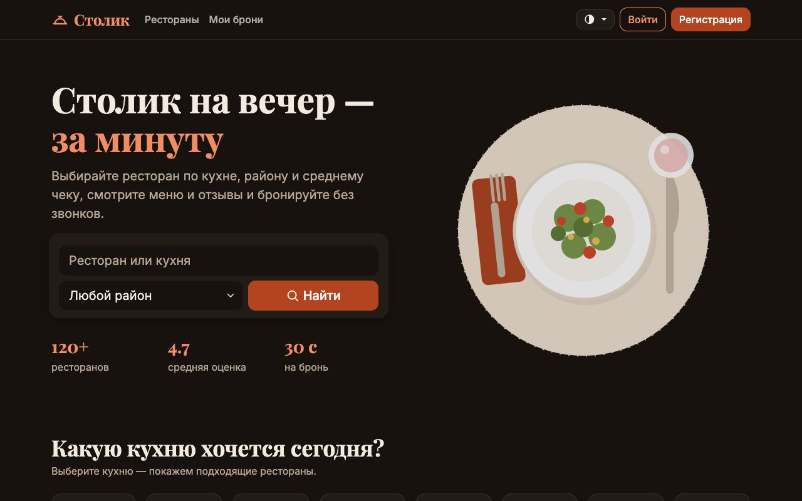 |
| 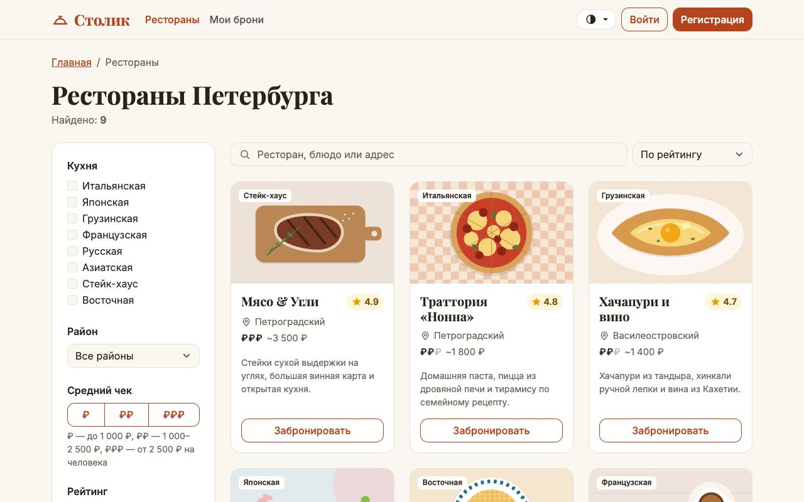 | 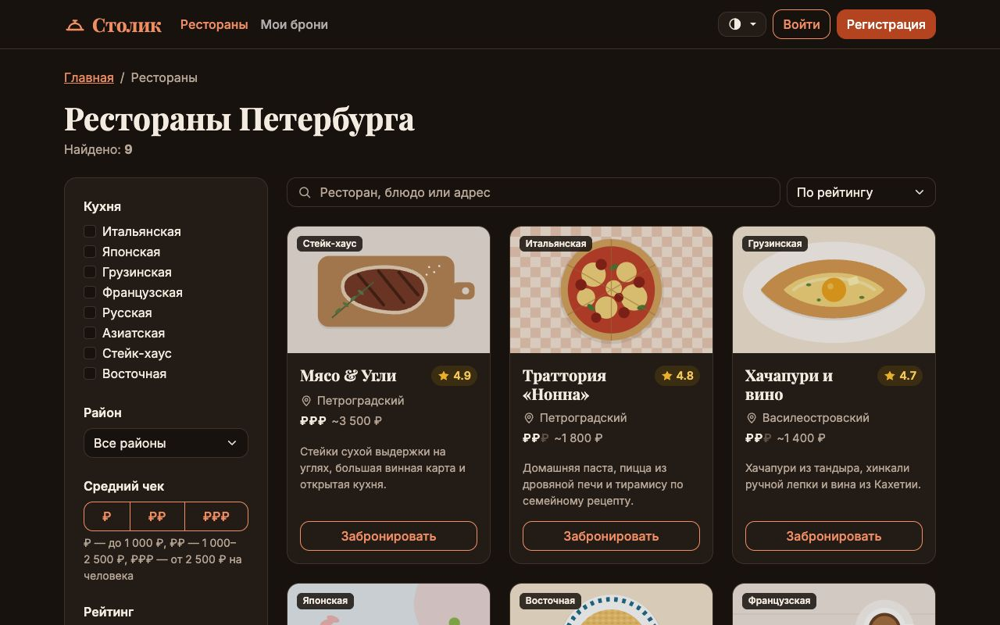 |
| 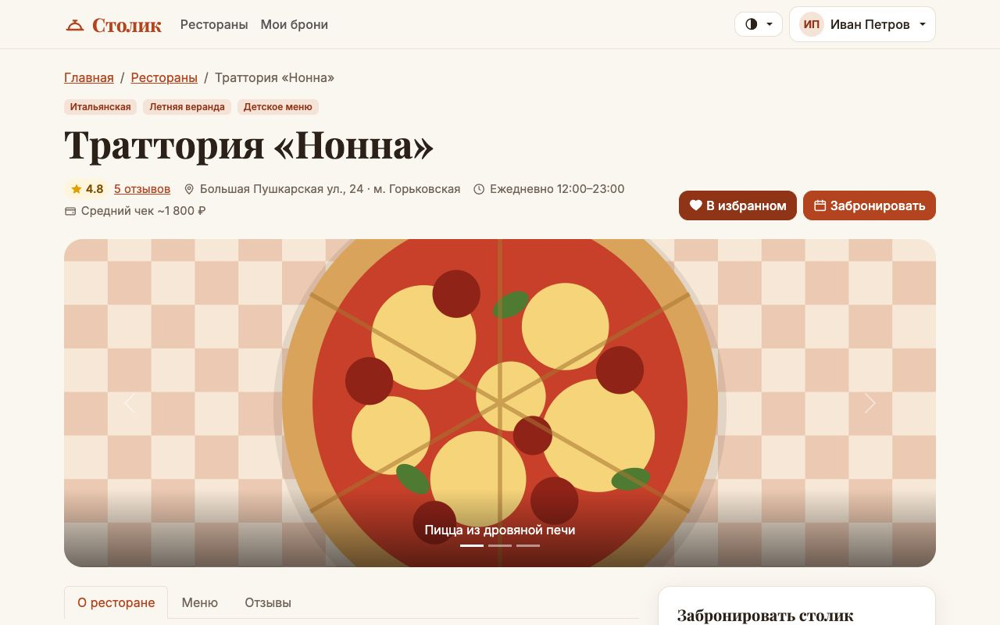 | 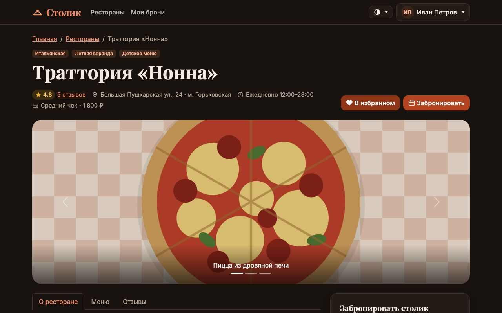 |

Тёмная тема на остальных экранах:

| | |
|---|---|
| 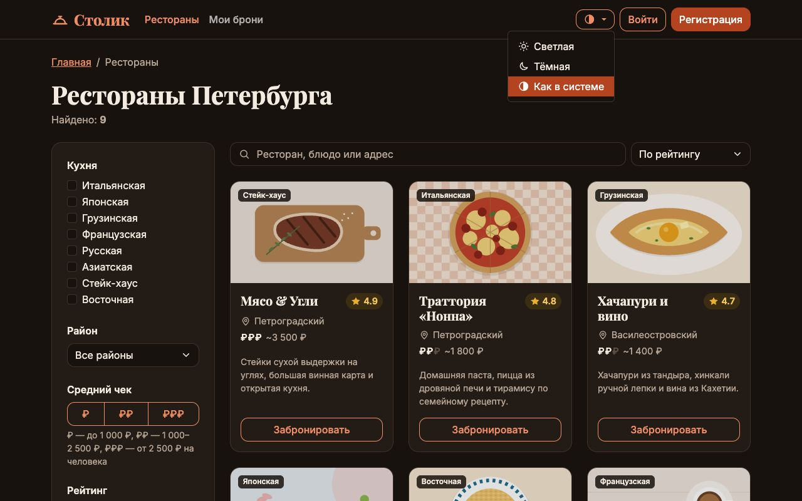 Переключатель темы в шапке | 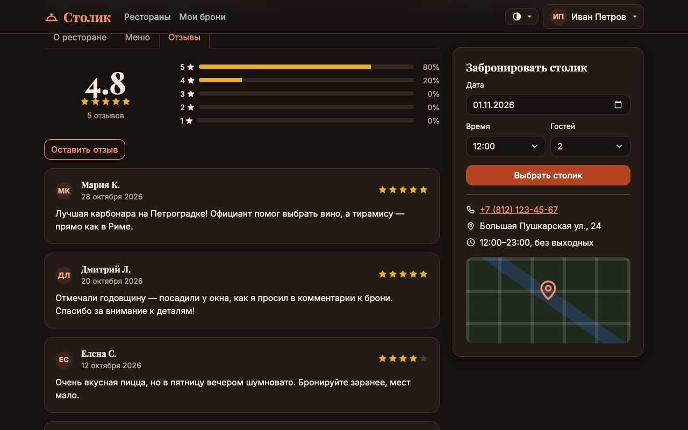 Отзывы и рейтинг |
| 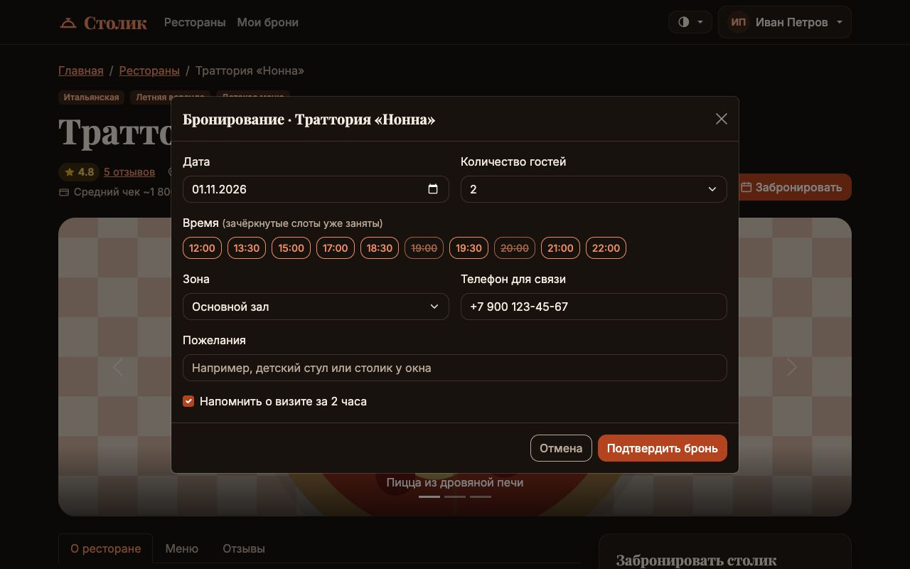 Модалка бронирования | 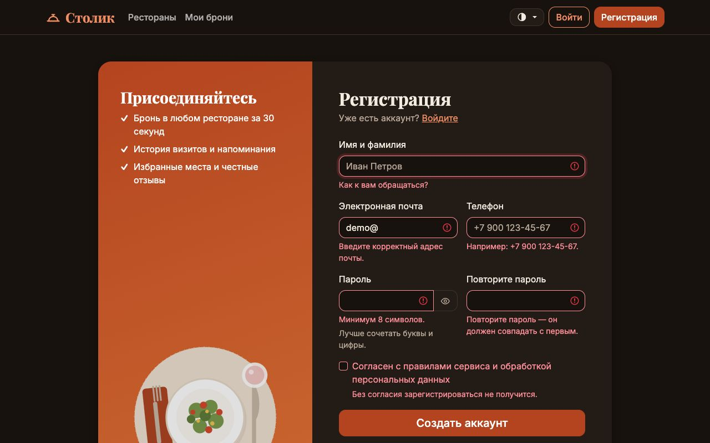 Ошибки формы регистрации |
| 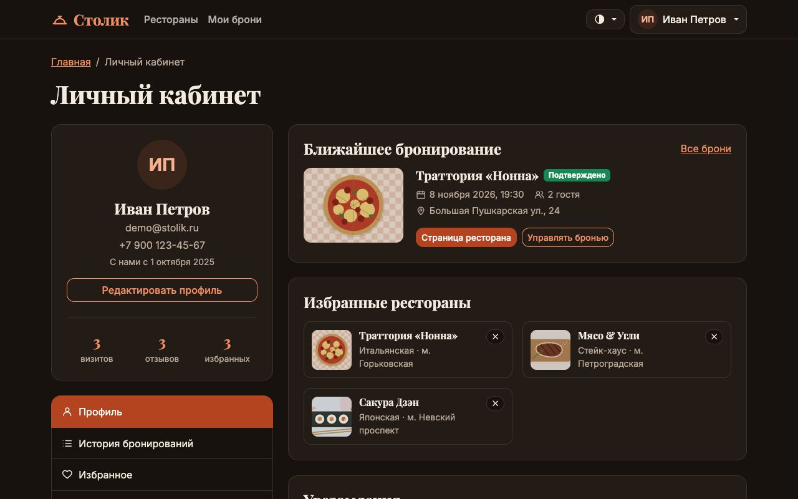 Личный кабинет | 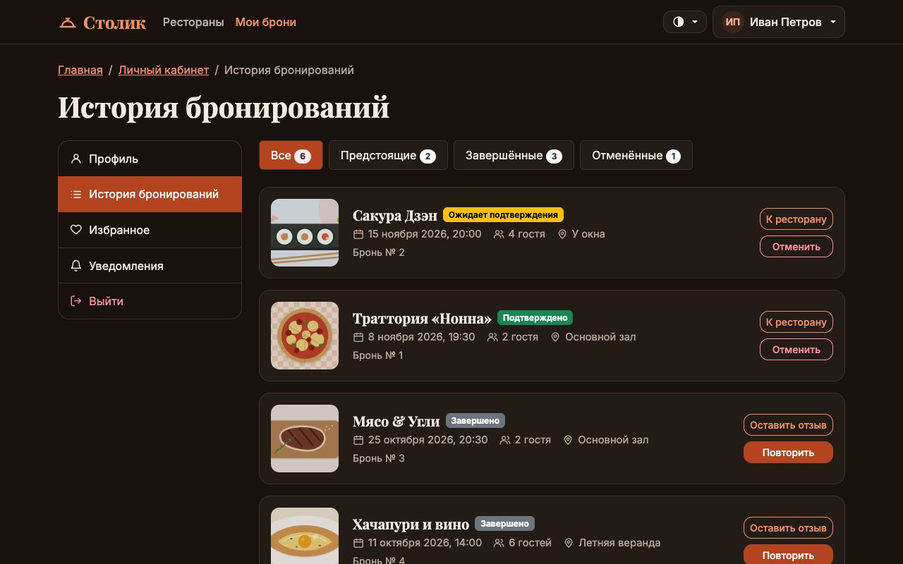 История бронирований |

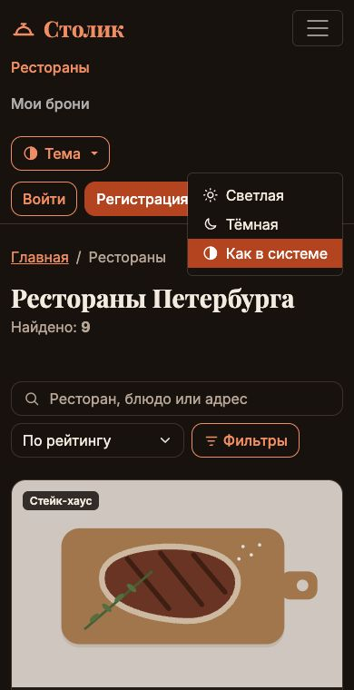

Мобильная версия: переключатель в раскрывающемся меню.

## Вывод

Все цвета сайта вынесены в CSS-переменные с понятными именами, а значения переменных лежат в двух файлах тем. Тёмная тема подключается по `prefers-color-scheme` средствами одного CSS, как в примере с лекции. Небольшой скрипт поверх этого даёт пользователю выбрать тему вручную, запоминает выбор и держит Bootstrap-компоненты в той же теме. Отдельное внимание — контрасту: у фирменного и красного цветов разные значения для заливки и для текста, и обе темы проходят проверку WCAG AA.
