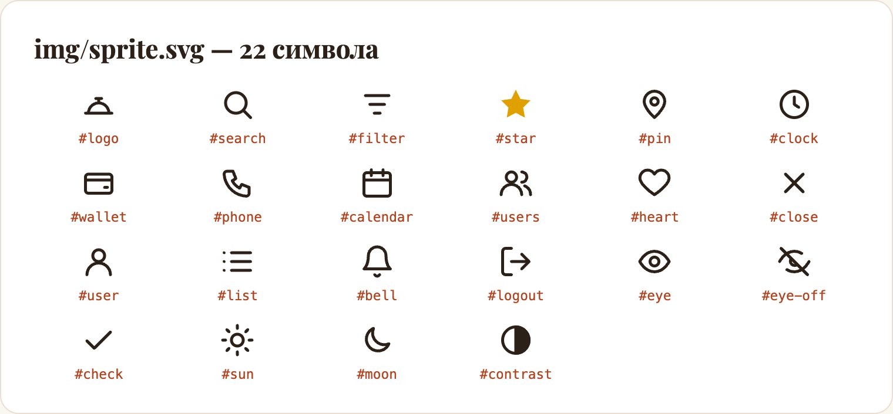
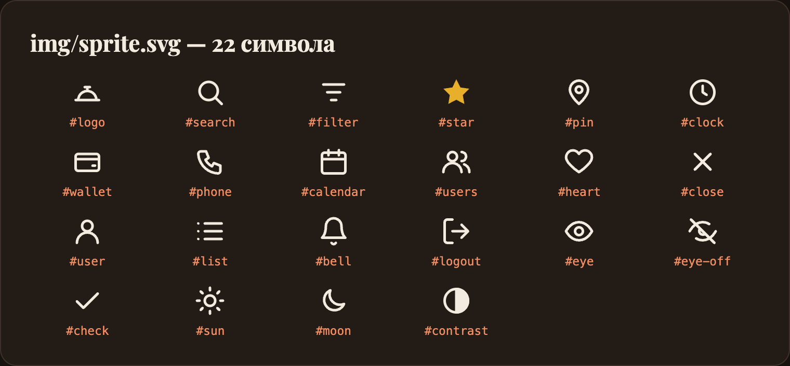
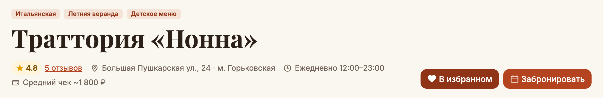
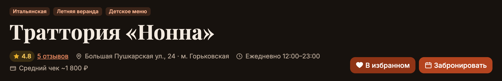
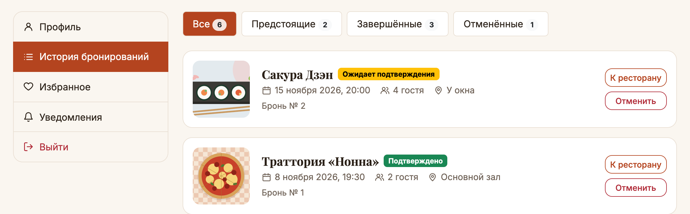
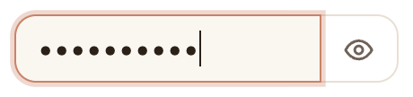
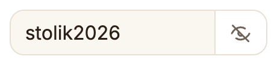
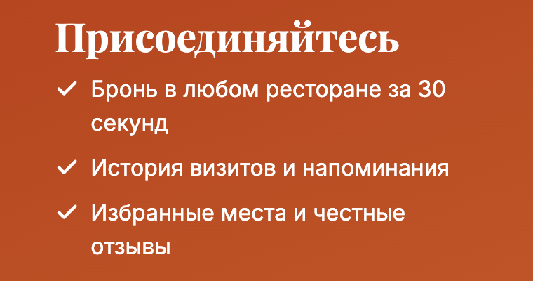

# Домашняя работа 4. SVG-спрайт

**Студент:** Субботин Александр, поток K3439
**Вариант:** 1 — приложение для бронирования столиков в ресторанах («Столик»)

## Задание

Вынести все используемые ранее SVG-иконки в общий SVG-спрайт. Если иконок не было, добавить 3–5 иконок и поместить их в спрайт.

За основу взят сайт из ДЗ3 (вёрстка ЛР1, API из ЛР2, доступность из ДЗ2, темы из ДЗ3). Иконки на нём были с самого начала, но каждая вставлялась прямо в разметку как inline-SVG. Запуск:

```bash
npm install
npm start
```

Затем откройте http://localhost:3000/index.html. Демо-аккаунт: `demo@stolik.ru` / `stolik2026`.

## Что было

На 7 страницах стояло **86 inline-SVG**, ещё 5 иконок были строками в `js/ui.js`. При этом уникальных иконок всего **20**: одна и та же иконка повторялась на каждой странице. Логотип и три иконки переключателя темы были в шапке всех 7 страниц и в меню, звезда — в рейтинге и в форме отзыва. Чтобы поменять иконку, пришлось бы править её во всех копиях.

```html
<a class="navbar-brand brand-logo" href="index.html">
  <svg class="icon icon-lg" viewBox="0 0 24 24" aria-hidden="true"><path d="M3 18h18M5 18a7 7 0 0 1 14 0M12 11V8M10 8h4"/></svg>
  Столик
</a>
```

## Что стало

### Спрайт `public/img/sprite.svg`

Все иконки — это `<symbol>` с `id` и `viewBox` в одном файле, у каждой есть комментарий, где она используется:

```xml
<svg xmlns="http://www.w3.org/2000/svg">
  <!-- Логотип «Столика»: клош — блюдо под крышкой -->
  <symbol id="logo" viewBox="0 0 24 24">
    <path d="M3 18h18M5 18a7 7 0 0 1 14 0M12 11V8M10 8h4"/>
  </symbol>

  <!-- Поиск — лупа -->
  <symbol id="search" viewBox="0 0 24 24">
    <circle cx="11" cy="11" r="7"/><path d="M21 21l-4.3-4.3"/>
  </symbol>
  …
</svg>
```

В разметке на месте иконки осталась только ссылка на символ:

```html
<svg class="icon icon-lg" aria-hidden="true"><use href="img/sprite.svg#logo"></use></svg>
```

| Светлая тема | Тёмная тема |
|---|---|
|  |  |

| Группа | Иконки |
|---|---|
| Общие | `logo`, `search`, `filter` |
| Карточки и страница ресторана | `star`, `pin`, `clock`, `wallet`, `phone`, `calendar`, `users`, `heart`, `close` |
| Меню личного кабинета | `user`, `list`, `bell`, `logout` |
| Формы | `eye`, `eye-off` *(новая)*, `check` *(новая)* |
| Переключатель темы | `sun`, `moon`, `contrast` |

### Почему отдельный файл, а не спрайт внутри страницы

В примере с лекции показаны оба варианта: спрайт можно встроить в `<body>` (`<svg display="none">` с символами) или вынести в `sprite.svg`. Здесь выбран отдельный файл:
- **Кэш.** Страниц семь, а иконки на них одни и те же. Отдельный файл браузер скачивает один раз и дальше берёт из кэша. Встроенный спрайт пришлось бы повторять в каждом HTML.
- **Одно место правки.** Новая иконка добавляется в одном файле и сразу доступна на всех страницах и в JS.

Сайт и спрайт отдаёт один и тот же сервер, поэтому ограничение `<use>` на загрузку только с того же origin не мешает.

### Цвет иконок и темы

В символах нет ни одного цвета. Обводка и заливка наследуются от класса `.icon` на внешнем `<svg>`:

```css
.icon {
  fill: none;
  stroke: currentColor;
  stroke-width: 2;
}

.icon-fill {   /* звёзды рейтинга */
  fill: currentColor;
  stroke: none;
}
```

Содержимое `<use>` наследует свойства от `<svg>`, на котором стоит класс. Поэтому одна и та же иконка `#heart` становится контурной на кнопке «В избранное» и залитой, когда ресторан уже в избранном (`.favorite-btn.active .icon { fill: currentColor }`). Через `currentColor` иконки сами перекрашиваются в тёмной теме из ДЗ3: в спрайте под тему ничего менять не пришлось.




### Иконки в JS

Карточки ресторанов, отзывы, брони и избранное рисуются скриптами по данным из API. Раньше в `ui.js` лежали пять SVG-строк целиком. Теперь там общая функция, которая возвращает ссылку на символ спрайта:

```js
// main.js
const SPRITE_URL = 'img/sprite.svg';

function iconHtml(name, className = 'icon') {
  return `<svg class="${className}" aria-hidden="true"><use href="${SPRITE_URL}#${name}"></use></svg>`;
}

// ui.js
const ICONS = {
  star: iconHtml('star', 'icon icon-fill'),
  pin: iconHtml('pin'),
  calendar: iconHtml('calendar'),
  users: iconHtml('users'),
  close: iconHtml('close'),
};
```



### Новые иконки

- **`eye-off`** — перечёркнутый глаз. Раньше у кнопки «Показать пароль» была одна иконка в обоих состояниях. Теперь, когда пароль виден, кнопка показывает перечёркнутый глаз. Иконка меняется одной строкой: скрипт подставляет другой символ того же спрайта в `href`.

  ```js
  btn.querySelector('use').setAttribute('href', `${SPRITE_URL}#${isHidden ? 'eye-off' : 'eye'}`);
  ```

  | Пароль скрыт | Пароль виден |
  |---|---|
  |  |  |

- **`check`** — галочки в списке преимуществ на странице регистрации. Раньше это был текстовый символ «✓» в `::before`, теперь иконка из спрайта того же стиля, что и остальные.

  

### Доступность

Все иконки декоративные: рядом всегда есть текст или подпись у кнопки (`aria-label="Показать пароль"`, «Убрать „Мясо & Угли“ из избранного»). Поэтому у внешнего `<svg>` сохранён `aria-hidden="true"` из ДЗ2, и скринридер иконки пропускает.

## Что не вошло в спрайт

Иллюстрации в `img/` — блюда в карточках кухонь, картинка на главной, фото-заглушки ресторанов — тоже SVG-файлы, но это картинки, а не иконки. Они многоцветные, со своими цветами, подключаются через `` с `alt` и не должны перекрашиваться от `currentColor`. Им место в отдельных файлах. `favicon.svg` тоже остался отдельным: браузер берёт его по `<link rel="icon">`.

## Проверка

- **Попиксельное сравнение с ДЗ3.** Каждую страницу и состояние снял в обеих версиях сайта: ДЗ3 с inline-иконками и ДЗ4 со спрайтом. Затем сравнил снимки через `pixelmatch` в 22 вариантах: 11 экранов (все страницы, мобильное меню, вкладка отзывов, контакты ресторана, меню темы) × 2 темы.

  | Экраны | Отличающихся пикселей |
  |---|---|
  | 20 из 22 | **0** — иконки из спрайта рисуются точно так же, как inline |
  | Регистрация, светлая и тёмная тема | отличаются только галочки: был символ «✓», стала иконка `#check` |

- **Переключатель пароля.** В браузере `href` меняется на `#eye-off`, иконка отрисовывается, `aria-label` становится «Скрыть пароль».
- **Спрайт — корректный XML.** В нём 22 `<symbol>`, во всех HTML и JS не осталось ни одного inline `<path>`/`<circle>`/`<rect>`.

| | До (ДЗ3) | После (ДЗ4) |
|---|---|---|
| Inline-SVG в HTML | 86 | 0 (89 ссылок `<use>`) |
| SVG-строк в JS | 5 | 0 |
| Размер 7 HTML-страниц | 109.7 КБ | 104.4 КБ |
| `sprite.svg` | — | 4.9 КБ (1.9 КБ в gzip), загружается один раз на весь сайт |

## Вывод

Все 20 иконок сайта собраны в один файл `img/sprite.svg`, к ним добавлены две новые. На страницах и в скриптах остались только ссылки `<use href="img/sprite.svg#…">`. Цвет иконок задаётся снаружи через `currentColor`, поэтому они работают в обеих темах и в любых состояниях кнопок без отдельных версий. Внешне сайт не изменился, что подтверждает попиксельное сравнение. Зато иконку теперь можно поменять в одном месте, а не в 14 копиях.
