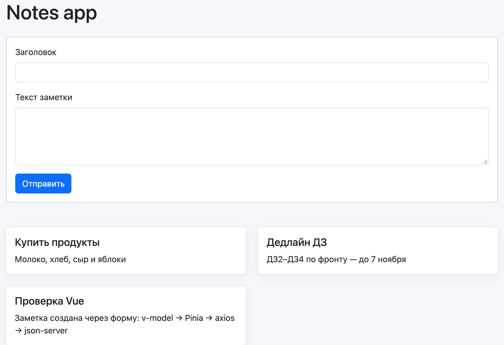
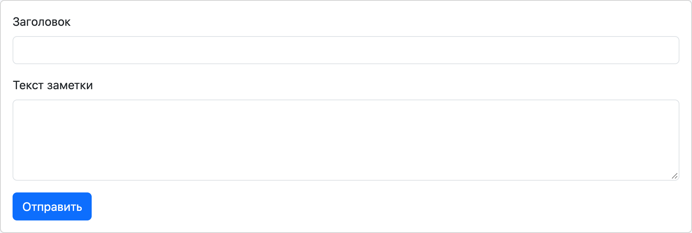
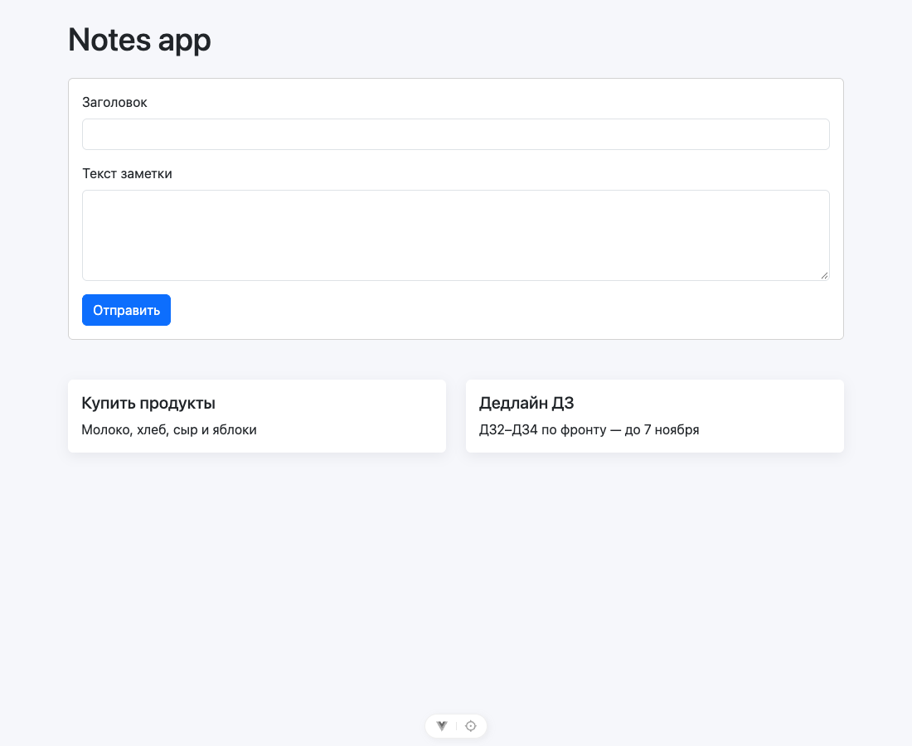
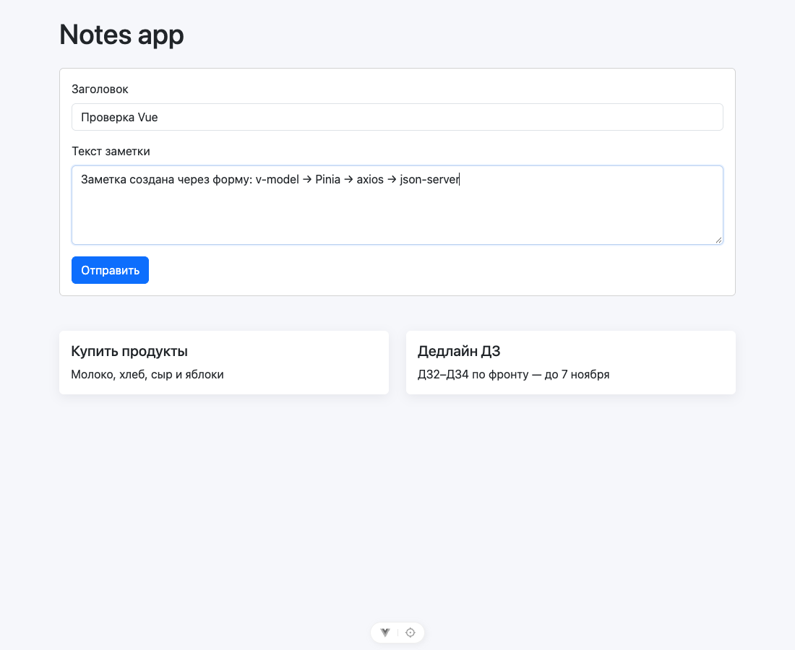
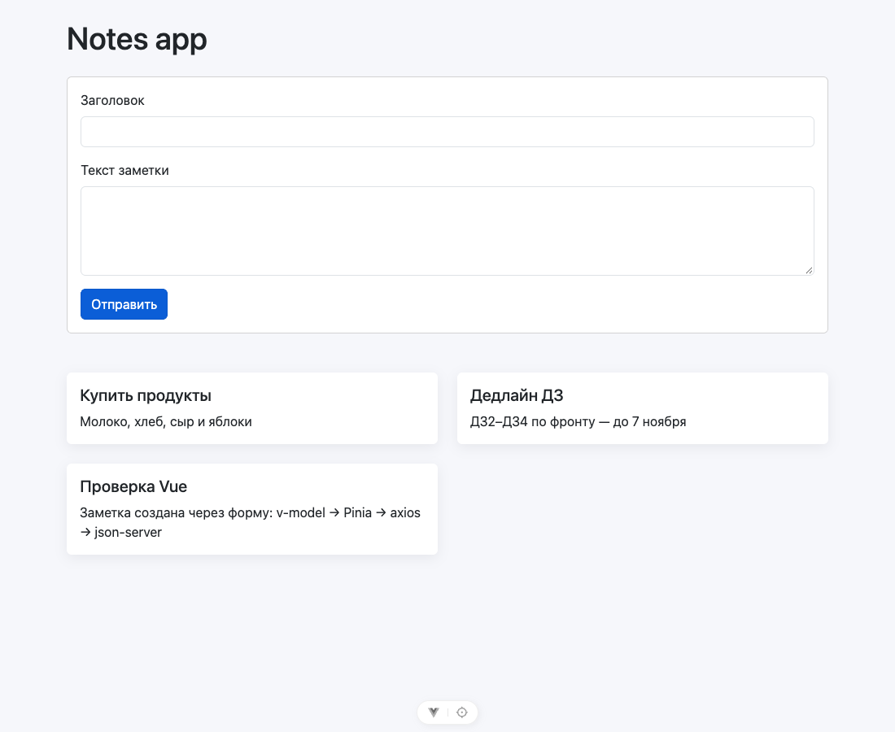

# Домашняя работа 5. Основы npm и Vue.js

**Студент:** Субботин Александр, поток K3439

## Задача

Изучить основные команды пакетного менеджера npm и научиться стартовать проект на Vue по [мануалу курса](https://docs.google.com/document/d/187UkgGNrcWqkb2aCGpkHTLgeozoElMqdVgVGMBOC9gk/edit?usp=sharing). В качестве отчёта — скриншоты компонентов и код получившегося приложения.

По мануалу собрано приложение заметок: список заметок загружается с моковой API на json-server, новую заметку можно добавить через форму.

## Как запустить

```bash
npm install
npm run api     # json-server с заметками на http://localhost:3000
npm start       # приложение на http://localhost:8080 (во втором терминале)
```

## Ход работы

### 1. npm и создание проекта

| Команда | Что делает |
|---|---|
| `npm create vue@latest hw5 -- --router --pinia --eslint` | скачивает и запускает утилиту `create-vue` и создаёт проект с Vue Router, Pinia и ESLint. Флаги после `--` отвечают на вопросы мастера заранее |
| `npm install` | ставит зависимости из `package.json` и фиксирует точные версии в `package-lock.json` |
| `npm i axios pinia-persists bootstrap -S` | ставит библиотеки приложения и записывает их в `dependencies` (`-S` = `--save`) |
| `npm i -D json-server@0.17.4` | ставит json-server как dev-зависимость (`devDependencies`) — он нужен только при разработке |
| `npm start`, `npm run api`, `npm run build`, `npm run lint` | запускают скрипты из секции `scripts` |

В мануале сначала ставится глобальный `@vue/cli` (`npm install -g @vue/cli`, нужны права администратора), а потом вызывается `npm init vue@latest`. Глобальная установка для этого не нужна: `npm create vue` (это то же самое, что `npm init vue`) сам скачивает утилиту `create-vue` на время запуска. Поэтому глобальных пакетов я не ставил.

Версии в проекте новее, чем в мануале: Vue 3.5.44, Vue Router 5.4.0, Pinia 4.1.0, Vite 8.3.5, axios 1.21.0, Bootstrap 5.3.8. Код из мануала с ними работает без изменений.

Секция `scripts` в `package.json` — как в мануале, плюс скрипт `api` для json-server:

```json
"scripts": {
  "start": "vite --port 8080",
  "dev": "vite",
  "api": "json-server --watch db.json --port 3000",
  "build": "vite build",
  "preview": "vite preview",
  "lint": "run-s \"lint:*\"",
  "lint:oxlint": "oxlint . --fix",
  "lint:eslint": "eslint . --fix --cache"
}
```

### 2. Структура проекта

```
src/
├── api/
│   ├── instance.js     # общий экземпляр axios
│   ├── notes.js        # класс NotesApi — запросы к /notes
│   └── index.js        # «IoC-контейнер»: собирает API с конкретным instance
├── stores/
│   ├── index.js        # Pinia + плагин pinia-persists
│   └── notes.js        # хранилище заметок
├── layouts/
│   └── BaseLayout.vue  # обёртка-контейнер со <slot>
├── components/
│   └── NoteCard.vue    # карточка заметки (props)
├── views/
│   └── NotesPage.vue   # страница: форма + список заметок
├── router/index.js     # маршрут «/» → NotesPage (ленивая загрузка)
├── App.vue             # только <router-view />
└── main.js             # подключение Pinia, роутера и Bootstrap
db.json                 # данные json-server
```

### 3. Работа с API: axios

`src/api/instance.js`

```js
import axios from 'axios'

// Моковое API заметок поднимается json-server'ом: npm run api.
// Адрес можно переопределить переменной окружения VITE_API_URL
const apiURL = import.meta.env.VITE_API_URL ?? 'http://localhost:3000'

const instance = axios.create({
  baseURL: apiURL,
})

export default instance
```

`src/api/notes.js`

```js
// Методы для работы с заметками. instance передаётся снаружи (DI),
// поэтому класс не знает, куда именно уходят запросы
class NotesApi {
  constructor(instance) {
    this.API = instance
  }

  getAll = async () => {
    return this.API({
      url: '/notes',
    })
  }

  createNote = async (data) => {
    return this.API({
      method: 'POST',
      url: '/notes',
      data,
      headers: {
        'Content-Type': 'application/json',
      },
    })
  }
}

export default NotesApi
```

`src/api/index.js`

```js
// Корневой модуль API (IoC-контейнер): здесь решаем, с каким instance работает каждый класс
import instance from '@/api/instance'
import NotesApi from '@/api/notes'

const notesApi = new NotesApi(instance)

export { notesApi }
```

Класс `NotesApi` получает экземпляр axios в конструкторе и не знает, куда уходят запросы. Конкретный экземпляр выбирается в одном месте — в `api/index.js`. В мануале это называется принципом DI. Адрес API по умолчанию `http://localhost:3000`, как в мануале. Его можно поменять переменной `VITE_API_URL`.

### 4. Состояние: Pinia и pinia-persists

`src/stores/index.js`

```js
import { persist } from 'pinia-persists'
import { createPinia } from 'pinia'

const pinia = createPinia()

// стейт всех хранилищ сохраняется в localStorage и не сбрасывается при перезагрузке
pinia.use(persist())

export default pinia
```

`src/stores/notes.js`

```js
import { defineStore } from 'pinia'
import { notesApi } from '@/api'

const useNotesStore = defineStore('notes', {
  state: () => ({
    notes: [],
  }),

  actions: {
    async loadNotes() {
      const response = await notesApi.getAll()

      this.notes = response.data

      return response
    },

    async createNote(data) {
      const response = await notesApi.createNote(data)

      // сервер возвращает созданную заметку — добавляем её к списку, а не заменяем им весь список
      this.notes.push(response.data)

      return response
    },
  },
})

export default useNotesStore
```

Одно отличие от мануала. Там `createNote` записывает в `this.notes` ответ сервера, то есть одну созданную заметку вместо всего списка. Список потом всё равно перезагружается, но до этого он на мгновение «схлопывается». Здесь созданная заметка добавляется к списку.

Благодаря `pinia-persists` стейт хранилища лежит в `localStorage` под ключом `pinia_notes` и переживает перезагрузку страницы.

`src/main.js`

```js
import { createApp } from 'vue'

import App from '@/App.vue'
import router from '@/router'
import store from '@/stores'

import 'bootstrap/dist/css/bootstrap.min.css'
import 'bootstrap'
import '@/assets/main.css'

const app = createApp(App)

app.use(store)
app.use(router)

app.mount('#app')
```

`src/App.vue`

```vue
<template>
  <router-view />
</template>
```

### 5. Компоненты

**`NoteCard` — карточка заметки.** Получает `name` и `text` через `props`. Если текста нет, через `v-if`/`v-else` показывает «Без текста».


`src/components/NoteCard.vue`

```vue
<template>
  <article class="card note-card">
    <div class="card-body">
      <h2 class="card-title h5">{{ name }}</h2>
      <p v-if="text" class="card-text">{{ text }}</p>
      <p v-else class="card-text text-body-secondary fst-italic">Без текста</p>
    </div>
  </article>
</template>

<script>
export default {
  name: 'NoteCard',

  // свойства, которые компонент получает от родителя
  props: {
    name: {
      type: String,
      required: true,
    },
    text: {
      type: String,
      required: false,
      default: '',
    },
  },
}
</script>
```

**`BaseLayout` — лейаут.** Задаёт контейнер Bootstrap с отступами. Содержимое страницы подставляется на место `<slot />`.



`src/layouts/BaseLayout.vue`

```vue
<template>
  <main class="container my-4">
    <!-- сюда подставляется содержимое страницы, обёрнутой в лейаут -->
    <slot />
  </main>
</template>

<script>
export default {
  name: 'BaseLayout',
}
</script>
```

**`NotesPage` — представление (страница).** Использует `BaseLayout` и `NoteCard`:
- форма связана с данными компонента через `v-model`, отправка идёт через `@submit.prevent`;
- список выводится через `v-for` с `:key`;
- заметки загружаются в хуке `mounted`;
- состояние и действия хранилища подключены через `mapState` и `mapActions`.



`src/views/NotesPage.vue`

```vue
<template>
  <base-layout>
    <h1>Notes app</h1>

    <form ref="noteForm" class="card card-body my-4" @submit.prevent="createCard">
      <div class="mb-3">
        <label class="form-label" for="noteName">Заголовок</label>
        <input id="noteName" v-model="form.name" type="text" class="form-control" required />
      </div>

      <div class="mb-3">
        <label class="form-label" for="noteText">Текст заметки</label>
        <textarea id="noteText" v-model="form.text" class="form-control" rows="4" />
      </div>

      <div>
        <button type="submit" class="btn btn-primary">Отправить</button>
      </div>
    </form>

    <p v-if="!notes.length" class="text-body-secondary">Заметок пока нет.</p>

    <div v-else id="notes" class="row row-cols-1 row-cols-md-2 g-4 mt-2">
      <div v-for="note in notes" :key="note.id" class="col">
        <note-card :name="note.name" :text="note.text" />
      </div>
    </div>
  </base-layout>
</template>

<script>
import { mapActions, mapState } from 'pinia'

import BaseLayout from '@/layouts/BaseLayout.vue'
import NoteCard from '@/components/NoteCard.vue'
import useNotesStore from '@/stores/notes'

export default {
  name: 'NotesPage',

  components: { BaseLayout, NoteCard },

  data() {
    return {
      form: {
        name: '',
        text: '',
        // пока заметки создаются от пользователя с id 1
        userId: 1,
      },
    }
  },

  computed: {
    ...mapState(useNotesStore, ['notes']),
  },

  mounted() {
    this.loadNotes()
  },

  methods: {
    ...mapActions(useNotesStore, ['loadNotes', 'createNote']),

    async createCard() {
      await this.createNote(this.form)
      await this.loadNotes()

      // reset() очищает поля формы, а v-model — данные компонента
      this.$refs.noteForm.reset()
      this.form.name = ''
      this.form.text = ''
    },
  },
}
</script>
```

`src/router/index.js`

```js
import { createRouter, createWebHistory } from 'vue-router'

const router = createRouter({
  history: createWebHistory(import.meta.env.BASE_URL),
  routes: [
    {
      path: '/',
      name: 'notes',
      // ленивая подгрузка: код страницы скачивается только при первом переходе на неё
      component: () => import('../views/NotesPage.vue'),
    },
  ],
})

export default router
```

Представление и компонент разделены, как в мануале. Маршрут ведёт на представление-страницу, а компонент — это переиспользуемая часть страницы.

### 6. Результат

| Заметки загружены из API | Заполненная форма | Заметка добавлена, форма очищена |
|---|---|---|
|  |  |  |

Проверено в браузере:
- две заметки из `db.json` загружаются;
- новая заметка из формы уходит в json-server (`POST /notes`) и появляется в списке;
- форма после отправки очищается;
- стейт сохраняется в `localStorage`;
- ошибок в консоли нет.

`npm run lint` (oxlint + ESLint) проходит без замечаний, `npm run build` собирает проект.

## Вывод

Освоены основные команды npm: создание проекта через `npm create`, установка зависимостей в `dependencies` и `devDependencies`, работа со скриптами `package.json`, роль `package-lock.json`.

На Vue по мануалу собрано небольшое приложение заметок. В нём есть:
- роутер с ленивой загрузкой страницы;
- деление на представление, компонент и лейаут;
- `props`, `slot`, `v-model`, `v-for`, `v-if`, хук `mounted`;
- общий экземпляр axios и классы API с внедрением зависимостей;
- хранилище Pinia с сохранением в `localStorage`.

Это та же структура, на которую в ЛР3 будет перенесён сайт «Столик».
