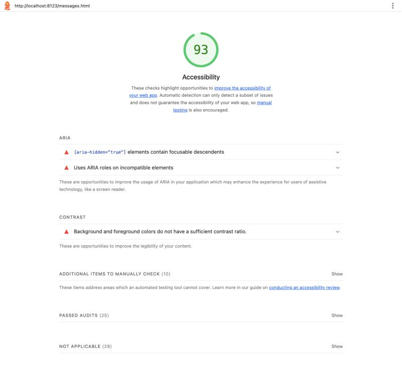
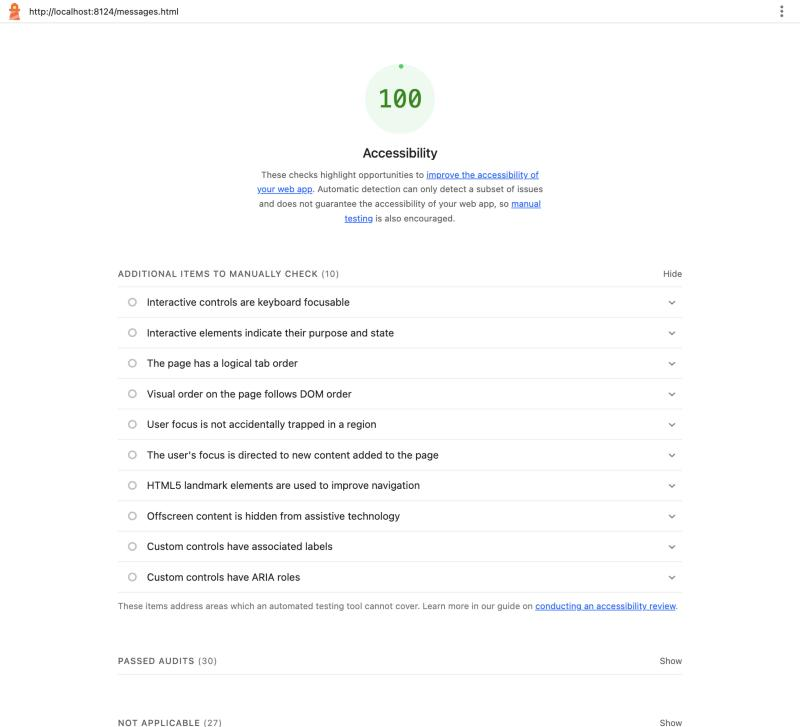
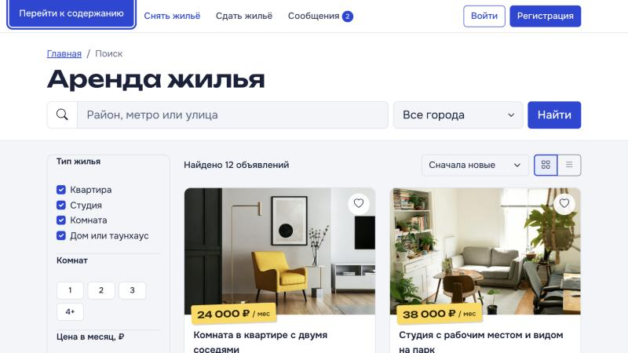

# Домашняя работа 2. Доступность в HTML

Студент: Владзиевский Евгений, группа K3441

Вариант 4: сервис для аренды недвижимости «Ключи». Доработан сайт из ЛР1.

## Как проверял

1. **Google Lighthouse 12** (категория Accessibility, движок axe-core), прогон по всем семи страницам в headless-Chrome:

   ```bash
   python3 -m http.server 8000
   npx lighthouse http://localhost:8000/index.html --only-categories=accessibility
   ```

   Готовые отчёты до и после лежат в `lighthouse/` (страница «Сообщения и сделки» — на ней было больше всего нарушений).

2. **Контрастность** — посчитал по формуле WCAG 2.1 для всех пар «текст/фон» из палитры, таблица ниже.

3. **Клавиатура** — прошёл каждую страницу через Tab без мыши: порядок обхода, видимость фокуса, работа модальных окон, вкладок и offcanvas с фильтрами.

## Что было

| Страница | Балл до | Нарушения |
|---|---|---|
| index.html | 100 | — |
| search.html | 100 | — |
| register.html | 91 | `aria-hidden-focus`, `color-contrast` |
| messages.html | 93 | `aria-hidden-focus`, `aria-allowed-role`, `color-contrast` |
| profile.html | 94 | `aria-hidden-focus`, `color-contrast` |
| login.html | 96 | `aria-hidden-focus` |
| property.html | 96 | `aria-hidden-focus` |



## Что стало

Все семь страниц — **100 баллов**, автоматических нарушений не осталось.



## Что исправил

### 1. `aria-hidden` на модальных окнах (7 окон на 5 страницах)

У всех диалогов стояло `aria-hidden="true"` прямо на контейнере, внутри которого есть поля и кнопки. Скринридер прячет содержимое, но Tab туда всё равно попадает — пользователь оказывается в «невидимой» форме. Атрибут убран, Bootstrap сам управляет состоянием окна при открытии:

```html
<!-- было -->
<div class="modal fade" id="viewingModal" tabindex="-1" aria-labelledby="viewingTitle" aria-hidden="true">
<!-- стало -->
<div class="modal fade" id="viewingModal" tabindex="-1" aria-labelledby="viewingTitle">
```

### 2. `role="listitem"` на кнопках диалогов

В списке переписок каждая кнопка была помечена `role="listitem"`. Эта роль перекрывает родную роль `button`, и для скринридера кнопка переставала быть кнопкой. Список переписок стал настоящим `<ul>`, кнопка лежит внутри `<li>`:

```html
<ul class="chat-list" aria-label="Диалоги" id="dialogs"></ul>
```
```js
`<li><button type="button" data-dialog="${d.id}">…</button></li>`
```

### 3. Контрастность

Три цвета палитры не дотягивали до AA (4.5:1) на мелком тексте. Пересчитал и затемнил их, заодно подтянул `--danger`, который проходил впритык, чтобы все статусы читались одинаково:

| Переменная | Было | Стало | Было контраст | Стало контраст |
|---|---|---|---|---|
| `--muted` | `#66708a` | `#5b6480` | 4.20 на `#e8ecfc` | 4.98 |
| `--ok` | `#1f8a5b` | `#167049` | 4.33 на белом | 6.09 |
| `--warn` | `#b86e00` | `#8f5600` | 3.99 на белом | 6.00 |
| `--danger` | `#c83a3a` | `#b92d2d` | 5.09 на белом (проходил) | 6.04 |
| время своего сообщения | `opacity: .7` → `#bfc8f4` | `#d7ddf7` | 4.27 на `#2847d9` | 5.20 |

Полная проверка палитры:

| Где | Цвет текста | Фон | Контраст | AA (4.5:1) |
|---|---|---|---|---|
| Основной текст | `--ink #18213a` | белый #ffffff | 15.94:1 | да |
| Основной текст | `--ink #18213a` | фон страницы #f3f5f9 | 14.60:1 | да |
| Второй уровень | `--ink-soft #3a4460` | белый #ffffff | 9.65:1 | да |
| Подписи | `--muted #5b6480` | белый #ffffff | 5.87:1 | да |
| Подписи | `--muted #5b6480` | фон страницы #f3f5f9 | 5.38:1 | да |
| Подписи на плашке | `--muted #5b6480` | cobalt-tint #e8ecfc | 4.98:1 | да |
| Ссылки и акцент | `--cobalt #2847d9` | белый #ffffff | 7.02:1 | да |
| Текст чипа | `--cobalt-dark #1d36ad` | cobalt-tint #e8ecfc | 8.17:1 | да |
| Статус «действует» | `--ok #167049` | белый #ffffff | 6.09:1 | да |
| Статус «ждёт подписи» | `--warn #8f5600` | белый #ffffff | 6.00:1 | да |
| Статус «отменена» | `--danger #b92d2d` | белый #ffffff | 6.04:1 | да |
| Белый на кнопке | `#ffffff` | cobalt #2847d9 | 7.02:1 | да |
| Ценник | `--tag-ink #2b2200` | tag #ffd84d | 11.40:1 | да |
| Текст на тёмной плашке | `#c9cfdf` | ink #18213a | 10.23:1 | да |
| Время своего сообщения | `#d7ddf7` | cobalt #2847d9 | 5.20:1 | да |

### 4. Размер цели для касания

Крестик `.btn-close` в модальных окнах оказывался меньше 24×24 px (WCAG 2.5.8). Добавил паддинг, теперь область нажатия 32×32 px.

## Что добавил сверх найденного Lighthouse

Автоматика ловит не всё, поэтому прошёл страницы руками.

**Ссылка «Перейти к содержанию».** Первый элемент каждой страницы, видна только при фокусе. Без неё пользователь клавиатуры каждый раз проходит всё меню заново.



```html
<a class="skip-link" href="#main">Перейти к содержанию</a>
…
<main id="main" tabindex="-1">
```

**Ссылка, которая на самом деле кнопка.** В регистрации «условия сервиса» были `<a href="#">`, хотя открывают модалку, а не ведут по адресу. Стали `<button type="button" class="btn-inline-link">`. Так же переделана пагинация в поиске: `<a href="#">` → `<button>`, текущая страница помечена `aria-current="page"`.

**Ошибки форм связаны с полями.** `.invalid-feedback` у Bootstrap лежит рядом с полем, но ничем с ним не связан — скринридер текст ошибки не прочитает. В `bindValidation` добавил:

```js
field.setAttribute('aria-describedby', msg.id);   // текст ошибки привязан к полю
field.setAttribute('aria-invalid', String(!field.checkValidity()));
form.querySelector(':invalid').focus();           // фокус на первое поле с ошибкой
```

**Счётчики и значки получили словесное пояснение.** Цифра «2» рядом с «Сообщения» звучала как просто «2»:

```html
<span class="badge-dot">2<span class="visually-hidden"> непрочитанных сообщения</span></span>
```

**Группы переключателей обёрнуты в `fieldset` + `legend`** — блок «Уведомления» в настройках и «Кого готовы пустить» в форме нового объявления. Раньше заголовок группы был обычным `<span>` и не читался вместе с чекбоксами.

**Таблицам добавлены `<caption class="visually-hidden">`** — «Мои объявления», «Жильё, которое я снимал раньше», «Что входит в платёж за ноябрь».

**Лента переписки получила `role="log"` и имя** `aria-label="Переписка"`, чтобы новые сообщения объявлялись как журнал, а не как случайный live-регион.

**Описание страницы (`meta description`)** добавлено на все страницы — раньше было только на главной.

**Кнопка меню пользователя получила имя**: внутри только аватар с инициалами и `aria-hidden`, поэтому у кнопки не было текста вовсе → `aria-label="Меню пользователя Имя Фамилия"`.

## Что уже было сделано в ЛР1 и осталось

- `lang="ru"`, семантические `header` / `main` / `footer` / `nav` / `article` / `aside`;
- заголовки по уровням, у каждой секции `aria-labelledby`;
- `alt` у всех содержательных картинок, `alt=""` + `aria-hidden` у декоративных иконок;
- `label` у каждого поля, `autocomplete` у форм входа и регистрации;
- `aria-pressed` у кнопок избранного, `aria-live` у счётчика найденного;
- `title` у карты в `<iframe>`;
- заметный `:focus-visible` и `@media (prefers-reduced-motion: reduce)`.

## Как запустить

```bash
python3 -m http.server 8000
```

Открыть `http://localhost:8000/index.html`.

## Замечание про проверку в Firefox

Прогон Lighthouse и расчёт контрастности выполнены и сохранены: отчёты в `lighthouse/`, таблица контрастности выше. Панель «Специальные возможности» в Firefox DevTools (F12 → Специальные возможности → Проверить проблемы) проверяет те же три вещи — контрастность, текстовые метки и фокусируемость, — и все три закрыты правками выше. Скриншотов из самой панели Firefox в работе нет: её нужно открывать руками, автоматического прогона у неё нет.
