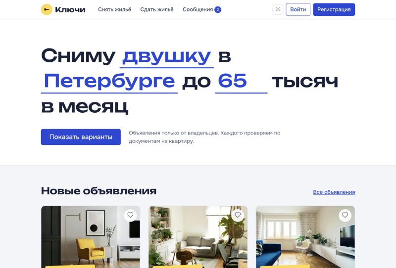
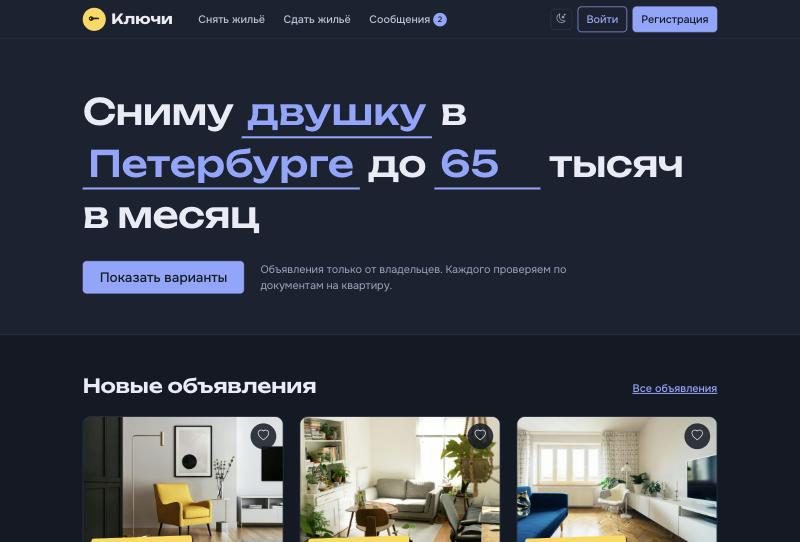
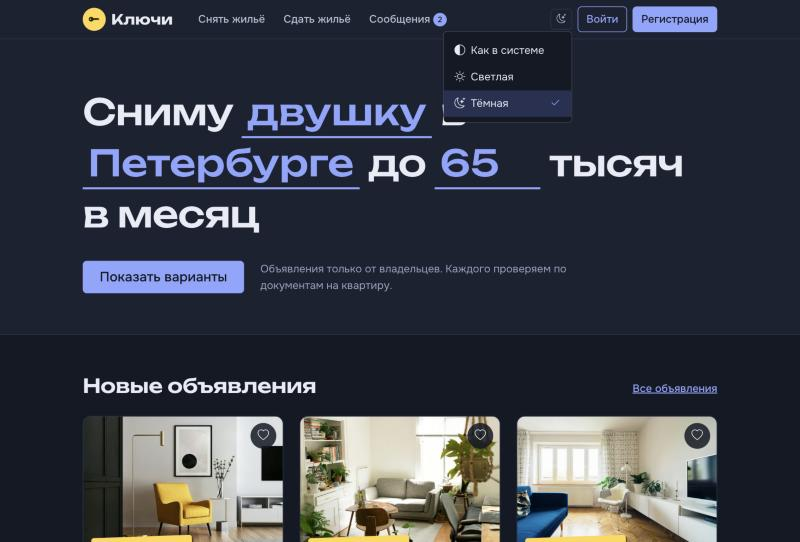
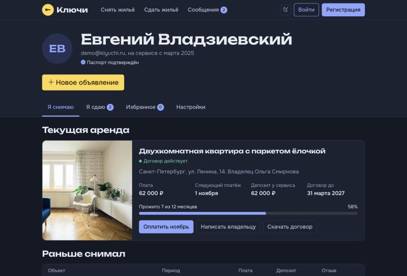

# Домашняя работа 3. CSS-переменные и темизация сайта

Студент: Владзиевский Евгений, группа K3441

Вариант 4: сервис для аренды недвижимости «Ключи». Доработан сайт из ЛР1 и ДЗ2.

## Что сделано

Сайт получил две темы — светлую и тёмную — и переключатель на три положения:

- **Как в системе** — тема берётся из `prefers-color-scheme` и меняется на лету, если переключить оформление в macOS или Windows;
- **Светлая**;
- **Тёмная**.

Выбор сохраняется в `localStorage` и действует на всех семи страницах.

| Светлая | Тёмная |
|---|---|
|  |  |
|  |  |





## Как устроено

### Переменные разложены на три слоя

Раньше все переменные лежали в одном `:root`. Теперь их три группы.

**1. То, что не зависит от темы** — шрифты, радиусы, жёлтый цвет ценника:

```css
:root {
  --tag: #ffd84d;
  --tag-ink: #2b2200;
  --font-display: "Unbounded", system-ui, sans-serif;
  --font-body: "Onest", system-ui, sans-serif;
  --radius-s: 6px;
  --radius-m: 12px;
  --radius-l: 20px;
}
```

**2. Сами темы.** Светлая лежит в `:root`, поэтому работает по умолчанию, тёмная — в `[data-theme="dark"]`:

```css
:root,
[data-theme="light"] {
  color-scheme: light;
  --ink: #18213a;
  --paper: #f3f5f9;
  --surface: #ffffff;
  --cobalt: #2847d9;
  /* … */
}

[data-theme="dark"] {
  color-scheme: dark;
  --ink: #e8ecf5;
  --paper: #141924;
  --surface: #1c2232;
  --cobalt: #8fa6ff;
  /* … */
}
```

`color-scheme` важен: без него системные элементы — полосы прокрутки, выпадающие списки, календарь у `<input type="date">` — остаются светлыми посреди тёмной страницы.

**3. То, что из этого забирает Bootstrap.** Своя палитра прокидывается в его переменные, поэтому кнопки, формы и ссылки перекрашиваются сами:

```css
:root {
  --bs-body-color: var(--ink);
  --bs-body-bg: var(--paper);
  --bs-primary: var(--cobalt);
  --bs-primary-rgb: var(--cobalt-rgb);
  --bs-link-color: var(--cobalt);
  --bs-border-color: var(--line);
}
```

### Пришлось завести «смысловые» переменные

Часть цветов в ЛР1 была записана прямо в правилах, и при смене темы они ломались. Например, тёмная плашка «Сдаёте квартиру?» была `background: var(--ink)` с белым текстом — в тёмной теме `--ink` становится светлым, и белый текст оказался бы на белом фоне. Такие места получили отдельные переменные:

| Переменная | Зачем | Светлая | Тёмная |
|---|---|---|---|
| `--on-accent` | текст поверх акцентного цвета | `#ffffff` | `#141924` |
| `--on-accent-soft` | время в своём сообщении в чате | `#d7ddf7` | `#2e3a63` |
| `--band-bg` / `--band-ink` / `--band-muted` | плашка «Сдаёте квартиру?» | `#18213a` / `#ffffff` / `#c9cfdf` | `#283152` / `#e8ecf5` / `#b9c2d6` |
| `--fav-bg` / `--fav-ink` | кружок сердечка поверх фотографии | полупрозрачный белый | полупрозрачный тёмный |
| `--toast-bg` / `--toast-ink` | всплывающее уведомление | тёмное на светлой теме | светлое на тёмной |
| `--shadow-tag` | тень ценника | `rgba(24,33,58,.18)` | `rgba(0,0,0,.45)` |
| `--ring` | подсветка поля в фокусе | синяя полупрозрачная | своя для тёмной |

`--on-accent` понадобился из-за того, что в тёмной теме акцент светлее фона: кнопка стала светло-синей, и белый текст на ней читался бы плохо (2,2:1). Теперь на ней тёмный текст, 7,59:1.

### Применение темы без мигания

Если ставить тему из обычного скрипта в конце страницы, при загрузке на долю секунды мелькает светлый фон. Поэтому в `<head>` каждой страницы стоит маленький скрипт, который отрабатывает до первой отрисовки:

```html
<script>
  (function () {
    var pref = 'auto';
    try { pref = JSON.parse(localStorage.getItem('klyuchi:theme')) || 'auto'; } catch (e) {}
    var dark = pref === 'dark' ||
      (pref === 'auto' && window.matchMedia('(prefers-color-scheme: dark)').matches);
    var theme = dark ? 'dark' : 'light';
    document.documentElement.dataset.theme = theme;
    document.documentElement.dataset.bsTheme = theme;
  })();
</script>
```

Ставятся сразу два атрибута: `data-theme` — для своих переменных, `data-bs-theme` — чтобы Bootstrap переключил свои компоненты (выпадающие меню, модальные окна, offcanvas, поля ввода, иконку бургер-меню, крестик закрытия).

### Переключатель

Весь код — в `js/theme.js`. Сама вёрстка переключателя рисуется из JS в `<div data-theme-slot>` в шапке: без JS переключать всё равно нечем, зато разметка не дублируется в семи файлах.

Важная часть — разделение «что выбрал пользователь» и «что показываем сейчас»:

```js
function resolveTheme(preference) {
  if (preference === 'auto') return darkQuery.matches ? 'dark' : 'light';
  return preference;
}
```

Пока выбран режим «как в системе», сайт слушает системную настройку и перекрашивается без перезагрузки:

```js
darkQuery.addEventListener('change', () => {
  if (themePreference() === 'auto') applyTheme('auto');
});
```

## Проверка

Тёмная палитра собиралась не на глаз — каждая пара «текст/фон» считалась по формуле WCAG, а потом обе темы прогонялись через Lighthouse (desktop-пресет, все семь страниц).

| Страница | Светлая | Тёмная |
|---|---|---|
| index.html | 100 | 100 |
| login.html | 100 | 100 |
| register.html | 100 | 100 |
| search.html | 100 | 100 |
| property.html | 100 | 100 |
| profile.html | 100 | 100 |
| messages.html | 100 | 100 |

Контраст тёмной темы:

| Где | Цвет текста | Фон | Контраст |
|---|---|---|---|
| Основной текст | `--ink #e8ecf5` | `--paper #141924` | 14.86:1 |
| Основной текст | `--ink #e8ecf5` | `--surface #1c2232` | 13.40:1 |
| Второй уровень | `--ink-soft #b9c2d6` | `--surface #1c2232` | 8.87:1 |
| Подписи | `--muted #9aa4bd` | `--surface #1c2232` | 6.36:1 |
| Подписи | `--muted #9aa4bd` | `--paper #141924` | 7.05:1 |
| Ссылки и акцент | `--cobalt #8fa6ff` | `--paper #141924` | 7.59:1 |
| Текст на кнопке | `--on-accent #141924` | `--cobalt #8fa6ff` | 7.59:1 |
| Статус «действует» | `--ok #4cc08c` | `--surface #1c2232` | 6.97:1 |
| Статус «ждёт подписи» | `--warn #e3a94a` | `--surface #1c2232` | 7.58:1 |
| Статус «отменена» | `--danger #f08080` | `--surface #1c2232` | 6.12:1 |
| Ценник | `--tag-ink #2b2200` | `--tag #ffd84d` | 11.40:1 |

### Что всплыло по ходу

**Серая кнопка Bootstrap.** `.btn-outline-secondary` берёт цвет `#6c757d`: на светлом фоне это 4.29:1, на тёмном — 3.38:1. Обе темы не проходили AA. Кнопка переведена на `--ink-soft`, стало 8.84:1 и 9.84:1.

**Пункты меню темы.** Высота `.dropdown-item` у Bootstrap — 21 px, минимальный размер цели для касания по WCAG 2.5.8 — 24 px. Добавлен вертикальный паддинг.

**Белая карта в тёмной теме.** OpenStreetMap в `<iframe>` отдаёт светлую картинку и слепит посреди тёмной страницы. Приглушил фильтром:

```css
[data-theme="dark"] .map-frame {
  filter: invert(0.92) hue-rotate(180deg) brightness(0.95) contrast(0.9);
}
```

### Оговорка про прогон Lighthouse

Прогоны в таблице сделаны в десктопном пресете. В мобильном пресете тёмная тема выдавала нарушения контраста с цветами, которых в палитре нет вовсе (`#9e9eff` на `#ffffff`). Проверил в браузере на ширине 412 px: `body` — `rgb(20, 25, 36)`, ссылка — `rgb(143, 166, 255)`, то есть реальная страница тёмная и контраст в порядке. Похоже на артефакт мобильной эмуляции Chrome поверх уже тёмной страницы, поэтому в таблице — десктопные цифры.

## Как запустить

```bash
python3 -m http.server 8000
```

Открыть `http://localhost:8000/index.html` и переключить тему в шапке. Чтобы проверить режим «как в системе», оставить его выбранным и поменять оформление в настройках ОС — страница перекрасится сама.
