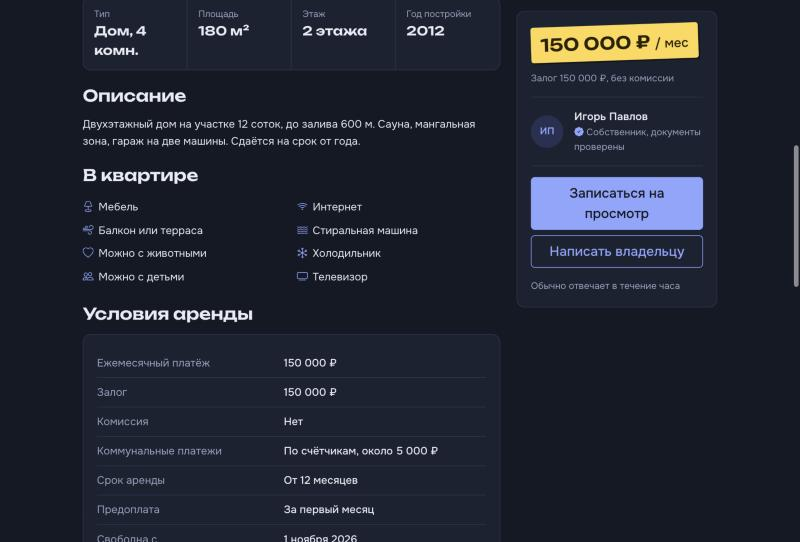
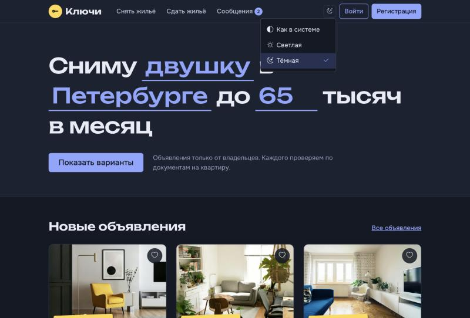

# Домашняя работа 4. SVG-спрайт

Студент: Владзиевский Евгений, группа K3441

Вариант 4: сервис для аренды недвижимости «Ключи». Доработан сайт из ЛР1, ДЗ2 и ДЗ3.

## Задача

В ЛР1 иконки подключались шрифтом Bootstrap Icons с CDN: `<i class="bi bi-key-fill">`. Иконок в проекте 32, а шрифт тянет за собой все 2050. По заданию их нужно собрать в один SVG-спрайт.

## Что сделано

Все 32 иконки лежат в `img/sprite.svg` как `<symbol>`, подключение шрифта убрано со всех семи страниц.

```html
<!-- было -->
<link href="https://cdn.jsdelivr.net/npm/bootstrap-icons@1.11.3/font/bootstrap-icons.min.css" rel="stylesheet">
...
<i class="bi bi-key-fill" aria-hidden="true"></i>

<!-- стало -->
<svg class="icon" aria-hidden="true"><use href="img/sprite.svg#key-fill"></use></svg>
```







## Как устроен спрайт

Файл — обычный SVG, внутри `<symbol>` с `id` и своим `viewBox`:

```xml
<svg xmlns="http://www.w3.org/2000/svg" style="display: none">
  <symbol id="key-fill" viewBox="0 0 16 16">
    <path d="M3.5 11.5a3.5 3.5 0 1 1 3.163-5H14L15.5 8 14 9.5l-1-1-1 1-1-1-1 1-1-1-1 1H6.663a3.5 3.5 0 0 1-3.163 2M2.5 9a1 1 0 1 0 0-2 1 1 0 0 0 0 2"/>
  </symbol>
  <!-- ещё 31 символ -->
</svg>
```

`style="display: none"` нужен, чтобы спрайт не занимал места, если его когда-нибудь вставят прямо в страницу. `viewBox` обязателен на каждом символе: без него браузер не знает систему координат и иконка не отрисуется.

### Сборка

Руками копировать 32 файла неудобно, поэтому спрайт собирается скриптом `tools/build-sprite.mjs` из пакета `bootstrap-icons`:

```bash
npm i bootstrap-icons@1.11.3
node tools/build-sprite.mjs img/sprite.svg key-fill search heart heart-fill ...
```

Скрипт берёт каждый файл `node_modules/bootstrap-icons/icons/<имя>.svg`, вытаскивает из него `viewBox` и внутренности тега `<svg>`, и заворачивает в `<symbol>`.

### Стили

Один класс на все иконки:

```css
.icon {
  width: 1em;
  height: 1em;
  fill: currentColor;
  vertical-align: -0.125em;
  flex-shrink: 0;
}
```

`width/height` в `em` — иконка масштабируется вместе с текстом рядом. `fill: currentColor` — иконка принимает цвет родителя, поэтому в тёмной теме из ДЗ3 ничего отдельно перекрашивать не пришлось, а правило «неактивное удобство — серое» осталось однострочным:

```css
.amenities .icon { color: var(--cobalt); margin-right: 0.45rem; }
.amenities li.no .icon { color: var(--muted); }
```

### Динамические иконки

Часть иконок подставляется из JS. Там менялось только имя символа:

```js
// js/main.js — кнопка избранного
btn.innerHTML = `<svg class="icon" aria-hidden="true">
  <use href="img/sprite.svg#${active ? 'heart-fill' : 'heart'}"></use></svg>`;

// js/property.js — список удобств
const amenities = [
  ['lamp', 'Мебель', item.furniture],
  ['wind', 'Балкон или терраса', item.balcony],
  // …
];
`<svg class="icon" aria-hidden="true">
  <use href="img/sprite.svg#${yes ? icon : 'x-lg'}"></use></svg>`
```

## Что это дало

| | Было (шрифт) | Стало (спрайт) |
|---|---|---|
| Файлы | `bootstrap-icons.min.css` + `bootstrap-icons.woff2` | `img/sprite.svg` |
| Размер | 85 875 + 130 396 = **211 КБ** | **16.4 КБ** |
| Размер по сети | 13.4 КБ (css в gzip) + 127 КБ (woff2 уже сжат) ≈ **140 КБ** | **5.3 КБ** (gzip) |
| Иконок внутри | 2050 (нужны 32) | 32 |
| Запросов | 2 (css, затем шрифт) | 1 |
| Зависимость от CDN | есть | нет, файл свой |

Кроме размера есть разница по сути: глиф шрифта — это текст, и его может подменить пользовательский шрифт или режим чтения; `<symbol>` — это графика, она рисуется как задумано.

## Список иконок в спрайте

`check2`, `chevron-down`, `circle-half`, `eye`, `eye-slash`, `geo-alt`, `grid`, `heart`, `heart-fill`, `house-door`, `key-fill`, `lamp`, `link-45deg`, `list`, `moon-stars`, `patch-check-fill`, `people`, `plus-lg`, `search`, `send`, `shield-check`, `signpost-2`, `sliders`, `snow`, `star-fill`, `sun`, `three-dots`, `tv`, `water`, `wifi`, `wind`, `x-lg`.

Исходники — [Bootstrap Icons](https://icons.getbootstrap.com) 1.11.3, лицензия MIT.

## Доступность

Иконки декоративные, подпись всегда рядом текстом, поэтому у каждой `aria-hidden="true"`. Там, где рядом текста нет (кнопка отправки сообщения, кнопка избранного, крестик), у самой кнопки есть `aria-label` — это осталось с ДЗ2. После замены шрифта на спрайт прогнал Lighthouse ещё раз по всем семи страницам: по-прежнему **100** на каждой.

## Оговорка про `file://`

`<use href="img/sprite.svg#id">` — ссылка на внешний файл. Браузеры не дают загрузить его, если страница открыта двойным кликом по `file://`: иконки просто не появятся. По http всё работает, поэтому запускать надо через сервер:

```bash
python3 -m http.server 8000
```

Открыть `http://localhost:8000/index.html`.
