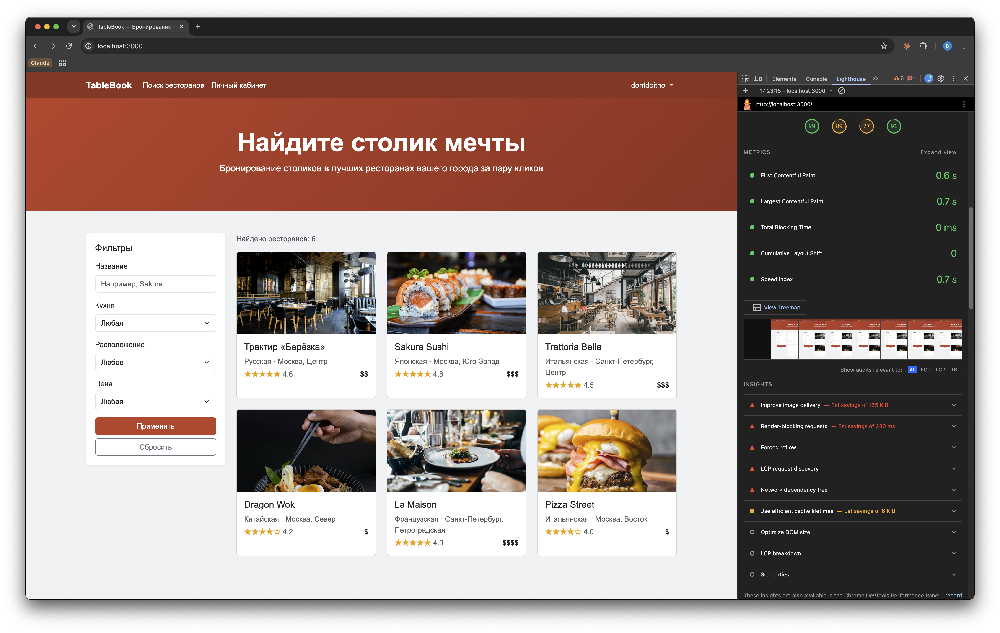
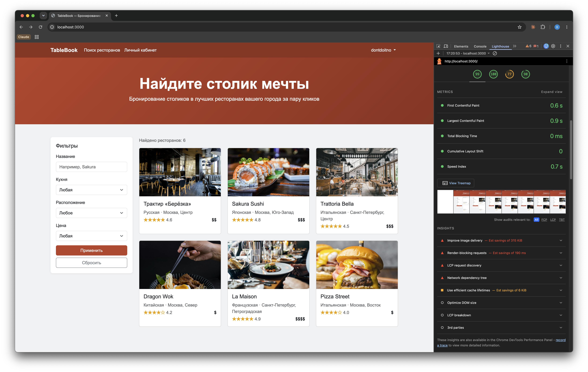
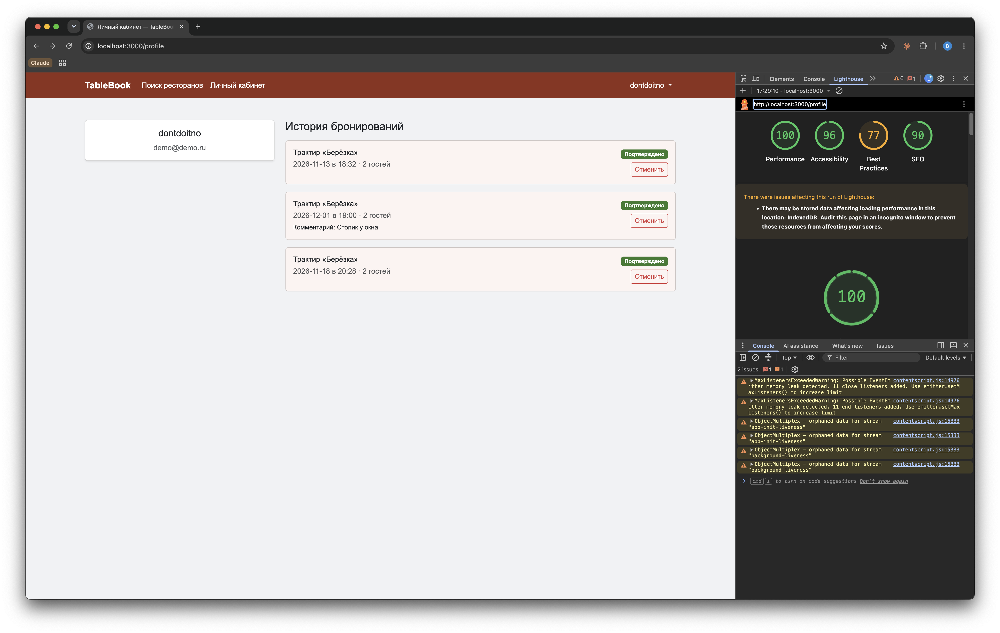
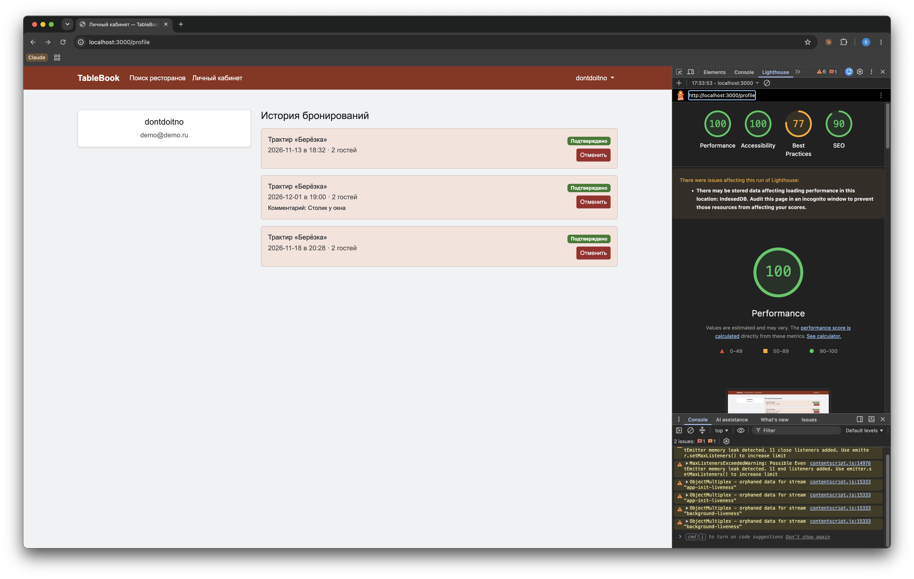
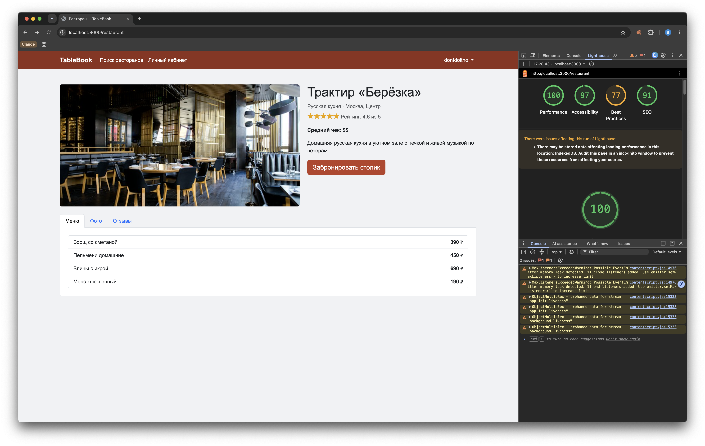

# Отчёт по доступности — TableBook (hw-2)

За основу взят сайт из lab-2 (бронирование столиков). Ниже перечислено, что именно изменено,
для какой группы пользователей это важно и в каком файле/месте правка сделана. Проверка проведена
инструментами Firefox DevTools (Accessibility Inspector) и Google Lighthouse (вкладка Accessibility).

## 0. Скриншоты Lighthouse: до / после

| Страница | До изменений | После изменений |
|---|---|---|
| Поиск ресторанов (`index.html`) | Accessibility **89**    | Accessibility **100**    |
| Личный кабинет (`profile.html`) | Accessibility **96**    | Accessibility **100**    |
| Страница ресторана (`restaurant.html`) | — (замеров «до» не делали) | Accessibility **97**    |

## 1. Навигация с клавиатуры и структура страницы

- **Skip-link «Перейти к основному содержимому»** добавлен первым элементом `<body>` на всех
  страницах (`index.html`, `profile.html`, `register.html`, `login.html`, `restaurant.html`).
  Для пользователей экранных читалок и клавиатурной навигации — позволяет пропустить повторяющееся
  меню и попасть прямо в `<main id="main-content">`.
- Навигация обёрнута в семантический `<header>` (во всех HTML-файлах), добавлен `aria-label="Основная навигация"`
  на `<nav>` — чтобы пользователи скринридеров сразу понимали назначение блока при обходе по лэндмаркам.
- Кнопка-гамбургер (`.navbar-toggler`, все страницы) получила `aria-controls="navMenu"`,
  `aria-expanded="false"` и `aria-label="Открыть меню навигации"` — ранее это была пустая кнопка
  без доступного имени, нечитаемая скринридером.
- Активный пункт меню помечен `aria-current="page"` (ссылки «Поиск ресторанов» / «Личный кабинет»)
  — пользователи скринридеров узнают, на какой странице они находятся.
- Заголовки приведены в логическую иерархию: `h1` — заголовок страницы/ресторана, `h2` — разделы
  («Фильтры», «История бронирований», скрытый `h2` «Результаты поиска» в `index.html`), `h3` — карточки
  ресторанов и позиции бронирований (`js/search.js`, `js/profile.js`). Раньше карточки ресторанов и
  профиль использовали `h5`, пропуская уровни.

## 2. Карточка ресторана: доступность для клавиатуры (index.html / js/search.js)

- **Было:** карточка — это `
`, недоступная ни с клавиатуры, ни для скринридера
  (нет роли, нет фокуса).
- **Стало:** карточка превращена в семантическую ссылку `<a href="restaurant.html?id=...">`
  (`js/search.js`, функция `restaurantCardHtml`). Теперь карточка полностью управляется клавишей Tab
  и Enter, имеет видимый `:focus-visible` контур (`css/style.css`), и единое `aria-label` с названием,
  кухней, городом, рейтингом и ценовой категорией — вместо разрозненных визуальных фрагментов.
- Декоративное изображение внутри карточки получило `alt=""` и `aria-hidden="true"`, так как вся
  информация о ресторане уже озвучена через `aria-label` ссылки (без этого скринридер дублировал бы
  название ресторана как `alt` картинки и как заголовок карточки).

## 3. Звёздный рейтинг и иконки (js/data.js, js/restaurant.js, js/search.js)

- Символы «★/☆» — чисто визуальная иллюстрация числового рейтинга. Везде, где рядом есть видимое
  число (`4.5`, «Рейтинг: 4.5 из 5»), блок со звёздами скрыт от вспомогательных технологий через
  `aria-hidden="true"`, чтобы скринридер не зачитывал бессмысленный набор символов.
- В отзывах (`restaurant.html`, блок «Отзывы»), где рядом нет отдельного числового значения,
  звёздам присвоен `aria-label="Оценка: N из 5"`.
- Цена (`$$$`) сопровождается `aria-label` с текстовым уровнем цены («Бюджетно/Средне/Дорого/Премиум»)
  — иначе пользователь скринридера слышал бы просто «доллар доллар доллар».

## 4. Формы (register.html, login.html, restaurant.html — модалка бронирования)

- Для **всех** полей форм добавлены атрибуты `for`/`id`, связывающие `<label>` с полем ввода. Ранее
  подписи визуально стояли рядом, но программно не были связаны с полями — скринридер объявлял только
  тип поля («edit text»), без названия («Имя», «Email» и т.д.).
- Поля с валидацией получили `aria-describedby`, указывающий на текст подсказки/ошибки
  (`.invalid-feedback`) — при фокусе на поле скринридер теперь зачитывает требование («Пароль должен
  содержать не менее 4 символов») вместе с названием поля.
- Блоки с серверными ошибками (`#login-error`, `#register-error`, `#booking-error`) получили
  `role="alert"` и `aria-live="assertive"` — сообщение об ошибке теперь объявляется автоматически,
  без необходимости искать его глазами на странице.
- В `js/auth.js` при неуспешной отправке формы фокус переводится на первое невалидное поле
  (`form.querySelector(':invalid')?.focus()`) — упрощает работу клавиатурным и скринридер-пользователям,
  которым иначе пришлось бы заново искать проблемное поле.

## 5. Динамический контент и живые регионы

- Счётчик результатов поиска `#results-count` (`index.html`) и блок «Ничего не найдено» получили
  `role="status" aria-live="polite"` — пользователи скринридеров слышат про изменение результатов
  фильтрации без повторного обхода страницы.
- Список бронирований в личном кабинете (`#bookings-list`, `js/profile.js`) и предупреждение о
  необходимости войти перед бронированием (`#booking-login-warning`) помечены `role="status"`/`aria-live`
  — актуально после отмены бронирования или открытия модалки неавторизованным пользователем.
- Toast об успешном бронировании (`restaurant.html`) получил `aria-live="assertive"` и `aria-atomic="true"`
  в дополнение к уже имевшемуся `role="alert"` — сообщение зачитывается целиком и сразу.

## 6. Модальное окно и вкладки (restaurant.html, js/restaurant.js)

- Модалка бронирования получила `aria-labelledby="bookingModalTitle"`, ссылающийся на заголовок —
  при открытии скринридер объявляет название диалога («Бронирование столика»), а не пустое окно.
- Заголовок модалки переведён из `h5` в семантический `h2` (визуально выглядит как `h5` благодаря
  Bootstrap-классу) — чтобы не терялась иерархия заголовков страницы.
- Кнопки закрытия (`.btn-close` в модалке и toast'е) получили `aria-label="Закрыть окно бронирования"`
  / `aria-label="Закрыть уведомление"` — иконки-кресты без текста ранее не имели доступного имени.
- Вкладки «Меню / Фото / Отзывы» дополнены полным набором ARIA для паттерна Tabs: `role="tablist"`,
  `role="tab"` + `aria-selected` на кнопках, `role="tabpanel"` + `aria-labelledby` + `tabindex="0"`
  на содержимом вкладок. `aria-selected` обновляется в коде при переключении вкладки (слушатель
  `shown.bs.tab`). Ранее переключение вкладок не было объявлено скринридерам никак.
- Изображения в галерее «Фото» получили содержательный `alt` с номером фото и названием ресторана
  вместо одинакового `alt="Фото {name}"` на всех снимках.

## 7. Контраст цвета

- Статус бронирования «Ожидает» (`.status-badge-pending`, `css/style.css`) перекрашен с `#f9a825`
  на `#b06a00` — исходный жёлто-оранжевый с белым текстом Bootstrap-бейджа не проходил контраст 4.5:1
  (WCAG AA) для людей со слабым зрением; новый цвет проходит проверку.
- Личный кабинет (`profile.html` / `css/style.css`), карточка бронирования `.booking-history-item`:
  фон сделан более насыщенным (`#fdf4f2` → `#f6e2dc`), а `text-muted` внутри карточки переопределён на
  тёмно-серый `#55504f !important` — исходный светло-розовый фон с серым Bootstrap-текстом `text-muted`
  не проходил контраст 4.5:1 (Lighthouse: «Background and foreground colors do not have a sufficient
  contrast ratio»). Пробовали добавить акцентную левую границу карточки для дополнительного визуального
  разделения, но это распознанный шаблонный приём ИИ-дизайна («side-tab accent border»), поэтому границу
  убрали — контраста фона и текста достаточно и без неё.
- Кнопка «Отменить» (`.cancel-btn`, `css/style.css`): была `btn btn-outline-danger` — красный текст
  `#dc3545` на светлом фоне, контраст на грани/ниже порога 4.5:1. Заменена на сплошную заливку
  `#a41e2d` с белым текстом (контраст ≈7.4:1), hover/focus — `#7e1620` (контраст ещё выше). Правка
  затрагивает только людей со слабым зрением/нарушением цветового восприятия, которым нужно читать
  текст кнопки, не ориентируясь на цвет.
