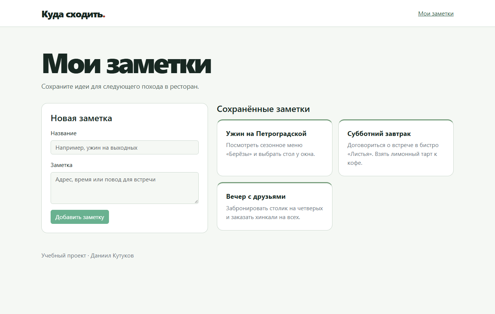
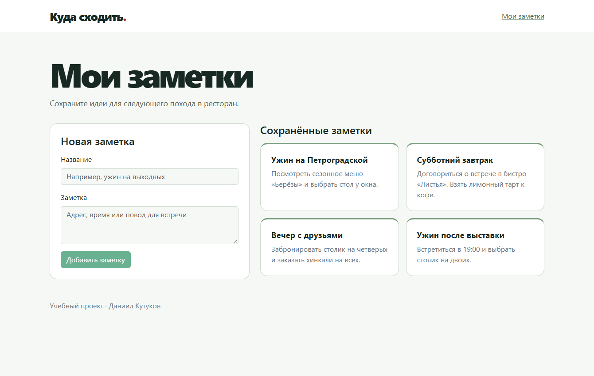

# Домашняя работа 5. npm и Vue

**Исполнитель** — Даниил Кутуков, К3439.

«Куда сходить» — записная книжка с идеями для походов в ресторан. Приложение собрано на Vue и Vite по методичке курса. `NoteForm` отправляет данные формы, `NoteCard` показывает отдельную заметку, `NotesView` связывает эти компоненты с хранилищем Pinia. Vue Router открывает представление по адресу `/notes`. Заметки записываются в JSON Server через Axios и доступны после перезагрузки.

## Команды npm

Из этой папки выполните `npm ci`, чтобы установить версии из `package-lock.json`. Команда `npm install` устанавливает зависимости и при необходимости обновляет lock-файл. `npm install <пакет>` добавляет зависимость, ключ `-D` сохраняет её в `devDependencies`.

В первом терминале запустите `npm run api`, во втором — `npm start`. Откройте [записную книжку](http://localhost:8080/notes). `npm run build` создаёт production-сборку, `npm run preview` позволяет проверить её локально при запущенном API.

## Скриншоты компонентов

