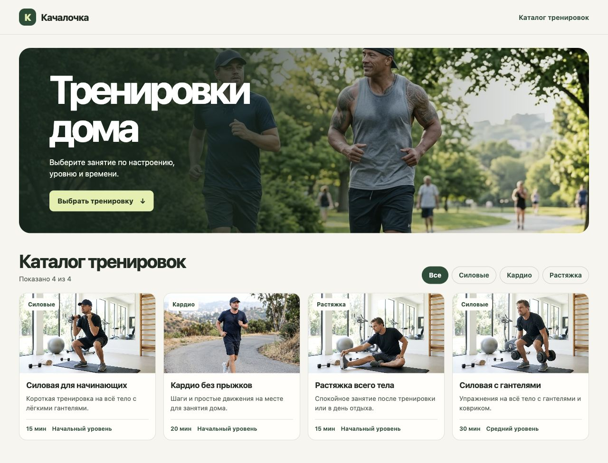
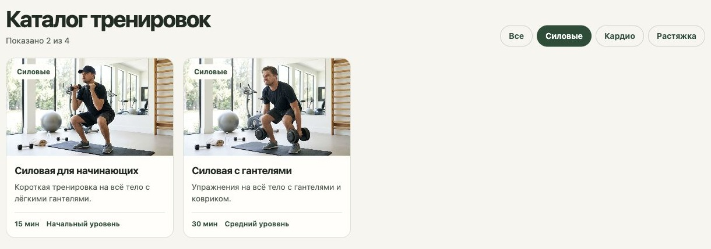

<!-- @suppress structural-heading -->

# Домашняя работа 5. Основы npm и Vue

Проект создан командой `npm create vue@latest`. Зависимости установлены через `npm install`. Приложение запущено через `npm run dev` и собрано командой `npm run build`.

Компонент `WorkoutCard` отображает данные тренировки, полученные через свойства. Компонент `WorkoutFilter` передаёт выбранную категорию через `v-model`.

Проверены все категории. При открытии отображаются четыре карточки (рисунок [рис:catalog]). После выбора «Силовые» остаются две (рисунок [рис:filter]).

Рисунок {catalog} - Каталог со всеми тренировками

Рисунок {filter} - Каталог с выбранной категорией «Силовые»
