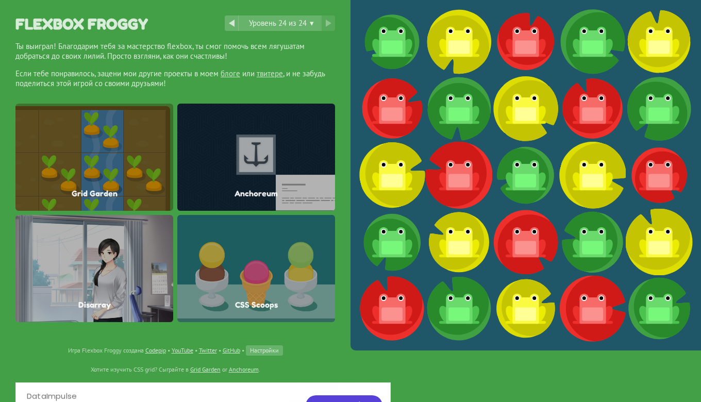
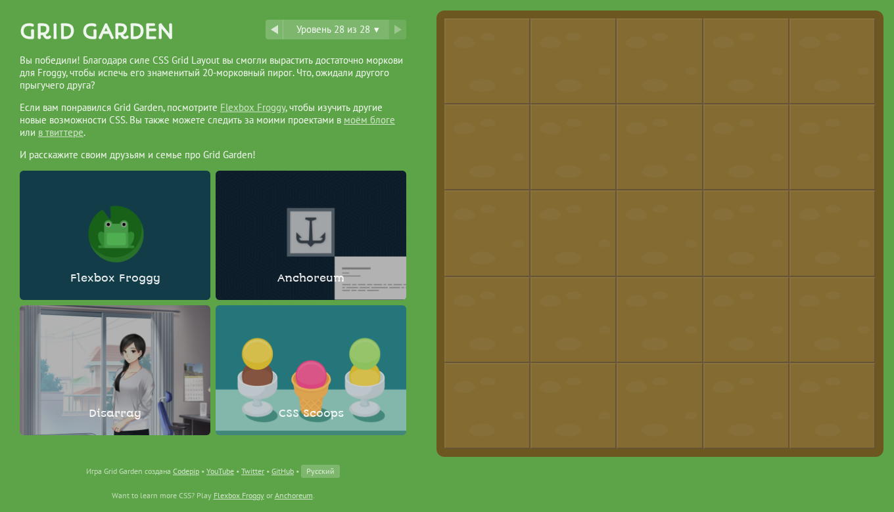
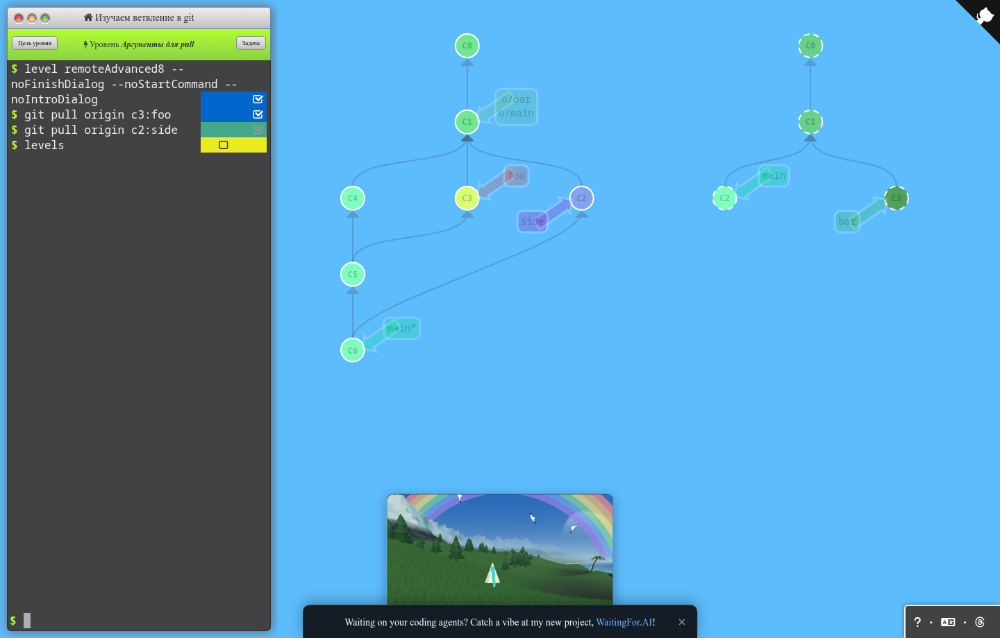
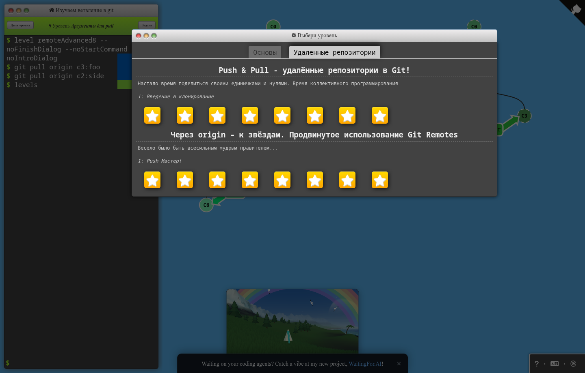

# Задача

Пройти все уровни Flexbox Froggy и CSS Grid Garden. В Learn Git Branching пройти четыре вводных урока и все уроки вкладки «Удаленные репозитории».

# Ход работы

## Flexbox Froggy · 24 из 24

В упражнениях по расположению элементов использованы `justify-content`, `align-items` и `align-self`. Направление главной оси задаёт `flex-direction`, а `align-content` распределяет строки при переносе. В финальном уровне направление `column-reverse` сочетается с `wrap-reverse` и выравниванием по обеим осям.

## CSS Grid Garden · 28 из 28

В начале работы элементы размещались по линиям сетки и с помощью `span`. В следующих уровнях применены `grid-area`, `repeat()` и единицы `fr`. В 26-м уровне задана сетка из пяти строк с размерами `50px 0 0 0 1fr`. В финальном уровне запись `grid-template: 1fr 50px / 20% 1fr` задаёт два ряда и две колонки.

## Learn Git Branching · 20 уровней

| Раздел | Что выполнено |
|---|---|
| Введение (4 из 4) | Коммиты, создание и переключение веток, слияние и перебазирование. |
| Удалённые репозитории, вводная часть (8 из 8) | Клонирование, удалённые ветки, `fetch`, `pull`, имитация работы коллеги, `push`, `pull --rebase` и защищённая ветка. |
| Удалённые репозитории, расширенная часть (8 из 8) | Публикация и слияние нескольких веток, отслеживание, явные источники и назначения для `push`, `fetch` и `pull`, удаление ссылок через пустой источник. |

# Вывод

Flexbox удобен для выравнивания вдоль оси и переноса элементов, а Grid позволяет задать строки и колонки одновременно. В упражнениях по Git видно, что `fetch` обновляет ссылки на удалённые ветки, а `pull` дополнительно интегрирует изменения в локальную ветку. `push` отправляет локальные изменения в удалённый репозиторий.
