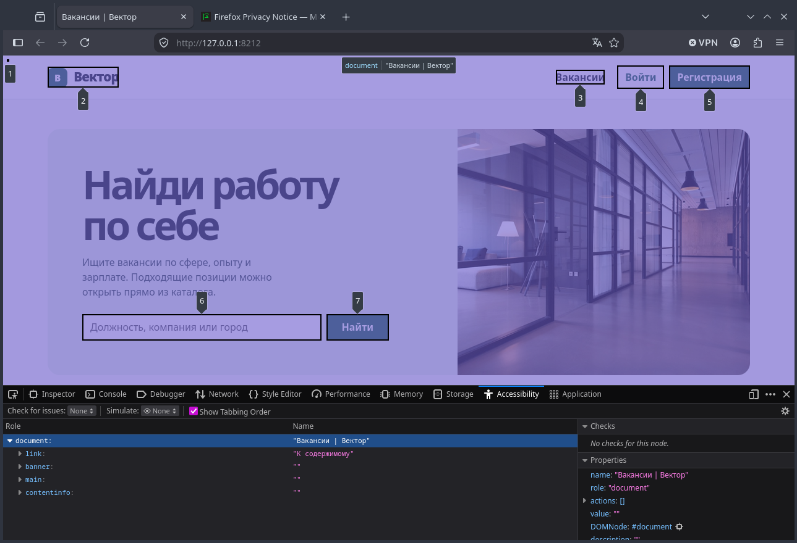

# Задача

Повысить доступность страниц сайта поиска работы «Вектор» и проверить получившийся интерфейс с помощью Firefox DevTools и Lighthouse.

# Ход работы

На страницах выделены основное содержимое, навигация и поиск. Ссылка «К содержимому» позволяет перейти к основному разделу с клавиатуры. После поиска фокус переносится на заголовок результатов. Контур фокуса виден на ссылках и полях ввода.

У полей есть подписи, а подсказки связаны с ними через `aria-describedby`. Атрибут `autocomplete` помогает при заполнении подходящих полей. Количество найденных вакансий и результаты отправки форм обновляются в областях `role="status"`. Ошибки выводятся через `role="alert"`.

## Проверка в Firefox

В Accessibility Inspector просмотрено дерево доступности каталога. Режим Show Tabbing Order показывает переходы по ссылкам меню, полю и кнопке поиска. Отдельно проверены переход к содержимому по Enter и перемещение фокуса после поиска.

## Проверка в Lighthouse

Для кабинетов использованы два тестовых аккаунта с разными ролями. Оценки получены в Lighthouse 13.6.0 с мобильным профилем. Данные по отдельным проверкам сохранены в `evidence/lighthouse.json`.

| Страница | Accessibility |
|---|---:|
| Каталог | 100 |
| Карточка вакансии | 100 |
| Вход | 100 |
| Регистрация | 100 |
| Кабинет соискателя | 100 |
| Кабинет работодателя | 100 |

# Вывод

Проверка с клавиатуры подтвердила, что можно перейти к содержимому и запустить поиск. Динамические состояния имеют текстовые сообщения, а все шесть страниц получили 100 баллов в категории Accessibility.
