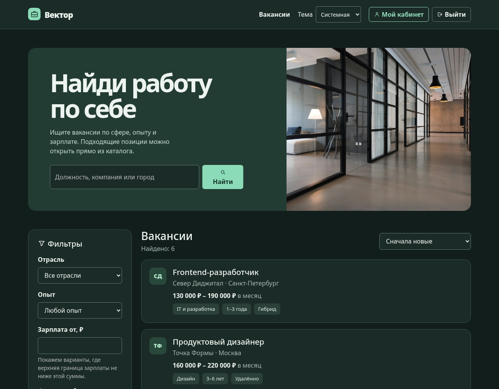

# Задача

Создать общий SVG-спрайт сайта «Вектор» и подключить пять иконок к интерфейсу.

# Ход работы

В `site/assets/icons.svg` добавлены пять элементов `symbol` с отдельными идентификаторами и общей сеткой `viewBox="0 0 24 24"`.

| Символ | Где используется |
|---|---|
| `briefcase` | Логотип «Вектор» |
| `search` | Кнопка «Найти» |
| `filter` | Заголовок «Фильтры» |
| `account` | Ссылка «Мой кабинет» |
| `sign-out` | Кнопка «Выйти» |

Иконки подключены через `use`. Пример для кнопки поиска.

```html
<svg class="icon" aria-hidden="true" focusable="false">
  <use href="assets/icons.svg#search"></use>
</svg>
```

Обводка использует `currentColor`, поэтому цвет иконок зависит от текста и выбранной темы. Текстовые подписи остаются видимыми. Декоративные иконки скрыты от скринридера через `aria-hidden`.

## Проверка

В Chromium открыли каталог под тестовым аккаунтом соискателя. Запрос к `icons.svg` вернул HTTP 200. На странице отрисовались все пять иконок, а кнопки «Найти» и «Выйти» сохранили доступные имена. Выход из аккаунта вернул в меню ссылку «Войти».



# Вывод

Пять иконок хранятся в одном файле и используются повторно на страницах. Цвет следует оформлению элементов, а их назначение передаётся текстовыми подписями.
