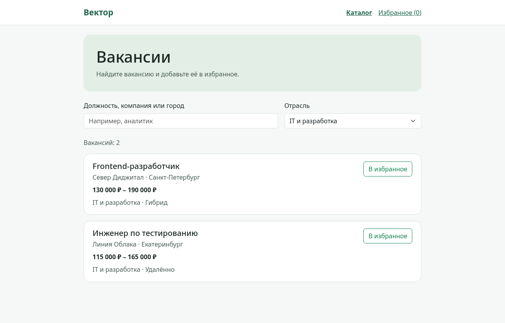
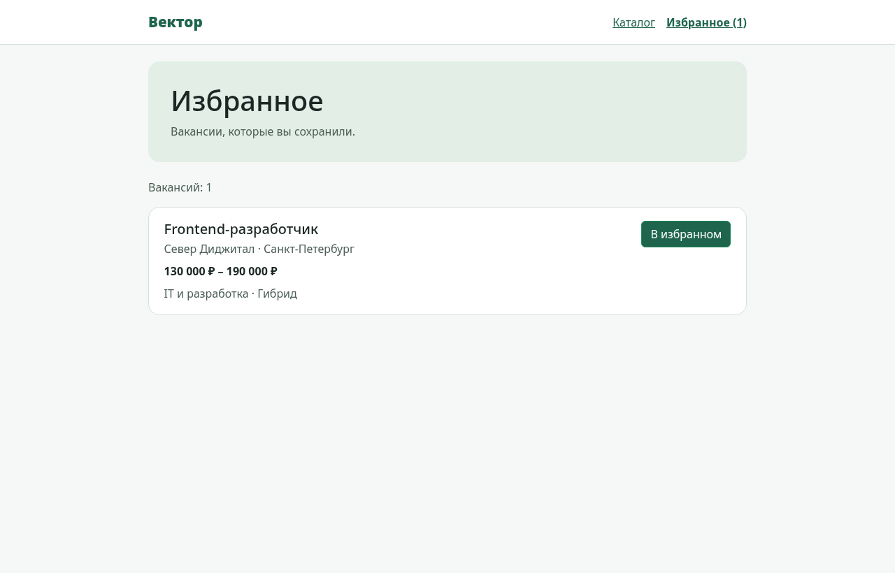

# Задача

Создать проект на Vue с помощью npm, запустить его локально и показать получившиеся компоненты.

# Ход работы

## Инициализация и запуск

Проект создан командой `npm init vue@latest -- app --router --pinia --bare`. Axios и Bootstrap добавлены через `npm install axios bootstrap`. В `package-lock.json` зафиксированы версии зависимостей. `npm ci` воспроизводит установку по этому файлу, `npm start` запускает Vite, а `npm run build` собирает приложение в `dist`.

## Компоненты

`CatalogFilters` получает отрасли через props, передаёт поисковую строку и выбранную отрасль через `v-model`. `VacancyCard` отображает данные вакансии и отправляет событие `toggle`. `VacancyList` применяет фильтры и показывает карточки через `v-for`, а для результатов, загрузки и ошибок использует условный рендеринг. Vue Router переключает каталог и избранное. Pinia хранит состояние, Axios запрашивает локальный JSON по HTTP.

# Вывод

Проверены запуск, сборка и работа компонентов на широком и мобильном экране. Поиск и фильтрация меняют список, избранное сохраняется после перезагрузки. Код приложения находится в папке `app`.
