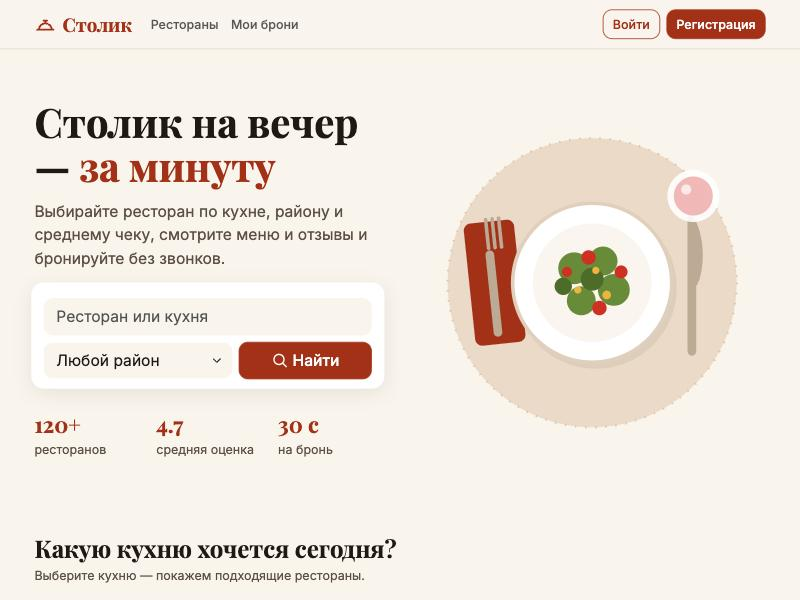
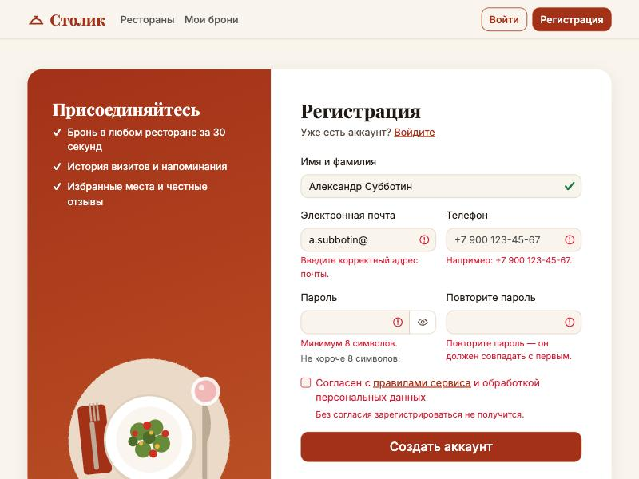
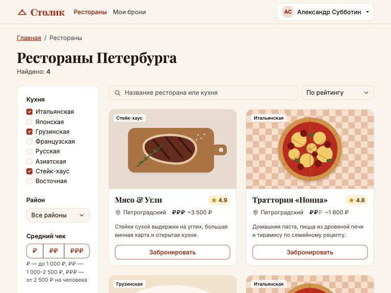
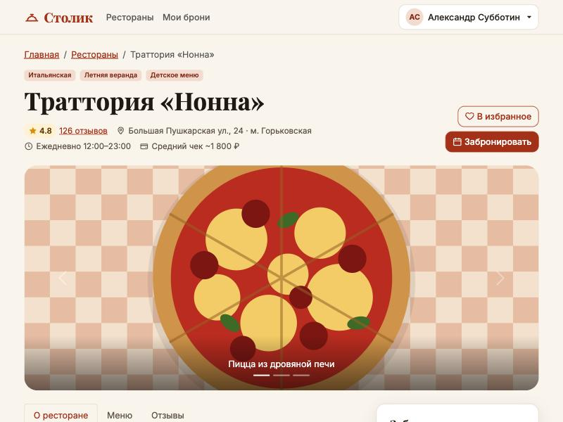
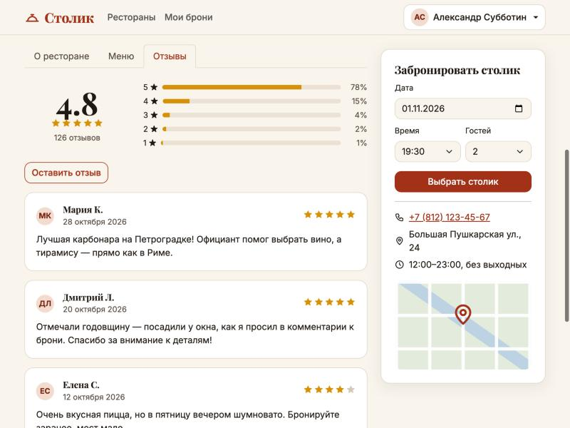
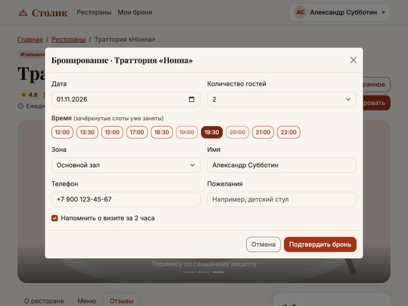
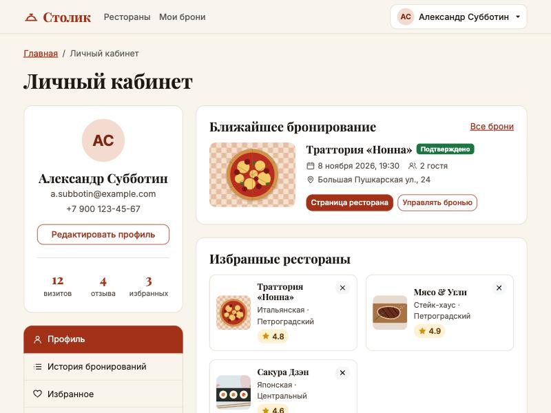
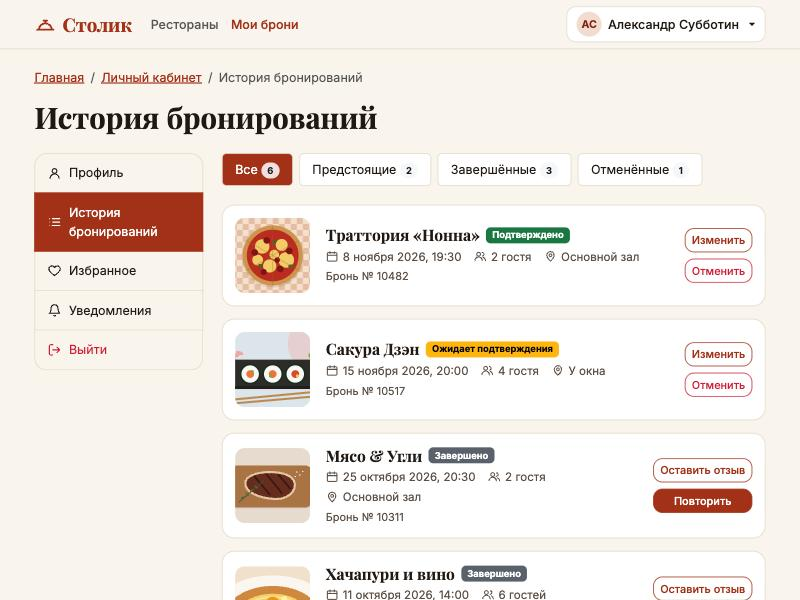

# Лабораторная работа 1. Вёрстка сайта средствами HTML, CSS и Bootstrap

**Студент:** Субботин Александр, поток K3439
**Вариант:** 1 — приложение для бронирования столиков в ресторанах
**Название проекта:** «Столик» — бронирование столиков в ресторанах Санкт-Петербурга

## Цель работы

Сверстать многостраничный адаптивный сайт на HTML, CSS и Bootstrap 5 по выбранному варианту и реализовать на JS интерактивность там, где без неё не обойтись (модальные окна, фильтрация, валидация форм).

## Стек

- HTML5 с семантической разметкой (`header`, `nav`, `main`, `section`, `article`, `aside`, `footer`)
- Bootstrap 5.3.3, подключён через CDN с SRI-хешами: сетка, компоненты, JS-плагины
- Собственный CSS поверх Bootstrap (`css/style.css`): фирменная палитра через CSS-переменные и переопределение переменных Bootstrap (`--bs-primary`, `--bs-btn-*` и т. д.)
- Ванильный JavaScript без сборщика
- Шрифты Inter и Playfair Display (Google Fonts)
- Иллюстрации блюд и интерьера нарисованы вручную в SVG (`img/`), поэтому сайт не зависит от сторонних фотографий

## Страницы

| Страница | Файл | Что реализовано |
|---|---|---|
| Главная | `index.html` | Hero с формой поиска (передаёт `q` и `district` на страницу поиска), плитки кухонь со ссылками на фильтр, популярные рестораны, блок «Как это работает», призыв зарегистрироваться (виден только гостю) |
| Вход | `login.html` | Форма входа с валидацией, кнопка «показать пароль», модальное окно восстановления пароля |
| Регистрация | `register.html` | Имя, почта, телефон (с маской через `pattern`), пароль с подтверждением, согласие с правилами; проверка совпадения паролей через Constraint Validation API |
| Поиск ресторанов | `search.html` | Фильтры по **кухне, району, ценовому уровню**, рейтингу и особенностям (веранда, детское меню, живая музыка), текстовый поиск и сортировка. На десктопе фильтры в липком сайдбаре, на мобильных — в выезжающей панели (`offcanvas-lg`) со счётчиком активных фильтров |
| Страница ресторана | `restaurant.html` | Карусель фото, вкладки «О ресторане / Меню / Отзывы», меню с ценами, сводка рейтинга с прогресс-барами, форма отзыва со звёздным рейтингом, карточка быстрой брони, модальное окно бронирования со слотами времени |
| Личный кабинет | `profile.html` | Карточка пользователя со статистикой, редактирование профиля в модальном окне, ближайшая бронь, избранные рестораны (можно удалять), настройки уведомлений |
| История бронирований | `bookings.html` | Список бронирований со статусами, фильтр «Все / Предстоящие / Завершённые / Отменённые» со счётчиками, отмена брони через модальное окно подтверждения |

Обязательные по заданию страницы (вход, регистрация, личный кабинет, поиск с фильтрацией) есть, плюс страница ресторана и история бронирований из описания варианта.

## Где используется JavaScript

- **`js/main.js`** — общий код для всех страниц: состояние авторизации в шапке (гость видит «Войти / Регистрация», пользователь — меню с аватаром), выход, всплывающие уведомления (Bootstrap Toast), обёртка `onValidSubmit` над Bootstrap-валидацией форм, переключатель видимости пароля.
- **`js/auth.js`** — вход, регистрация, восстановление пароля. Сервера в ЛР1 нет, поэтому «аккаунт» сохраняется в `localStorage` (без пароля). Это просто заглушка, в ЛР2 её заменит JSON-server с авторизацией.
- **`js/search.js`** — фильтрация и сортировка карточек по `data-*` атрибутам, подстановка параметров из URL, пустое состояние «Ничего не нашлось», счётчик результатов.
- **`js/restaurant.js`** — перенос данных из быстрой формы в модалку бронирования, минимальная дата (нельзя выбрать прошедший день), подстановка имени и телефона вошедшего пользователя, сохранение брони, автооткрытие модалки по ссылке `restaurant.html#booking`, кнопка «В избранное», добавление отзыва (пользовательский текст вставляется через `textContent`, чтобы не было XSS).
- **`js/profile.js`** — редактирование профиля, удаление из избранного, сохранение настроек уведомлений.
- **`js/bookings.js`** — вывод броней, сделанных на странице ресторана (через `<template>`), фильтр по статусу, отмена брони.

## Адаптивность

- Сетка Bootstrap (`row`, `col-*`, `row-cols-*`) и CSS Grid для плиток кухонь (2 → 4 → 8 колонок).
- Навигация сворачивается в бургер на ширине меньше `lg`.
- Фильтры поиска на мобильных уезжают в `offcanvas`, кнопки действий в истории бронирований переносятся под карточку.
- Размеры заголовков заданы через `clamp()`, у изображений фиксированные пропорции (`aspect-ratio` + `object-fit: cover`).

## Как запустить

Сайт статический, сборка не нужна. Достаточно открыть `index.html` в браузере или поднять любой статический сервер из папки работы:

```bash
python3 -m http.server 8080
```

После этого сайт открывается по адресу http://localhost:8080/index.html.

## Скриншоты

| | |
|---|---|
|  Главная |  Валидация формы регистрации |
|  Поиск с фильтрами |  Страница ресторана |
|  Отзывы и карточка брони |  Модальное окно бронирования |
|  Личный кабинет |  История бронирований |
|  Главная на телефоне |  Поиск на телефоне (2 активных фильтра) |

## Вывод

Свёрстан адаптивный сайт сервиса бронирования столиков из семи страниц на HTML, CSS и Bootstrap 5. Использованы сетка Bootstrap и компоненты: navbar, dropdown, modal, offcanvas, carousel, tabs, collapse, toast, list-group, progress, валидация форм. JS отвечает за модальные окна, фильтрацию и сортировку, валидацию и имитацию авторизации. Данные пока лежат в разметке и `localStorage`. В ЛР2 они переедут в моковое API на JSON-server с авторизацией.
