# Лабораторная работа 3. Одностраничное приложение на Vue.js

**Студент:** Субботин Александр, поток K3439
**Вариант:** 1 — приложение для бронирования столиков в ресторанах («Столик»)

## Цель работы

Мигрировать сайт из ЛР1 и ЛР2 на Vue.js. Требования к приложению:

- подключён роутер;
- работа с внешним API (через axios);
- разумное деление на компоненты;
- повторяющийся функционал вынесен в composables.

За основу взят самый полный вариант сайта — из ДЗ4: в нём уже есть доступность (ДЗ2), светлая и тёмная темы (ДЗ3) и SVG-спрайт (ДЗ4). Моковое API — то же, что в ЛР2: `json-server` + `json-server-auth`.

## Как запустить

Нужен Node.js 22.18+ или 24.12+ (проверено на 24.13).

```bash
npm install
npm start
```

`npm start` поднимает сразу два процесса (`run-p api dev`):

- `npm run api` — json-server с `db.json`, `json-server-auth` и правилами из `routes.json` на http://localhost:3000;
- `npm run dev` — Vite, приложение на http://localhost:5173.

**Демо-аккаунт:** `demo@stolik.ru` / `stolik2026` — у него есть брони, избранное и отзывы. Новые пользователи, брони и отзывы сохраняются в `db.json`; вернуть исходные данные — `git checkout db.json`.

Если порт 3000 занят, API можно поднять на другом, а адрес передать через переменную окружения: `VITE_API_URL=http://localhost:3002 npm run dev`.

Другие команды: `npm run build` — сборка в `dist/`, `npm run preview` — просмотр сборки, `npm run lint` — oxlint + ESLint.

## Как создавался проект

```bash
npm create vue@latest -- --router --eslint lab3   # create-vue 3.24: Vue 3.5, Vue Router 5, Vite 8, ESLint + oxlint
npm install axios bootstrap@5.3.3 @popperjs/core
npm install -D json-server@0.17.4 json-server-auth@2.1.0
```

Bootstrap зафиксирован на 5.3.3 — на этой версии (с CDN) свёрстаны ЛР1 и ЛР2. В 5.3.8 изменился цвет пунктов `.list-group-item-action`, и меню личного кабинета стало бы серым.

## Структура

```
lab3/
├── db.json, routes.json      # моковое API из ЛР2
├── index.html                # точка входа, шрифты
├── public/img/               # картинки и SVG-спрайт из ДЗ4
└── src/
    ├── main.js               # стили, тема, обработчик истёкшего токена, роутер
    ├── App.vue               # ссылка-пропуск, шапка, <RouterView>, подвал, тосты
    ├── router/index.js       # маршруты, guard'ы, заголовки, прокрутка, фокус
    ├── api/                  # axios: instance + класс на каждый ресурс
    ├── composables/          # переиспользуемая логика (useAuth, useRequest, …)
    ├── utils/                # форматирование дат, денег, рейтинга; статусы броней
    ├── assets/styles/        # style.css и темы light.css / dark.css из ДЗ3–ДЗ4
    ├── components/
    │   ├── ui/               # AppIcon, BaseModal, BaseTabs, BreadcrumbsNav, LoaderBlock, ErrorAlert, ToastContainer
    │   ├── layout/           # AppHeader, AppFooter, ThemeSwitcher, UserMenu
    │   ├── restaurant/       # карточка, галерея, меню, отзывы, формы брони
    │   ├── search/           # FiltersPanel
    │   ├── auth/             # AuthCard, PasswordInput, ResetPasswordModal
    │   └── account/          # AccountNav, ProfileCard, NextBooking, FavoritesList, NotificationsForm, EditProfileModal, BookingItem
    └── views/                # страницы: Home, Search, Restaurant, Login, Register, Profile, Bookings, NotFound
```

## Роутер

Вместо семи HTML-файлов — одна страница и Vue Router в режиме `createWebHistory`.

| Адрес | Страница | Доступ |
|---|---|---|
| `/` | главная | все |
| `/restaurants` | поиск с фильтрами (`?cuisine=…&price=…&sort=…`) | все |
| `/restaurants/:id` | страница ресторана (`id` приходит в компонент как prop) | все |
| `/login`, `/register` | вход и регистрация | только гости |
| `/profile` | личный кабинет | только вошедшие |
| `/bookings` | история бронирований | только вошедшие |
| всё остальное | «Такой страницы нет» | все |

- Все страницы, кроме главной, загружаются лениво (`() => import(...)`) — у каждой свой chunk в сборке.
- `beforeEach`: гостя с закрытой страницы отправляет на `/login?next=/bookings`, после входа возвращает обратно. `next` проверяется функцией `safeRedirect` — пропускаются только пути внутри сайта, `//evil.example` не пройдёт. Вошедшего пользователя `/login` и `/register` перекидывают дальше.
- `afterEach` ставит заголовок вкладки из `meta.title` (у ресторана — его название через `usePageTitle`) и переносит фокус на `<main>`: без этого после перехода фокус оставался бы на уже исчезнувшей ссылке.
- `scrollBehavior`: «Назад» возвращает прокрутку, ссылки `/profile#favorites` ведут к разделу, при смене только фильтров поиска страница не прыгает наверх.
- `linkActiveClass: 'active'` — ссылка текущей страницы в шапке подсвечивается классом Bootstrap и получает `aria-current="page"`.
- Ссылки `/restaurants/1#booking` (кнопки «Забронировать» на карточках) сразу открывают форму брони, `#reviews` — вкладку отзывов.

## Работа с API через axios

Слой API устроен как в мануале к ДЗ5: один настроенный instance и класс на каждый ресурс, которому instance передаётся в конструктор (`src/api/index.js`).

`src/api/instance.js`:

- `baseURL` — `VITE_API_URL` или `http://localhost:3000`;
- interceptor запроса добавляет `Authorization: Bearer <токен>`;
- interceptor ответа превращает ошибку в `ApiError` с понятным текстом (ответы json-server-auth переведены: «Неверный пароль», «Сессия истекла…», «Сервер недоступен…») и при `401` с токеном вызывает обработчик из `main.js`: выход и переход на вход с возвратом;
- `paramsSerializer: { indexes: null }` — json-server ждёт `?cuisineId=a&cuisineId=b`, а axios по умолчанию шлёт `cuisineId[]=a`;
- `ownList()` — правило `600` у json-server-auth отвечает `403` на пустой список нового пользователя, для него это просто `[]` (тот же обход, что в ЛР2).

| Класс | Запросы |
|---|---|
| `AuthApi` | `POST /login`, `POST /register` |
| `RestaurantsApi` | `GET /restaurants?_expand=cuisine&_expand=district&_embed=reviews` + фильтры `q`, `cuisineId`, `districtId`, `priceLevel`, `_sort=avgCheck`; `GET /restaurants/:id?…&_embed=menu&_embed=reviews` |
| `DictionariesApi` | `GET /cuisines`, `/districts`, `/features` |
| `BookingsApi` | `GET /bookings?userId=…&_expand=restaurant`, `POST /bookings`, `PATCH /bookings/:id` (отмена) |
| `FavoritesApi` | `GET /favorites?userId=…`, `POST /favorites`, `DELETE /favorites/:id` |
| `ReviewsApi` | `GET /reviews?userId=…`, `POST /reviews` |
| `UsersApi` | `GET /users/:id`, `PATCH /users/:id` (профиль и уведомления) |

## Компоненты

```
App
├── AppHeader ── ThemeSwitcher, UserMenu
├── RouterView
│   ├── HomeView ─────── RestaurantCard ── RatingPill, PriceLevel
│   ├── SearchView ───── FiltersPanel, RestaurantCard
│   ├── RestaurantView ─ RestaurantGallery, BaseTabs
│   │                    ├── RestaurantMenu
│   │                    ├── RestaurantReviews ── ReviewForm, ReviewItem ── StarRating
│   │                    ├── QuickBookingForm
│   │                    └── BookingModal ── BaseModal
│   ├── LoginView ────── AuthCard, PasswordInput, ResetPasswordModal ── BaseModal
│   ├── RegisterView ─── AuthCard, PasswordInput
│   ├── ProfileView ──── ProfileCard, AccountNav, NextBooking, FavoritesList,
│   │                    NotificationsForm, EditProfileModal ── BaseModal
│   ├── BookingsView ─── AccountNav, BookingItem, BaseModal
│   └── NotFoundView
├── AppFooter
└── ToastContainer
```

Как компоненты общаются:

- **props вниз, события вверх.** `BookingItem` получает бронь и сообщает `@cancel`, а отменяет её страница. `ReviewForm` отправляет отзыв и сообщает `@created`, а `RestaurantView` добавляет его в список — рейтинг и распределение оценок пересчитываются сами (`computed`).
- **v-model на своих компонентах** (`defineModel`): `FiltersPanel` (`v-model:filters`), `BaseTabs` (активная вкладка), `PasswordInput`.
- **Слоты.** `BaseModal` — обёртка над модалкой Bootstrap, её содержимое приходит через слот. `BaseTabs` рисует панель каждой вкладки из именованного слота (`#about`, `#menu`, `#reviews`). `AuthCard` — общая раскладка входа и регистрации.
- **`defineExpose`.** Модалки открываются методом: `bookingModal.open({ date, time, guests }, trigger)` — так быстрая форма в сайдбаре передаёт в модалку уже выбранные дату, время и число гостей.

Вкладки (`BaseTabs`) и карусель (`RestaurantGallery`) теперь на состоянии Vue, а не на JS Bootstrap. Вкладки работают по паттерну WAI-ARIA: стрелки, Home и End. JS Bootstrap остался для выпадающих меню, сворачиваемой навигации, выезжающей панели фильтров и модальных окон (фокус-ловушка, Esc, затемнение).

## Composables

| Composable | Что делает | Где используется |
|---|---|---|
| `useAuth` | сессия на всё приложение: пользователь, `isLoggedIn`, вход, регистрация, выход, обновление профиля, синхронизация между вкладками | шапка, роутер, формы, кабинет, ресторан |
| `useRequest` | `data` / `loading` / `error` для любого запроса; ответ устаревшего запроса отбрасывается (быстро переключили фильтры — рисуется только последний ответ) | все страницы с данными, `useBookings`, `useFavorites` |
| `useFormValidation` | Constraint Validation API + стили Bootstrap, `aria-invalid` и `aria-errormessage` из ДЗ2, фокус на первое ошибочное поле, блокировка кнопки на время запроса, текст ошибки API | 6 форм: вход, регистрация, сброс пароля, отзыв, бронь, профиль |
| `useBookings` | брони пользователя: сортировка, счётчики по статусам, ближайшая бронь, отмена | кабинет, история бронирований |
| `useFavorites` | избранное: загрузка, проверка, добавление/удаление | кабинет, страница ресторана |
| `useRestaurantFilters` | форма фильтров ⇄ адресная строка в обе стороны, задержка для текстового поиска, число активных фильтров | поиск |
| `useToast` | общий список уведомлений | все действия с API |
| `useTheme` | тема из ДЗ3: «как в системе» / светлая / тёмная, запоминается в `localStorage` | переключатель в шапке |
| `usePageTitle` | заголовок вкладки по данным (название ресторана) | страница ресторана |

`useAuth`, `useToast` и `useTheme` хранят состояние вне функции, поэтому все компоненты видят одно и то же. Остальные composables создают своё состояние при каждом вызове.

## Что изменилось по сравнению с ЛР2

| ЛР2 (fetch + DOM) | ЛР3 (Vue) |
|---|---|
| 7 HTML-страниц с одинаковыми шапкой и подвалом | одна страница, шапка и подвал — компоненты, страницы — маршруты |
| разметка из JS строками через `innerHTML` + своя `escapeHtml` | шаблоны Vue, экранирование — автоматически |
| после каждого изменения вручную перерисовать нужные куски | данные реактивные: отменили бронь — меняются карточка, счётчики и фильтр |
| `bookingGroup` и разметка брони продублированы в двух скриптах | `utils/booking.js`, `useBookings`, компоненты `BookingItem` и `NextBooking` |
| `fetch` и самодельная обёртка | axios: interceptors, сериализация параметров, классы ресурсов |
| `requireAuth()` в начале каждого закрытого скрипта | один guard в роутере |

Внешний вид не изменился: я сравнил Vue-версию с сайтом ДЗ4 попиксельно (puppeteer + pixelmatch, 7 страниц, 1280px, светлая и тёмная темы). Размеры страниц совпали, а отличия нашлись только в сглаживании шрифтов и в плавающей кнопке Vue DevTools, которая есть лишь в режиме разработки.

## Проверка

- `npm run lint` и `npm run build` проходят без ошибок и предупреждений.
- Сценарный прогон в Chrome (puppeteer, 61 проверка) на dev-сервере и на production-сборке. Проверено:
  - главная, поиск и фильтры с адресной строкой, «Назад»;
  - галерея, вкладки с клавиатуры;
  - вход с неверным и верным паролем, возврат по `?next`;
  - избранное, отзыв с ошибками валидации и без, бронь из быстрой формы и по ссылке `#booking`;
  - кабинет: редактирование профиля, уведомления, удаление из избранного с переносом фокуса;
  - история броней: фильтр и отмена;
  - тёмная тема, выход, закрытые страницы, регистрация нового пользователя (пустые списки без ошибок), 404.
- Отдельно: протухший токен → выход и вход с возвратом, ссылка-пропуск, телефон 375px (меню сворачивается после перехода, фильтры в выезжающей панели, нет горизонтальной прокрутки).
- Lighthouse 12 на production-сборке, 9 страниц (гость и вошедший): **Accessibility 100, Best Practices 100, SEO 100** везде. axe-core 4.14 (WCAG 2.2 AA + best practices) — 0 нарушений.

## Скриншоты

| | |
|---|---|
| 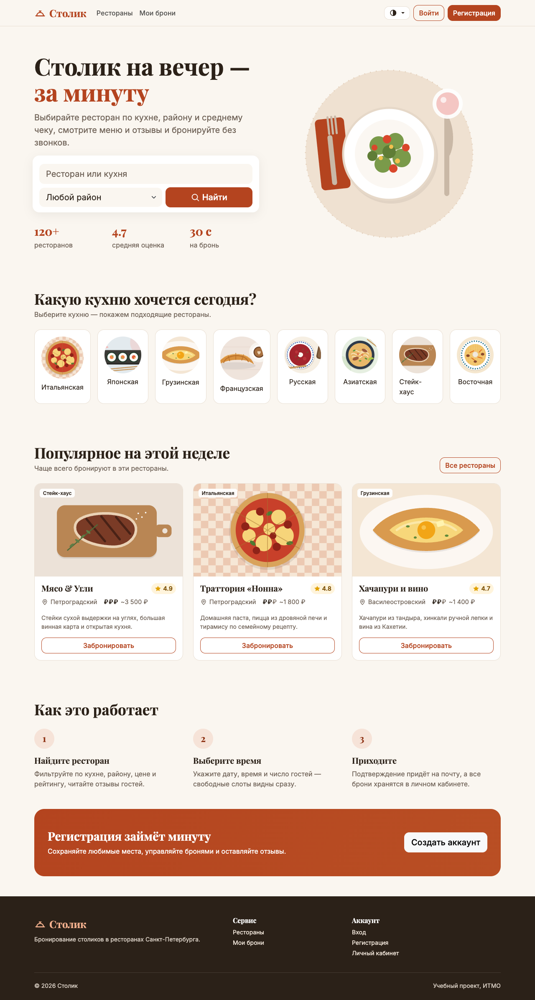 Главная: кухни, районы и популярные рестораны из API | 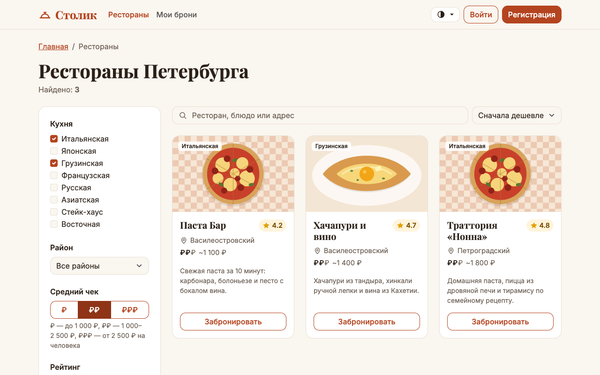 Поиск: фильтры по кухне и чеку и сортировка — json-server, состояние в адресе |
| 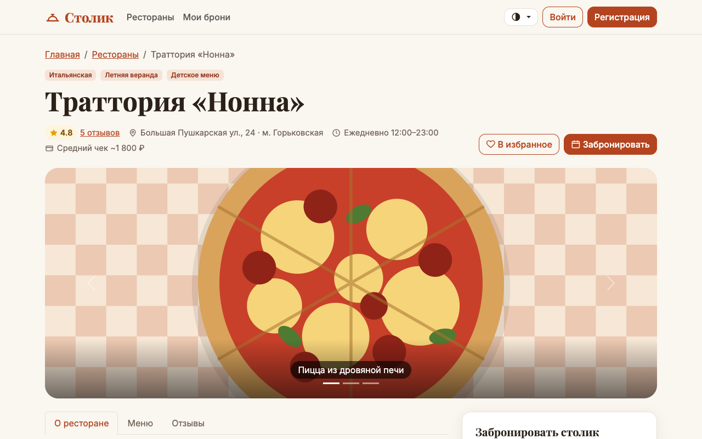 Страница ресторана `/restaurants/1` | 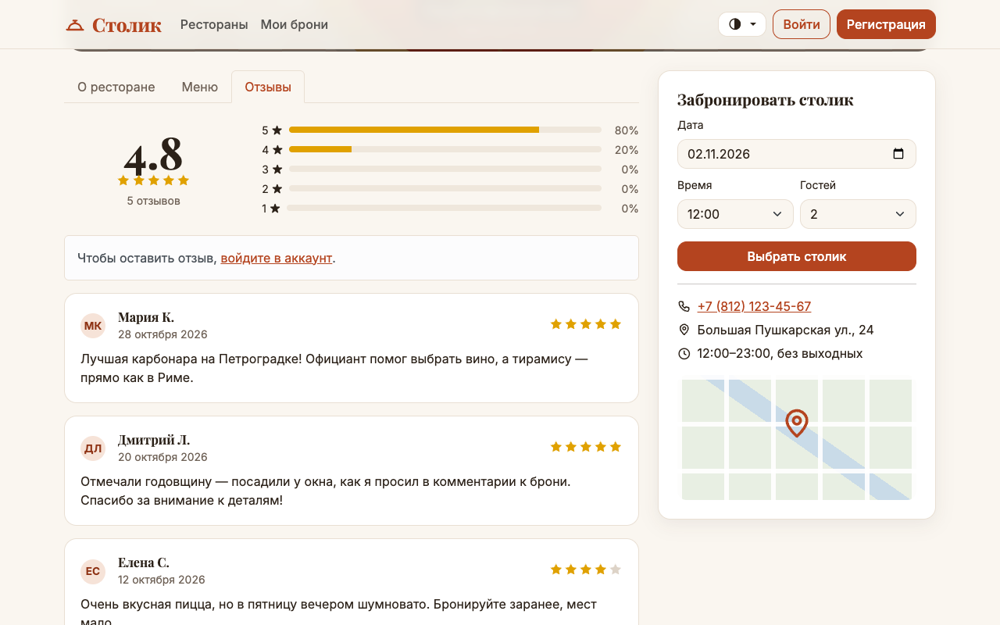 Вкладка «Отзывы»: рейтинг считается по отзывам |
| 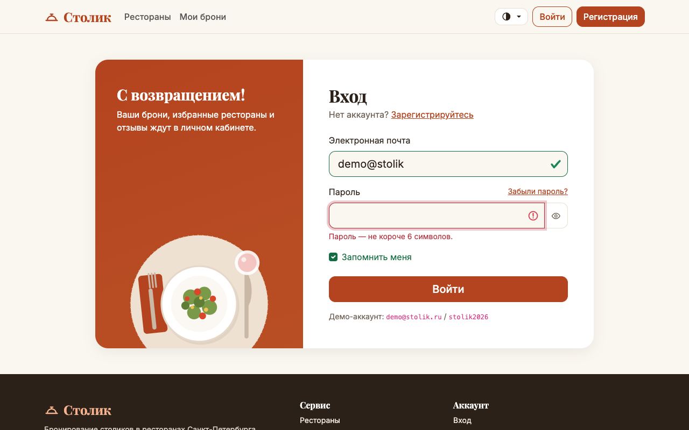 Вход: ошибки валидации (useFormValidation) | 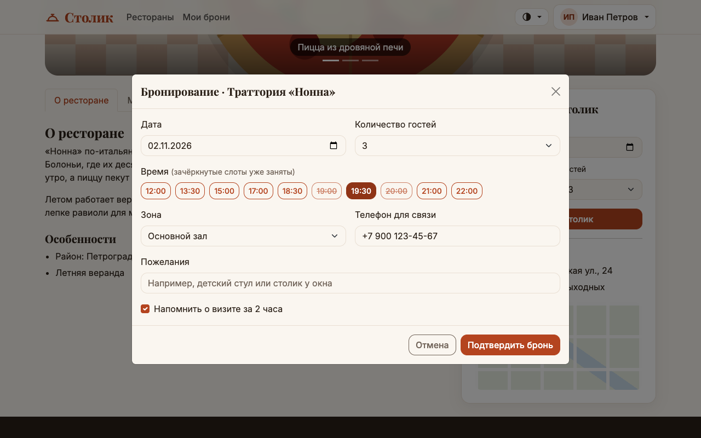 Бронь: время и гости пришли из быстрой формы, телефон — из профиля |
| 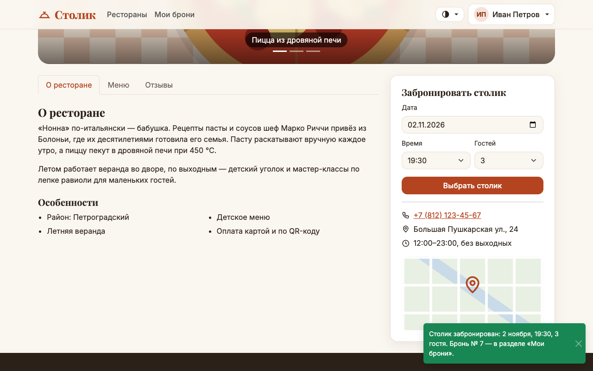 Бронь создана (`POST /bookings`) | 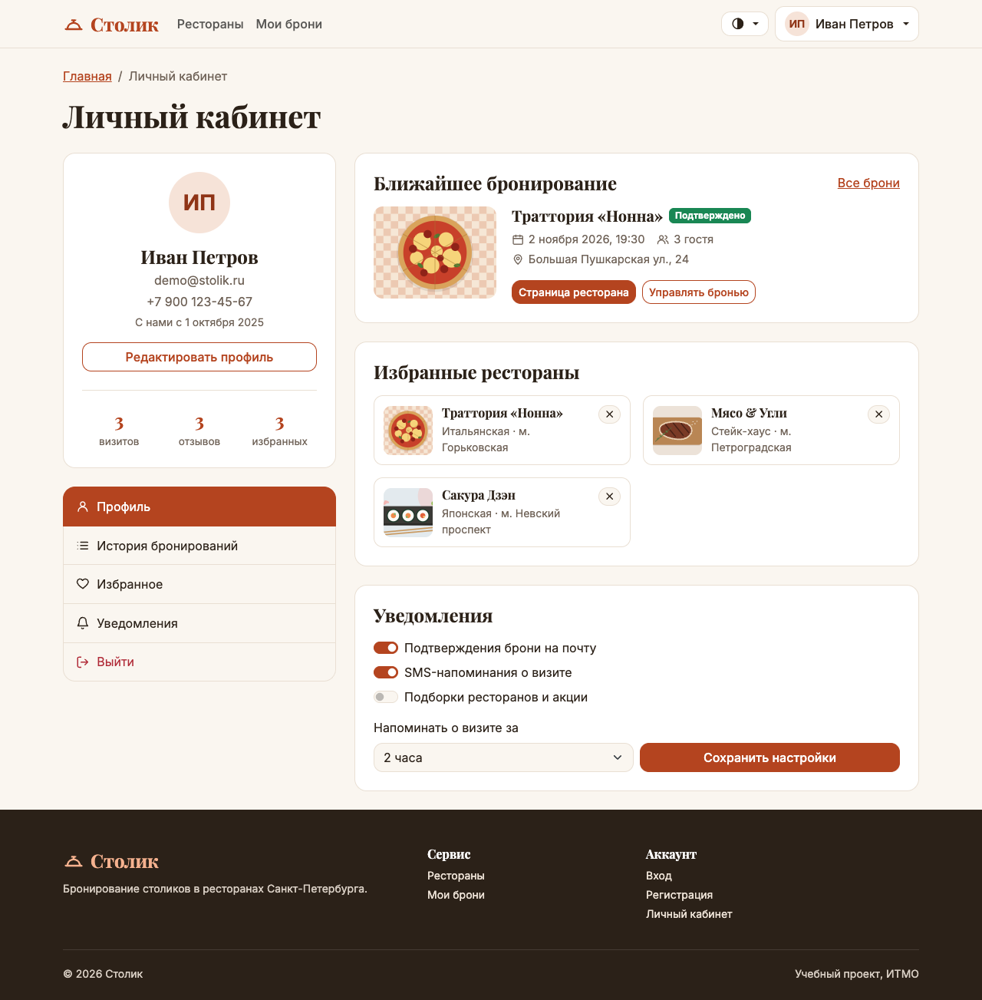 Личный кабинет: статистика, ближайшая бронь, избранное |
| 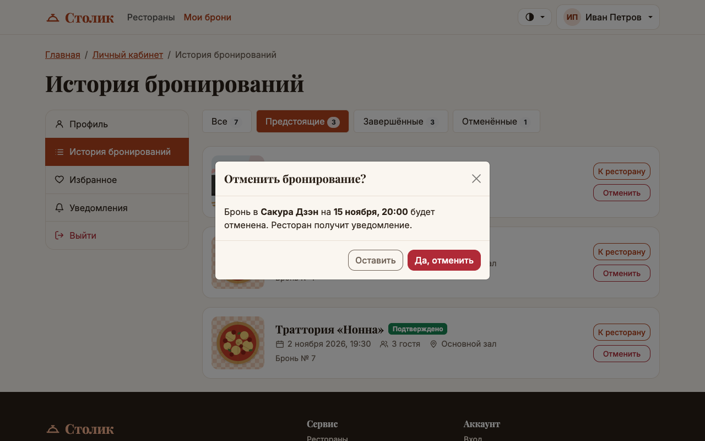 История бронирований: фильтр и отмена | 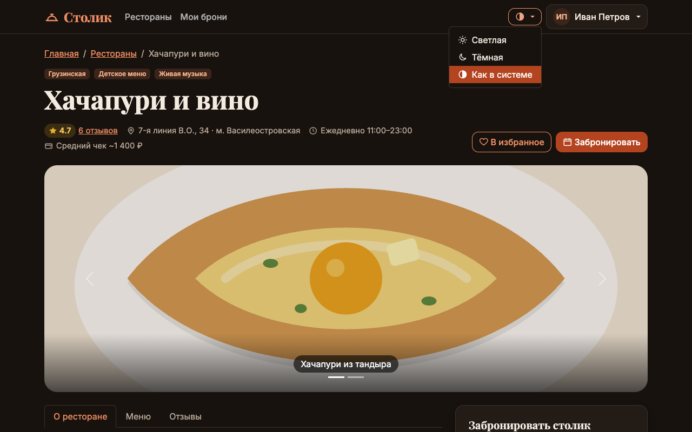 Тёмная тема и переключатель |
| 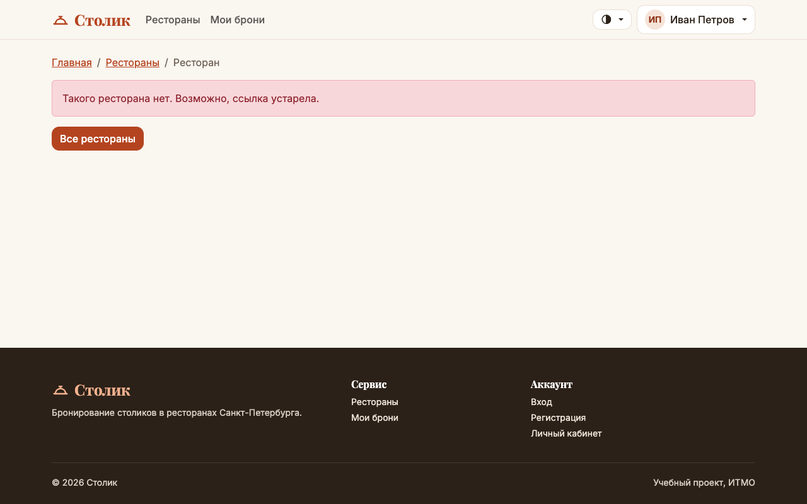 Несуществующий ресторан (404 от API) | 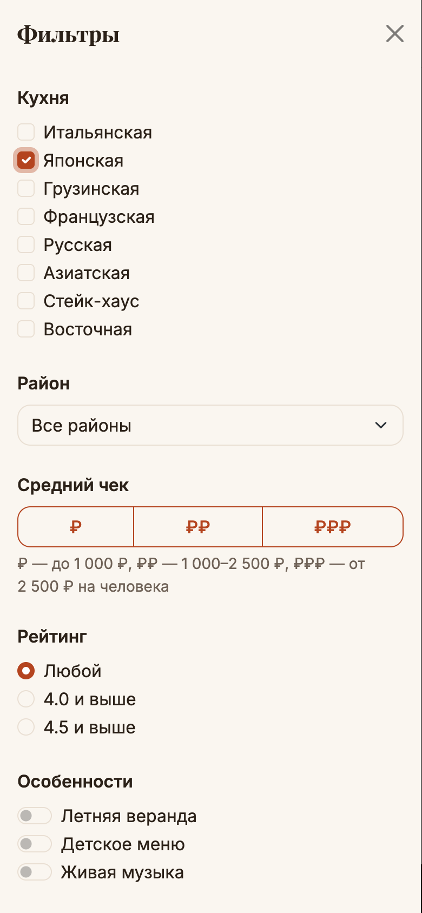 Телефон: фильтры в выезжающей панели |

## С чем пришлось разобраться

1. **Ошибка только в production-сборке.** В dev всё работало, а Lighthouse на собранной версии показал в консоли `Cannot read properties of undefined (reading 'backdrop')` при открытии любой страницы с модалкой. В `BaseModal` ref в шаблоне назывался `modal`, и так же называлась переменная с экземпляром Bootstrap. В production Vue встраивает шаблон прямо в `setup` и записывает элемент в одноимённую переменную, поэтому `Modal.getOrCreateInstance` получал пустой элемент. Ref переименован в `root`.
2. **Пропавшие пробелы.** Vue по умолчанию выбрасывает пробелы между тегами, если между ними перенос строки. На кнопке «♡ В избранное» иконка прилипла к тексту — нашлось при попиксельном сравнении с ДЗ4.
3. **Версия Bootstrap.** npm поставил 5.3.8 вместо 5.3.3 с CDN, и меню кабинета стало серым. Версия зафиксирована. Заодно выяснилось, что Vite не замечает изменений в `node_modules`, пока dev-сервер не перезапустить.
4. **Точки карусели без стилей.** Bootstrap оформляет их по атрибуту `[data-bs-target]`. Атрибут оставлен, а без `data-bs-slide-to` JS Bootstrap на эти кнопки не реагирует, слайды переключает компонент.
5. **Класс активной ссылки на кнопках.** На странице входа кнопка «Войти» в шапке получала `.active` и выглядела нажатой — для неё `active-class=""`.
6. **Переход из открытой модалки.** Если в окне брони нажать «Войдите», страница меняется, а затемнение Bootstrap остаётся. `BaseModal` при размонтировании убирает затемнение и блокировку прокрутки.
7. **json-server-auth** — те же особенности, что в ЛР2: `403` на пустой список нового пользователя (`ownList`), `401` на `_sort=date,time` (время досортировывается на клиенте), повторяющиеся параметры вместо `[]` (`paramsSerializer`).

## Вывод

Сайт из ЛР1–ЛР2 перенесён на Vue 3 без изменений во внешнем виде и доступности. В приложении есть:

- роутер с закрытыми страницами и ленивой загрузкой;
- слой API на axios с interceptors;
- 33 компонента и 8 страниц, которые общаются через props, события, `v-model`, слоты и `defineExpose`;
- 9 composables для повторяющейся логики: сессия, загрузка данных, валидация форм, брони, избранное, фильтры.

Код стал заметно короче и надёжнее: при изменении данных вручную перерисовывать ничего не нужно.
