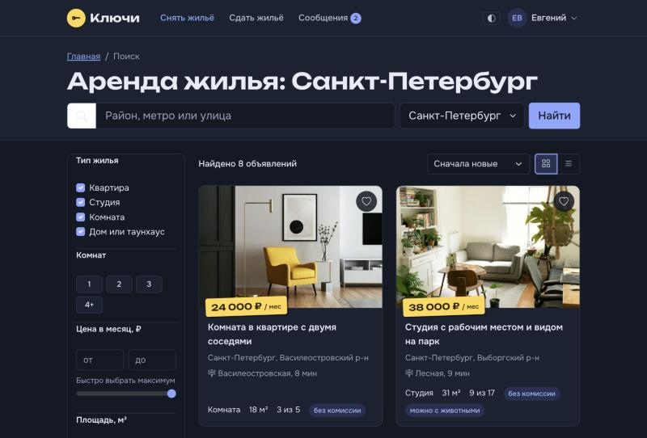

# Лабораторная работа 2. Взаимодействие с внешним API

Студент: Владзиевский Евгений, группа K3441

Вариант 4: сервис для аренды недвижимости «Ключи». Продолжение ЛР1 (вёрстка), ДЗ2 (доступность), ДЗ3 (темизация) и ДЗ4 (SVG-спрайт).

## Что сделано

Тестовый массив `js/data.js` из ЛР1 выброшен. Все семь страниц работают с моковым API на `json-server`, авторизация — через `json-server-auth` (JWT в заголовке `Authorization: Bearer`).

## Запуск

```bash
npm install
npm start
```

Открыть `http://localhost:3000`.

Один процесс отдаёт и статику, и API — поэтому запросы из браузера идут на тот же адрес и CORS не нужен:

```
json-server-auth db.json -r routes.json -s ./public -p 3000
```

Тестовый аккаунт: **demo@klyuchi.ru** / **demo1234** (пароль одинаковый у всех пользователей из `db.json`). На странице входа есть кнопка «Войти тестовым пользователем».

Пересобрать базу с нуля, если натыкали лишнего:

```bash
npm run seed
```

## Как выглядит

| | |
|---|---|
|  |  |
|  |  |

## Структура

```
lab2/
├── db.json           база json-server (генерируется скриптом)
├── routes.json       алиас /api/* и права доступа к коллекциям
├── package.json      зависимости и команды
├── tools/
│   ├── make-db.mjs   сборка db.json, пароли хешируются bcrypt
│   └── listings.js   данные объявлений, перенесённые из ЛР1
└── public/           сам сайт
    ├── js/api.js     весь обмен с сервером
    ├── js/format.js  форматирование (бывший data.js без данных)
    └── …
```

## Модель данных

| Коллекция | Что лежит | Поле владельца |
|---|---|---|
| `users` | аккаунты: почта, хеш пароля, имя, роль, телефон | `id` |
| `owners` | публичная карточка владельца: имя, с какого года, проверен ли | — |
| `listings` | 12 объявлений | `userId` |
| `reviews` | отзывы о владельцах | — |
| `favorites` | избранное | `userId` |
| `dialogs` | переписки | `userId` |
| `messages` | сообщения в переписках | `userId` |
| `deals` | сделки | `userId` |
| `rentals` | текущая и прошлые аренды | `userId` |
| `viewings` | на какие просмотры записался пользователь | `userId` |
| `requests` | заявки на просмотр его объектов | `userId` |

Две детали, которые пришлось продумать:

**Почему владелец объявления — `userId`, а не `ownerId`.** `json-server-auth` считает владельцем записи того, чей `id` лежит именно в поле `userId`, — другое имя он не ищет. Как только поле назвали правильно, права на объявления заработали сами: читать может кто угодно, менять и удалять — только автор.

**Почему рядом с `users` есть `owners`.** Коллекция `users` закрыта целиком: в ней хеши паролей, и читать её не должен никто, кроме самого пользователя. А имя владельца надо показывать на странице объявления всем, включая гостей. Поэтому публичная часть профиля вынесена в отдельную коллекцию `owners`, доступную только на чтение.

**Почему просмотры разведены на две коллекции.** У записи может быть ровно один владелец. Запись на просмотр интересна двоим — тому, кто записался, и хозяину квартиры, — а это разные люди. Поэтому `viewings` (куда записался я) и `requests` (кто просится ко мне) живут отдельно, и у каждой записи ровно один `userId`.

## Права доступа

`routes.json` — заодно и алиас `/api/*`, и права. Цифры как в правах Unix: 4 — чтение, 2 — запись, а три разряда это владелец, вошедший пользователь и гость.

```json
{
  "/api/*": "/$1",

  "users": 600,
  "owners": 444,
  "listings": 644,
  "reviews": 664,

  "favorites": 600,
  "dialogs": 600,
  "messages": 600,
  "deals": 600,
  "rentals": 600,
  "viewings": 600,
  "requests": 600
}
```

| Коллекция | Права | Что это значит |
|---|---|---|
| `users` | `600` | свой аккаунт читает и меняет только сам пользователь |
| `owners` | `444` | читают все, не меняет никто |
| `listings` | `644` | читают все, меняет и удаляет только автор |
| `reviews` | `664` | читают все, пишет любой вошедший |
| остальные | `600` | только свои записи |

Проверил руками, прямо запросами:

```bash
curl -s -o /dev/null -w "%{http_code}\n" localhost:3000/api/favorites            # 401, нет токена
curl -s -o /dev/null -w "%{http_code}\n" -X PATCH -H "Authorization: Bearer $ЧУЖОЙ" \
     -H 'Content-Type: application/json' -d '{"price":1}' localhost:3000/api/listings/3   # 403
curl -s -o /dev/null -w "%{http_code}\n" -H "Authorization: Bearer $ЧУЖОЙ" \
     localhost:3000/api/users/1                                                   # 403
```

| Запрос | Ответ |
|---|---|
| `GET /api/listings` без токена | 200 |
| `GET /api/favorites` без токена | 401 |
| `POST /api/login` с неверным паролем | 400 |
| `PATCH /api/listings/3` чужим токеном | 403 |
| `DELETE /api/listings/1` чужим токеном | 403 |
| `GET /api/users/1` чужим токеном | 403 |
| `POST /api/owners` вошедшим пользователем | 403 |
| `POST /api/register` с занятой почтой | 400 `Email already exists` |

## Авторизация

```js
// js/api.js
async login(email, password) {
  const data = await this.request('/login', { method: 'POST', body: { email, password } });
  this.startSession(data);           // accessToken и пользователь в localStorage
  return data.user;
}
```

Токен подставляется в каждый запрос, а ответ 401 означает «сессия кончилась»: данные сессии стираются и пользователь уходит на страницу входа. Это не теория: `json-server-auth` выдаёт токен на час (`JWT_EXPIRES_IN = '1h'`), и через час работы вкладка действительно получила 401 и сама увела на вход.

```js
if (response.status === 401) {
  this.forgetSession();
  throw new ApiError(401, 'Нужно войти заново');
}
```

Личный кабинет и сообщения закрыты. Страница сразу спрашивает, вошли ли мы, и если нет — уводит на вход, запомнив, куда возвращаться:

```js
requireLogin() {
  if (this.isLogged) return true;
  const back = encodeURIComponent(location.pathname.split('/').pop() + location.search);
  window.location.replace(`login.html?next=${back}`);
  return false;
}
```

Пароль пользователя нигде не хранится: `startSession` выкидывает поле `password` из ответа ещё до записи в `localStorage`.

## Что делает каждая страница

| Страница | Запросы |
|---|---|
| Главная | `GET /api/listings?_sort=posted&_order=desc&_limit=6` |
| Вход | `POST /api/login` |
| Регистрация | `POST /api/register` |
| Поиск | `GET /api/listings` со всеми фильтрами, сортировкой и `_page`/`_limit` |
| Объект | `GET /api/listings/:id`, `GET /api/owners/:id`, `GET /api/reviews?ownerId=`, похожие варианты, `POST /api/viewings`, `POST /api/dialogs`, `POST /api/messages` |
| Личный кабинет | `GET /api/rentals?_expand=listing`, `GET /api/listings?userId=`, `GET /api/requests?_expand=listing`, `GET /api/favorites?_expand=listing`, `PATCH /api/users/:id`, `PATCH`/`DELETE /api/listings/:id`, `POST /api/listings`, `PATCH /api/requests/:id` |
| Сообщения и сделки | `GET /api/dialogs?_embed=messages`, `GET /api/deals`, `POST /api/messages`, `POST /api/deals`, `PATCH /api/dialogs/:id` |
| Избранное (везде) | `GET /api/favorites`, `POST /api/favorites`, `DELETE /api/favorites/:id` |

## Что из json-server пригодилось

| Возможность | Где |
|---|---|
| `_sort`, `_order` | сортировка в поиске и свежие объявления на главной |
| `_page`, `_limit` + заголовок `X-Total-Count` | постраничный вывод в поиске |
| `_gte`, `_lte` | цена «от» и «до», площадь «не меньше» |
| `_ne` | похожие варианты: тот же город, кроме текущего объявления |
| повторяющийся параметр (`?type=flat&type=room`) | фильтр по типу жилья |
| сравнение по значению (`?pets=true`, `?commission=0`) | переключатели условий |
| `q` | строка поиска по району, метро и адресу |
| `_expand` | избранное и аренды сразу с объявлением |
| `_embed` | переписки сразу со всеми сообщениями |

Фильтры собираются в один объект и уходят на сервер, а не применяются к загруженному массиву:

```js
const params = {
  type: data.getAll('type'),
  price_gte: data.get('min') || undefined,
  price_lte: data.get('max') || undefined,
  area_gte: data.get('area') || undefined,
  city: quick.city.value || undefined,
  q: quick.q.value.trim() || undefined,
  ...SORTS[sortSelect.value],
  _page: page,
  _limit: PER_PAGE
};
```

## Что пришлось обойти

**Охранник приватных коллекций слишком добрый.** При запросе всей коллекции `json-server-auth` проверяет владельца через `Array.some()`: достаточно, чтобы хотя бы одна запись была твоей, — и коллекция отдаётся целиком. В исходниках это помечено как «too relax». Поэтому фильтр по владельцу клиент добавляет сам:

```js
async getMine(resource, params = {}) {
  try {
    return await this.getList(resource, { userId: this.user?.id, ...params });
  } catch (e) {
    if (e instanceof ApiError && e.status === 403) return [];
    throw e;
  }
}
```

Обратная сторона той же проверки: у нового пользователя своих записей нет ни одной, `some()` даёт `false`, и сервер отвечает 403 вместо пустого списка. Для списка это просто «пусто», поэтому 403 превращается в пустой массив — и свежезарегистрированный пользователь видит нормальные пустые состояния, а не ошибки.

**«4+ комнаты» вместе с точными значениями.** `?rooms=1&rooms=2` — это «или», `?rooms_gte=4` — диапазон. Соединить их в одном запросе json-server не умеет. Если выбрано только «4+» или только точные значения, всё уходит на сервер. Если выбрано и то и другое (редкий случай), берутся записи по остальным фильтрам, а комнаты отбираются на клиенте — в коде это отдельная ветка с комментарием.

**Восстановление пароля.** `json-server-auth` такого не умеет, форма осталась заглушкой с честным сообщением.

## Мелочи, которые заметны в работе

- пока идёт запрос, на месте карточек — серые заглушки, а не пустота;
- кнопка отправки формы блокируется на время запроса, чтобы не отправить дважды;
- поля цены не дёргают сервер на каждую клавишу: запрос откладывается на 350 мс;
- если сервер не запущен, `fetch` падает, и пользователь видит «Сервер не отвечает. Запустите его командой npm start», а не пустую страницу;
- всё, что приходит с сервера и попадает в разметку, экранируется функцией `esc()`.

## Доступность и темы

Правки из ДЗ2, ДЗ3 и ДЗ4 на месте: обе темы, спрайт иконок, разметка для скринридеров. Содержимое теперь рисуется из JS, поэтому атрибуты вроде `aria-pressed` и `aria-label` проставляются прямо при отрисовке карточек.

После переезда на API прогнал Lighthouse ещё раз по открытым страницам — главная, вход, регистрация, поиск, объект: везде по-прежнему **100**. Личный кабинет и сообщения закрыты авторизацией, Lighthouse на них попадает на страницу входа, поэтому их в прогоне нет.
