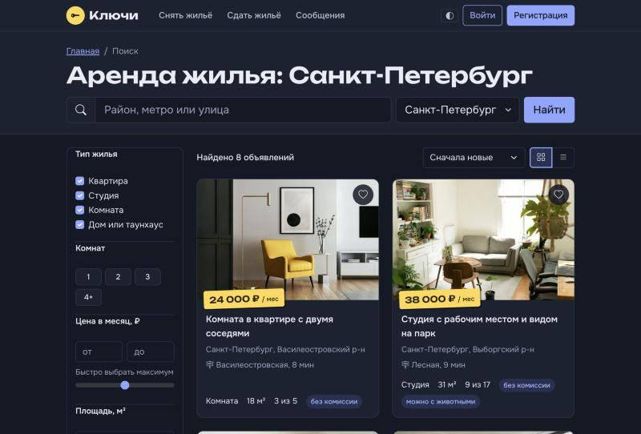
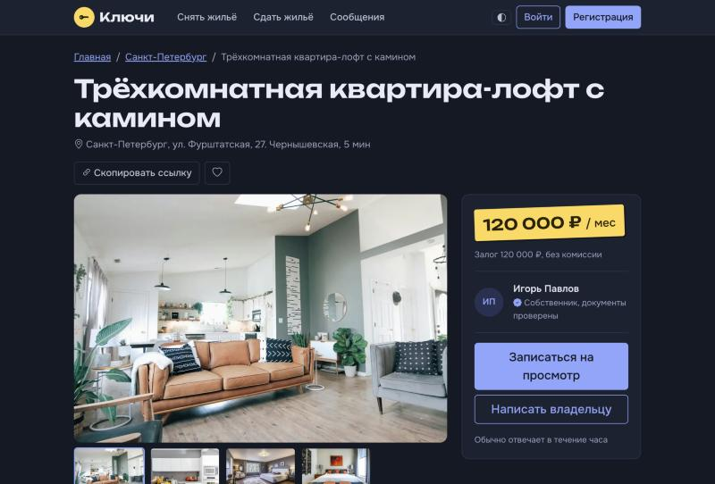
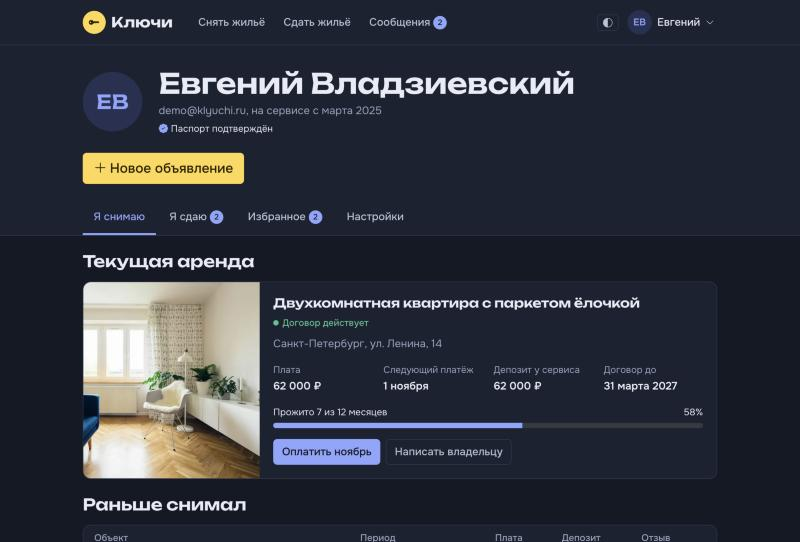
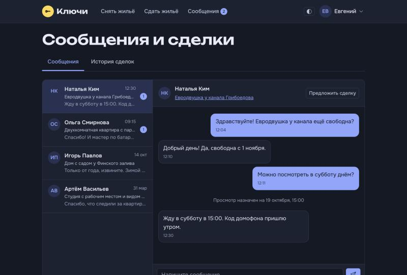
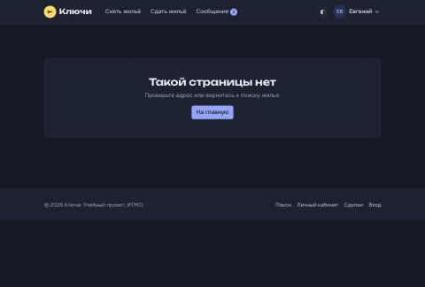

# Лабораторная работа 3. SPA на Vue.js

Студент: Владзиевский Евгений, группа K3441

Вариант 4: сервис для аренды недвижимости «Ключи». Приложение из ЛР1 и ЛР2 переписано на Vue 3 — семь страниц стали семью маршрутами одного SPA. API остался тот же, из ЛР2: json-server с авторизацией через json-server-auth.

## Запуск

```bash
npm install
npm start
```

Одна команда поднимает сразу API и клиент:

- API — `http://localhost:3000`
- приложение — `http://localhost:5173`

Можно и по отдельности: `npm run api` и `npm run dev`.

Тестовый аккаунт: **demo@klyuchi.ru** / **demo1234**. На странице входа есть кнопка «Войти тестовым пользователем».

Сборка и проверка собранного:

```bash
npm run build
npm run preview
```

Пересобрать базу, если натыкали лишнего: `npm run seed`.

## Как выглядит

| | |
|---|---|
|  |  |
|  |  |
|  |  |

## Требования работы и где они выполнены

| Требование | Где смотреть |
|---|---|
| Подключён роутер | `src/router/index.js` — семь маршрутов, ленивая загрузка, навигационные хуки |
| Работа с внешним API | `src/api/http.js` (экземпляр axios и перехватчики), `src/api/resources.js` (запросы) |
| Разумное деление на компоненты | `src/components/` — 12 компонентов, `src/views/` — 8 страниц |
| Composable для повторяющегося | `src/composables/` — 7 файлов |

## Структура

```
lab3/
├── db.json, routes.json, tools/   API из ЛР2 без изменений
├── vite.config.js                 прокси /api → json-server
├── public/img/                    фотографии и SVG-спрайт из ДЗ4
└── src/
    ├── main.js                    точка входа
    ├── App.vue                    каркас: шапка, <RouterView>, подвал, уведомления
    ├── assets/style.css           тема из ДЗ3
    ├── api/
    │   ├── http.js                axios, токен, разбор ошибок
    │   └── resources.js           запросы по названиям, а не по адресам
    ├── router/index.js            маршруты и защита личных разделов
    ├── composables/               общая логика
    ├── components/                переиспользуемые кусочки интерфейса
    └── views/                     страницы-маршруты
```

## Роутер

Семь страниц ЛР1 стали маршрутами. Каждая страница грузится отдельным файлом — Vite сам разрезает сборку:

```js
{
  path: '/property/:id',
  name: 'property',
  component: () => import('../views/PropertyView.vue'),
  props: true,
  meta: { title: 'Объявление | Ключи' }
}
```

Результат сборки — по чанку на страницу:

```
dist/assets/NotFoundView-*.js    0.58 kB
dist/assets/LoginView-*.js       4.91 kB
dist/assets/HomeView-*.js        5.80 kB
dist/assets/MessagesView-*.js   10.72 kB
dist/assets/SearchView-*.js     12.65 kB
dist/assets/PropertyView-*.js   14.63 kB
dist/assets/ProfileView-*.js    19.42 kB
```

**Защита маршрутов.** Личный кабинет и сообщения доступны только своим. Куда пользователь хотел попасть, запоминается в `?next=`:

```js
router.beforeEach((to) => {
  const { isLogged } = useAuth();
  if (to.meta.requiresAuth && !isLogged.value) {
    return { name: 'login', query: { next: to.fullPath } };
  }
  if (to.meta.guestOnly && isLogged.value) return { name: 'profile' };
  return true;
});
```

`guestOnly` — обратная проверка: вошедшему нечего делать на странице входа.

**`meta` вместо ручной возни с заголовком.** Название вкладки лежит рядом с маршрутом:

```js
router.afterEach((to) => {
  if (to.meta.title) document.title = to.meta.title;
});
```

Ещё в роутере — `scrollBehavior`: при переходе страница открывается сверху, при «назад» возвращается туда, где были.

## Работа с API через axios

Один экземпляр на всё приложение. Токен подставляется перехватчиком, а не руками в каждом запросе:

```js
http.interceptors.request.use((config) => {
  const token = getToken();
  if (token) config.headers.Authorization = `Bearer ${token}`;
  return config;
});
```

Ошибки тоже разбираются в одном месте: axios по умолчанию бросает «Request failed with status code 401», читать такое пользователю незачем.

```js
http.interceptors.response.use(
  (response) => response,
  (error) => {
    if (!error.response) {
      return Promise.reject(new ApiError(0, 'Сервер не отвечает. Запустите его командой npm run api'));
    }
    const { status, data } = error.response;
    if (status === 401) onUnauthorized();
    // …
  }
);
```

Что делать с 401, решает не этот файл, а `useAuth`: он подписывается через `setUnauthorizedHandler`. Иначе `http.js` импортировал бы `useAuth`, а `useAuth` — `http.js`, и получился бы круг.

`resources.js` переводит запросы на человеческий язык: компонент вызывает `fetchListings({ city })`, а не собирает адрес руками. Заодно там спрятана одна особенность json-server — общее число записей приходит заголовком, а не в теле:

```js
export const fetchListings = (params = {}) =>
  http.get('/listings', { params }).then((response) => ({
    items: response.data,
    total: Number(response.headers['x-total-count'] ?? response.data.length)
  }));
```

## Composable

Семь штук, каждый — ответ на вопрос «что повторялось бы в компонентах».

| Файл | Зачем |
|---|---|
| `useAuth.js` | вход, регистрация, выход, текущий пользователь |
| `useAsync.js` | `pending` / `error` / `data` вокруг любого запроса |
| `useListingSearch.js` | фильтры поиска, перевод их в параметры, пагинация, адресная строка |
| `useFavorites.js` | избранное: список, проверка, переключение |
| `useToasts.js` | очередь всплывающих уведомлений |
| `useTheme.js` | тема из ДЗ3 |
| `useFormat.js` | цены, падежи, склонение числительных |

**Общее состояние — ref вне функции.** Пользователь и избранное нужны в шапке, в карточках и в кабинете одновременно. Если объявить `ref` внутри `useAuth()`, у каждого вызова будет своё значение. Снаружи — одно на всех:

```js
const user = ref(readUser());        // один на всё приложение

export function useAuth() {
  return { user, isLogged: computed(() => Boolean(user.value)), /* … */ };
}
```

**`useAsync` убирает самый частый повтор.** Без него в каждом компоненте был бы один и тот же кусок с тремя `ref` и `try/catch`:

```js
const { data: fresh, pending, error } = useAsync(
  () => api.fetchListings({ _sort: 'posted', _order: 'desc', _limit: 6 }).then((r) => r.items),
  { initial: [], immediate: true }
);
```

Внутри есть мелочь, которую легко упустить: если быстро менять фильтры, ответы приходят вперемешку. Счётчик запусков гарантирует, что в `data` попадёт результат последнего запроса, а не того, что пришёл позже:

```js
let lastRun = 0;
async function run(...args) {
  const current = ++lastRun;
  const result = await task(...args);
  if (current === lastRun) data.value = result;
}
```

**`useListingSearch` — самый большой.** В нём состояние фильтров, перевод их в параметры json-server, разбор параметров с главной (`?type=flat2` значит «двухкомнатная квартира») и запись фильтров в адресную строку, чтобы ссылкой на поиск можно было поделиться.

## Деление на компоненты

Страницы в `views/` отвечают за «что показать», компоненты в `components/` — за «как». Самое мелкое вынесено отдельно, потому что встречается везде:

- `AppIcon` — иконка из спрайта (ДЗ4), одна строка вместо `<svg><use href></use></svg>` в каждом месте;
- `PriceTag`, `StatusBadge` — ценник и статус сделки;
- `ListingCard` → `ListingGrid` — карточка и сетка со скелетонами на время загрузки;
- `FavoriteButton` — сердечко, которое само ходит в API и само знает, вошёл ли пользователь;
- `EmptyState`, `SkeletonCard`, `ThePagination`, `FilterSidebar`;
- `AppHeader`, `AppFooter`, `ThemeSwitch`, `AppToasts` — каркас.

Сетка объявлений одна на трёх страницах — главной, поиске и избранном в кабинете, — и сама решает, показывать карточки или заглушки:

```vue
<ListingGrid :listings="listings" :pending="pending" :row="view === 'list'" />
```

`EmptyState` оставляет кнопку на усмотрение вызывающего — это слот:

```vue
<EmptyState title="В избранном пусто" text="Нажмите на сердечко на карточке.">
  <RouterLink class="btn btn-primary" :to="{ name: 'search' }">Перейти к поиску</RouterLink>
</EmptyState>
```

## Что перенеслось из прошлых работ

- **ДЗ2 (доступность):** ссылка «Перейти к содержанию», `aria-*` у динамических элементов, `role="log"` у ленты сообщений, заголовки таблиц, `fieldset`/`legend` у групп переключателей. Прогнал Lighthouse по открытым маршрутам (главная, поиск, вход, регистрация, объявление) — везде **100**.
- **ДЗ3 (темизация):** переменные и переключатель темы, скрипт применения темы в `index.html` работает до загрузки Vue, поэтому при обновлении страницы по-прежнему нет вспышки светлого фона.
- **ДЗ4 (спрайт):** `public/img/sprite.svg` и компонент `AppIcon`.
- **ЛР2 (API):** `db.json`, права в `routes.json`, скрипт сборки базы — без изменений.

## На что наткнулся

**Галерея без карусели Bootstrap.** Карусель хранит состояние в DOM, а Vue этот DOM перерисовывает — они друг другу мешают. Вместо неё обычный `ref` с номером активного фото и миниатюры-кнопки: кода меньше, и ведёт себя предсказуемо.

**Модальные окна Bootstrap остались.** Они состояние не хранят, открываются по `data-bs-toggle`, с Vue не конфликтуют — переписывать было незачем.

**`:key` на `<RouterView>`.** Без него переход с `/property/1` на `/property/2` оставляет тот же экземпляр компонента, и на экране ненадолго висят данные прошлого объявления. `:key="route.fullPath"` заставляет Vue пересоздать страницу.

**Избранное после смены пользователя.** Список кэшируется, поэтому при входе и выходе его нужно сбрасывать — в `App.vue` на это стоит `watch` по текущему пользователю.

**Прокси вместо CORS.** Клиент на 5173, API на 3000. Вместо настройки заголовков Vite проксирует `/api` на json-server — в коде остаются относительные адреса, и в собранном виде (`npm run preview`) работает так же.

**Bootstrap пакетом, а не с CDN.** Сначала стили подключались ссылкой, а JS импортировался из `node_modules` — сборка на этом падала. Поставил пакетом: заодно свои стили гарантированно идут после бутстраповских, и сборка не зависит от сети.
