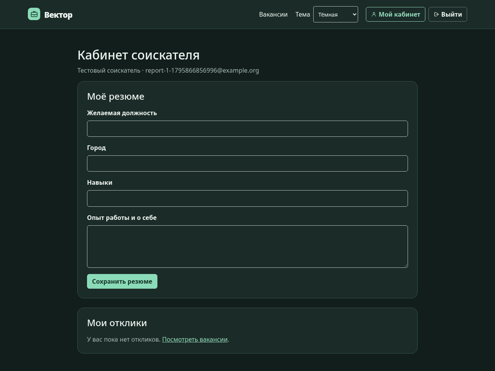

# Задача

Сверстать сайт по варианту 2 «Сайт для поиска работы» средствами HTML, CSS и Bootstrap. Реализовать каталог вакансий с фильтрами, страницы входа и регистрации и личные кабинеты.

# Исходные данные

«Вектор» — учебный сайт поиска работы. Проект запускается через локальный HTTP-сервер. Для показа каталога используются демонстрационные вакансии, а для входа и кабинетов — вымышленные аккаунты.

# Ход работы

Собраны страницы каталога, карточки вакансии, входа, регистрации, кабинета соискателя и кабинета работодателя. Bootstrap задаёт сетку и адаптивное расположение элементов. HTML содержит семантические области страницы, подписи к полям форм и ссылку быстрого перехода к основному содержимому.

JavaScript отображает вакансии и обрабатывает поиск по должности, компании или городу. Фильтры учитывают отрасль, опыт, нижнюю границу зарплаты и формат работы. Соискатель может заполнить резюме и отправить отклик. Работодатель управляет своими объявлениями. Для этой лабораторной сведения хранятся в localStorage браузера.

После ДЗ2–ДЗ4 добавлены подсказки к полям и области оповещения для скринридера. Фокус после поиска переносится на заголовок результатов. Переключатель темы использует CSS-переменные и сохраняет выбор, а пять иконок подключены из SVG-спрайта через `use`.

# Проверка результата

В Chromium проверены отображение каталога, поиск по названию, переход в карточку вакансии, регистрация и открытие кабинета соискателя. Гость при открытии кабинета перенаправляется на вход, а соискатель при открытии страницы работодателя возвращается в свой кабинет. При ширине окна 390 px горизонтальной прокрутки нет.

Проверены переход по ссылке «К содержимому», перенос фокуса после поиска, системная и ручная темы, сохранение выбора после перезагрузки и отображение всех пяти иконок после входа.

# Вывод

Получился адаптивный сайт с каталогом и кабинетами для двух ролей. Проект можно продемонстрировать с локального HTTP-сервера.
