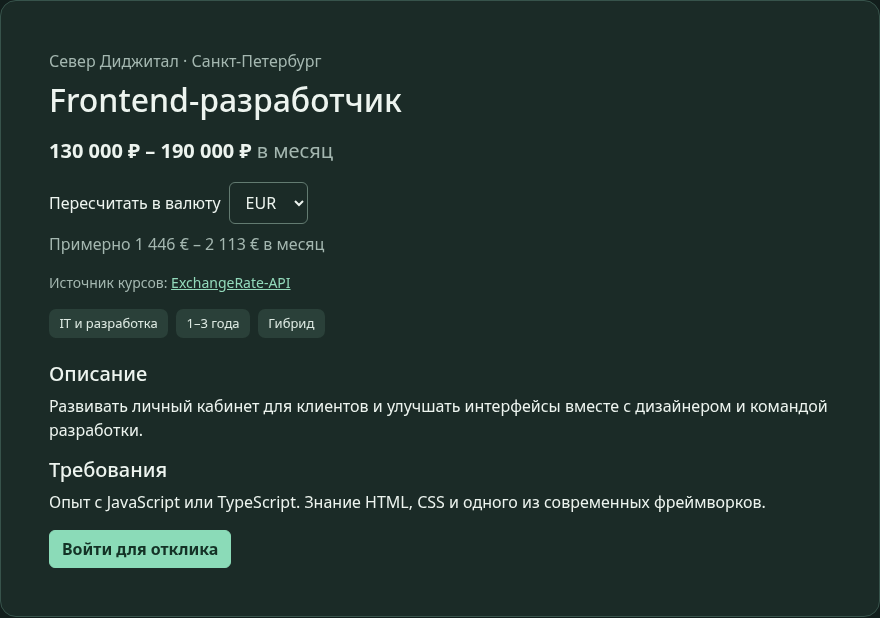

# Задача

Подключить интерфейс сайта «Вектор» к API через Fetch. Подготовить JSON Server с авторизацией и показать обращение к внешнему сервису.

# Исходные данные

Использованы интерфейс ЛР1, Node.js и JSON Server. Пример данных лежит в `server/db.seed.json`. При запуске сервер создаёт рабочую копию базы. Команды запуска и порт указаны в README.

# Ход работы

Клиент запрашивает каталог и отдельные вакансии через Fetch API. Создание и изменение резюме, отклики и управление объявлениями отправляются на JSON Server. Для входа используется json-server-auth. На закрытых маршрутах сервер проверяет JWT, роль и владельца записи.

В карточке вакансии добавлен пересчёт зарплаты из рублей в USD или EUR. Источник курсов — ExchangeRate-API. Эта возможность зависит от доступности внешнего API, а работа с каталогом и кабинетами использует локальный моковый сервер.

Интерфейс включает оформление из ДЗ2–ДЗ4. Сохранились подписи, управление фокусом, переключатель темы и пять иконок из общего спрайта. Состояния загрузки и результат пересчёта валюты объявляются через `role="status"`.

# Проверка результата

Проект запущен с отдельной тестовой копией базы. В Chromium проверены загрузка каталога, поиск по названию, открытие карточки, регистрация и переход в кабинет соискателя. Проверены перенаправления гостя на вход и соискателя из кабинета работодателя. При ширине 390 px страница помещается в окно. На скриншоте показан интерфейс выбора валюты в карточке вакансии.

Проверены переход по ссылке «К содержимому», перенос фокуса после поиска, системная и ручная темы, сохранение выбора после перезагрузки и отображение всех пяти иконок после входа.

# Вывод

Интерфейс работает с JSON Server и закрытыми маршрутами через Fetch. В карточку вакансии встроен внешний источник курсов.
