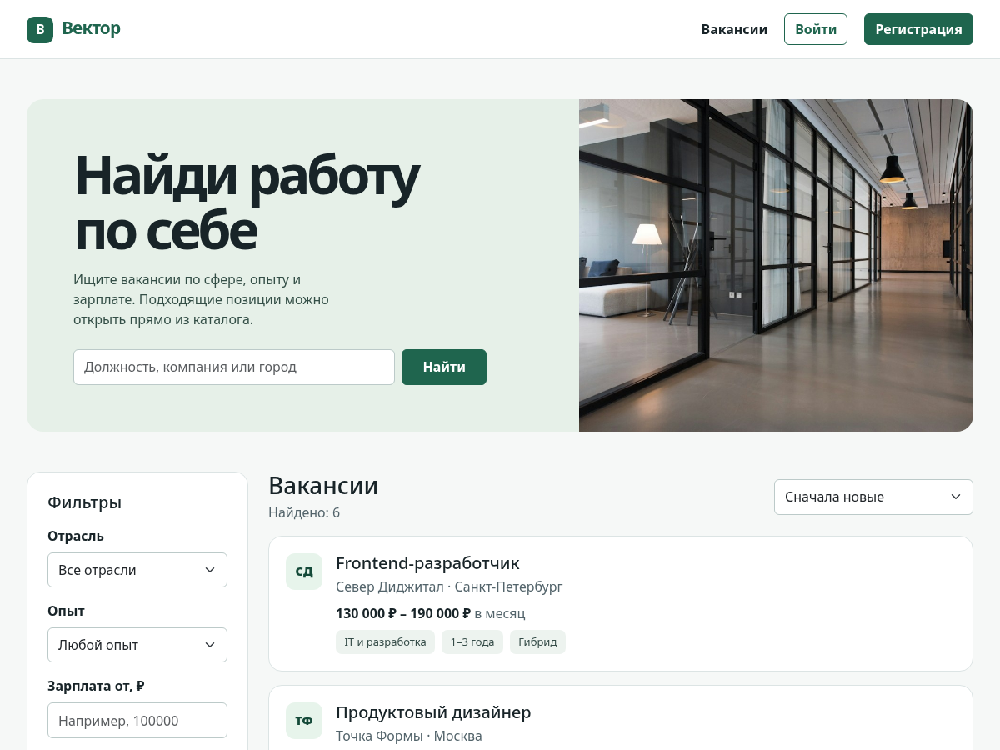
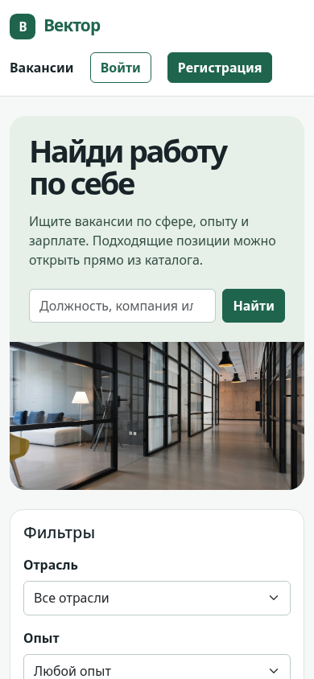

# Задача

Перенести сайт «Вектор» на Vue 3. Подключить клиентскую маршрутизацию, настроить работу с API через Axios и выделить повторно используемые компоненты и composables.

# Исходные данные

Использованы Vue 3, Vue Router, Axios, Vite и JSON Server. Каталог и сценарии работы с вакансиями опираются на ЛР1 и ЛР2. Запуск и сборка описаны в README.

# Ход работы

Vue Router открывает каталог, карточку вакансии, формы авторизации и кабинеты. Navigation guard проверяет сессию и роль при переходе на закрытую страницу.

Карточка, фильтры, редактор вакансии, теги и пересчёт зарплаты вынесены в отдельные компоненты. `useSession` управляет входом и текущим аккаунтом. `useRequest` обрабатывает состояние загрузки и ошибки. Axios обращается к JSON Server через `/api`, а пересчёт зарплаты использует внешний источник курсов.

# Проверка результата

Сборка `npm run build` прошла успешно. В Chromium проверены загрузка каталога, поиск по названию, открытие карточки, регистрация и кабинет соискателя. Гость перенаправляется на вход. Соискатель при обращении к кабинету работодателя возвращается в свой кабинет. При ширине 390 px горизонтальной прокрутки нет.

# Вывод

Проект перенесён на Vue 3 с клиентской маршрутизацией и взаимодействием с API. Компоненты и composables разделяют отображение, сессию и состояние запросов.
